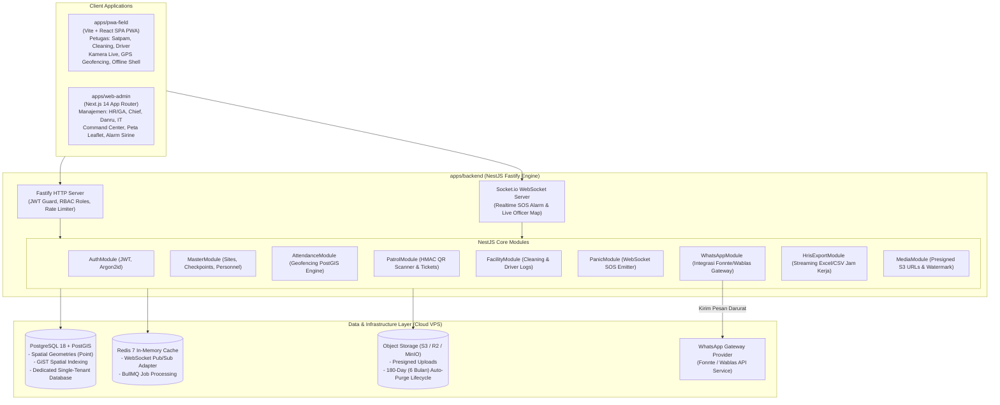
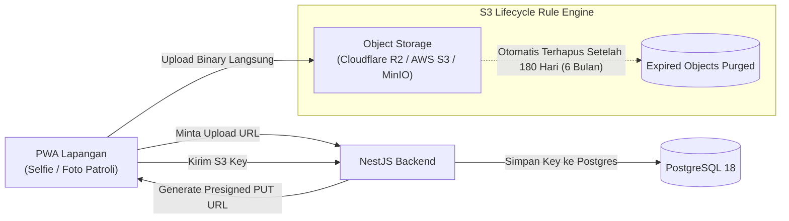

# Spesifikasi Arsitektur Sistem Baru (Modern Enterprise Architecture)
## Project: Enterprise Patrol & Facility Management System (Beli Putus)
**Versi:** 2.0.0 (Final Enterprise In-House)  
**Status:** Approved for Development  
**Model:** Single-Tenant Enterprise Dedicated Server  
**Tech Stack:** TypeScript (NestJS Fastify), PostgreSQL 18 + PostGIS, Next.js 14, Vite React PWA

---

## 1. Topologi Monorepo & Struktur Direktori

Sistem ini dikelola dalam arsitektur **Monorepo** berbasis npm/pnpm workspaces untuk menyatukan *type-safety*, kontrak API, dan pustaka komponen dalam satu repositori yang tertata rapi:

```
Patrol-Management-System/
├── apps/
│   ├── backend/                 # NestJS Fastify API, WebSocket Gateway & WhatsApp Service
│   ├── web-admin/               # Next.js 14 Portal Admin, Command Center & HRIS Export
│   └── pwa-field/               # Vite + React PWA (Aplikasi Mobile Ringan Petugas Lapangan)
├── packages/
│   ├── types/                   # Shared TypeScript Interfaces, Enums & DTOs
│   ├── database/                # Skema Database, Migrasi SQL, & PostGIS Seeds
│   └── config/                  # Shared ESlint, Prettier, & TypeScript Configs
├── docs/                        # Dokumentasi Desain Sistem & Panduan Pre-Development
├── docker/                      # Dockerfiles & Nginx Reverse Proxy Configs
├── docker-compose.yml           # Konfigurasi Layanan: Postgres 18 PostGIS, Redis 7, MinIO
└── README.md
```

---

## 2. Diagram Blok Arsitektur Sistem



---

## 3. Komponen Arsitektur Utama

### A. Backend Service (`apps/backend` - NestJS Fastify)
1. **Fastify Engine**: Pilihan adapter HTTP berkinerja tinggi, mampu menangani ribuan transaksi presensi serentak saat pergantian shift tanpa lonjakan pemakaian CPU.
2. **Modular Clean Architecture**:
   - Controller: Menangani rute HTTP & payload WebSocket.
   - Service: Mengimplementasikan logika bisnis murni.
   - Repository: Mengelola query database PostgreSQL via Kysely / Prisma.
3. **Penyedia Integrasi WhatsApp (`WhatsAppService`)**:
   - Menghubungkan backend dengan WhatsApp Gateway API (contoh: Fonnte / Wablas).
   - Mengirim pesan peringatan otomatis seketika saat tombol Panic Button ditekan:
     ```typescript
     @Injectable()
     export class WhatsAppService {
       async sendEmergencyAlert(data: { officer: string; site: string; lat: number; lng: number }) {
         const mapsUrl = `https://maps.google.com/?q=${data.lat},${data.lng}`;
         const text = `🚨 *[ALARM DARURAT - PANIC BUTTON SOS]*\n\n` +
                      `Petugas: *${data.officer}*\n` +
                      `Lokasi: *${data.site}*\n` +
                      `Waktu: ${new Date().toLocaleString('id-ID')}\n\n` +
                      `📍 *Titik Peta:*\n${mapsUrl}`;
         
         await axios.post(process.env.WA_GATEWAY_URL, {
           target: process.env.WA_SUPERVISOR_GROUP_ID,
           message: text
         }, {
           headers: { Authorization: process.env.WA_API_KEY }
         });
       }
     }
     ```

---

### B. Portal Web Admin (`apps/web-admin` - Next.js 14)
- **Komponen & UI**: Next.js 14 App Router, Tailwind CSS, Shadcn UI.
- **Pusat Komando (Command Center)**:
  - Peta Leaflet interaktif untuk memantau titik-titik pos, rute patroli satpam, dan status armada kendaraan driver.
  - Listener WebSocket bawaan: Saat menerima event `emergency:alert`, browser memutar audio sirine bahaya (*Web Audio API*) dan menampilkan modal darurat berisi foto & koordinat GPS.
- **Modul Ekspor HRIS**:
  - Generator berkas Excel streaming (`exceljs`) yang menghasilkan rekap jam kerja, keterlambatan, dan lembur karyawan dalam hitungan detik tanpa membebani memori server.

---

### C. Aplikasi Lapangan Petugas (`apps/pwa-field` - Vite React PWA)
- **Ukuran Sangat Ringan (< 300 KB)**: Berbasis Vite Single Page Application (SPA), instan dibuka bahkan di smartphone berspesifikasi rendah dengan jaringan 3G minim di pos jaga belakang.
- **PWA Service Worker (`vite-plugin-pwa` + Workbox)**:
  - Cache-First strategy untuk file shell (HTML, CSS, JS, aset grafis).
  - PWA Web App Manifest: Dapat diinstal instan di layar utama (*Add to Home Screen*) di Android dan iOS tanpa proses rilis toko aplikasi.
- **Kamera & Pemindai QR Universal**:
  - Library `Html5Qrcode` untuk scanner barcode kamera belakang.
  - HTML5 `navigator.mediaDevices.getUserMedia` untuk live selfie absensi, dengan fallback standar `<input type="file" accept="image/*" capture="user">` yang menjamin kompatibilitas 100% pada Safari iOS.

---

### D. Basis Data Geospasial: PostgreSQL 18 + PostGIS
- Menggunakan citra resmi `postgis/postgis:18-3.5`.
- Data koordinat titik pusat site dan rute patroli disimpan dalam tipe data `GEOMETRY(Point, 4326)` (WGS84).
- Validasi Geofencing dijalankan secara matematis di level kernel database:
  ```sql
  SELECT ST_DWithin(
      user_coords::geography, 
      site_coords::geography, 
      radius_meters
  );
  ```
  Menjamin validasi kehadiran fisik tidak dapat dimanipulasi oleh perubahan data di sisi ponsel.

---

## 4. Pipeline Media & Kebijakan Retensi 6 Bulan (180 Hari)

Sistem menerapkan prinsip *Zero Server File Storage* untuk menjaga Cloud VPS tetap bersih:



### Konfigurasi Lifecycle Rule Bucket:
```json
{
  "Rules": [
    {
      "ID": "PurgePhotosAfter180Days",
      "Status": "Enabled",
      "Filter": { "Prefix": "photos/" },
      "Expiration": { "Days": 180 }
    }
  ]
}
```
*Hasil:* Foto tersimpan aman selama 6 bulan untuk kebutuhan investigasi/audit hukum manajemen, lalu dibersihkan otomatis oleh storage engine tanpa membebani disk VPS.

---

## 5. Rencana Deployment Cloud VPS

Sistem dideploy pada satu unit **Cloud VPS Linux (Ubuntu 24.04 LTS)** yang dikelola rapi melalui Docker Compose:

```
[ CLOUD VPS (Ubuntu 24.04 LTS) ]
├── Nginx Reverse Proxy (Port 80/443 + Let's Encrypt SSL)
│     ├── /           ──> apps/web-admin (Next.js Node Process)
│     ├── /pwa        ──> apps/pwa-field (Vite Static Build)
│     ├── /api        ──> apps/backend (NestJS Fastify Process)
│     └── /socket.io  ──> apps/backend (WebSocket Gateway)
│
└── Docker Compose Network (Internal Bridge)
      ├── Container 1: PostgreSQL 18 + PostGIS (Port 5432 - Internal Only)
      ├── Container 2: Redis 7 In-Memory (Port 6379 - Internal Only)
      └── Container 3: MinIO S3 Object Storage (Port 9000 - Internal/External)
```
