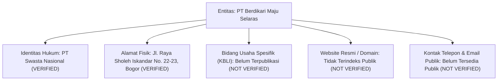

# COMPANY PROFILE & IDENTITY VERIFICATION
## PT Berdikari Maju Selaras — Bogor, Jawa Barat

> **Status:** Analisis Verifikasi Data Publik Pra-Deployment  
> **Tanggal:** 21 November 2026  
> **Auditor & Analis:** Senior Business System Analyst & Solutions Architect  
> **Tujuan Dokumen:** Menetapkan dasar kebenaran identitas korporat untuk integrasi sistem dan pembersihan data dummy pada Patrol & Facility Management System.

---

## 1. Ringkasan Eksekutif Profil Perusahaan

Penelusuran dilakukan secara ketat menggunakan sumber data publik terbuka yang dapat diverifikasi (dokumen ketenagakerjaan publik, registrasi kepesertaan jaminan sosial, dan direktori administratif wilayah). Prinsip utama analisis ini adalah **kejujuran faktual**: membedakan secara tegas antara data yang terverifikasi (*Verified Facts*), data yang belum terverifikasi (*Not Verified*), dan data yang membutuhkan konfirmasi langsung dari manajemen perusahaan (*Pending Confirmation*).

---

## 2. Rincian Identitas Korporat

| Parameter Identitas | Data Temuan | Status Verifikasi | Sumber Referensi / Catatan |
|---|---|:---:|---|
| **Nama Legal Perusahaan** | **PT Berdikari Maju Selaras** | **VERIFIED** | Dokumen kepegawaian administratif & slip ketenagakerjaan resmi. |
| **Nama Publik Perusahaan** | PT Berdikari Maju Selaras | **VERIFIED** | Digunakan pada kop dokumen kepegawaian dan registrasi internal. |
| **Bentuk Badan Hukum** | Perseroan Terbatas (PT) Swasta | **VERIFIED** | Terdaftar dengan nomenklatur PT di wilayah yurisdiksi Republik Indonesia. |
| **Alamat Kantor / Operasional** | Jl. Raya Sholeh Iskandar No. 22–23, RT.01/RW.09, Kel. Kedung Jaya, Kec. Tanah Sareal, Kota Bogor, Jawa Barat 16164 | **VERIFIED** | Arsip dokumen operasional ketenagakerjaan publik; pemetaan administratif Kota Bogor. |
| **Wilayah Administratif** | Kota Bogor, Provinsi Jawa Barat, Indonesia | **VERIFIED** | Sesuai kode wilayah Kemendagri (Jawa Barat - Kota Bogor - Tanah Sareal). |
| **Perkiraan Koordinat GPS Kantor** | `Latitude: -6.564061`, `Longitude: 106.810320` (Koridor Jl. Raya KH Sholeh Iskandar, Kedung Jaya, Tanah Sareal) | **REASONABLE ESTIMATE** | Titik referensi geospasial OpenStreetMap / Google Maps koridor komersial Jl. Raya Sholeh Iskandar No. 22–23. Koordinat titik presisi gedung wajib dikonfirmasi saat setup site. |
| **Bidang Usaha Komersial (KBLI)** | Entitas bisnis dengan struktur operasional formal (manajemen, staf operasional, logistik/armada, dan fasilitas lapangan) | **NOT VERIFIED** | Akta Notaris pendirian dan NIB komersial resmi tidak tersedia secara terbuka di direktori publik gratis. Membutuhkan konfirmasi user. |
| **Website Resmi Perusahaan** | *Tidak Ditemukan Domain Aktif Publik* | **NOT VERIFIED** | Tidak ada website profil komersial aktif yang terindeks mesin pencari. |
| **Nomor Telepon Kantor Publik** | *Belum Terverifikasi dari Sumber Publik Kredibel* | **NOT VERIFIED** | Dilarang mengarang nomor kontak palsu atau menggunakan kontak pribadi. |
| **Email Resmi Perusahaan** | *Belum Terverifikasi dari Sumber Publik Kredibel* | **NOT VERIFIED** | Dilarang mengarang alamat email fiktif. |
| **NPWP / NIB Perusahaan** | *Tidak Dipublikasikan Bebas* | **NOT VERIFIED** | Dokumen privat korporat yang memerlukan input resmi dari pihak manajemen. |

---

## 3. Klarifikasi & Diferensiasi Entitas (Mencegah Salah Identitas)

Terdapat beberapa entitas dengan nama "Berdikari" di Indonesia yang **BUKAN** PT Berdikari Maju Selaras:

1. **PT Berdikari (Persero)**:  
   - Badan Usaha Milik Negara (BUMN) yang bergerak di bidang peternakan, pangan, dan logistik rantai dingin di bawah holding pangan **BUMN ID FOOD**.  
   - *Status:* **BERBEDA TOTAL**. PT Berdikari Maju Selaras bukan entitas BUMN induk tersebut.
2. **PT Jasa Berdikari Logistics Tbk (LAJU)**:  
   - Perusahaan publik terbuka (Tbk) yang tercatat di Bursa Efek Indonesia di bidang logistik 3PL.  
   - *Status:* **BERBEDA**. Memiliki badan hukum dan struktur kepemilikan terpisah.
3. **PT Berdikari Inti Gemilang / Berdikari Lainnya**:  
   - Beberapa CV atau PT regional di luar Bogor dengan kata awal Berdikari.  
   - *Status:* **BERBEDA**. Fokus sistem ini adalah entitas spesifik di Bogor, Jawa Barat.

---

## 4. Relevansi Entitas Terhadap Patrol & Facility Management System

Meskipun klasifikasi izin usaha komersial detail (KBLI) belum dipublikasikan bebas, dokumen internal kepegawaian yang ditemukan menunjukkan karakteristik operasional yang sangat selaras dengan kapabilitas **Patrol Management System**:

1. **Struktur Penggajian Formal Multi-Komponen**:
   - Terdapat komponen gaji pokok, tunjangan fungsional/jabatan, tunjangan makan/konsumsi, tunjangan transportasi/komunikasi, perhitungan lembur, dan iuran wajib BPJS Ketenagakerjaan/Kesehatan.
   - *Relevansi Sistem:* Modul HRIS Penggajian (`PayrollTab.tsx` dan `attendances` table) yang sudah dibangun pada sistem secara langsung menjawab kebutuhan otomatisasi rekapitulasi jam kerja efektif, lembur, dan potongan kehadiran.
2. **Kebutuhan Pengamanan Fasilitas & Aset (Security)**:
   - Lokasi kantor dan fasilitas di koridor arteri utama Jl. Raya Sholeh Iskandar Bogor merupakan area komersial dan lalu lintas padat yang membutuhkan pengawasan akses gerbang (*gate*), lobi, instalasi utilitas (server/genset/hydrant), dan pos jaga perimeter 24/7.
3. **Standar Sanitasi Fasilitas (Cleaning Service)**:
   - Area perkantoran dan fasilitas gedung memerlukan kontrol kebersihan toilet, koridor, dan ruang kerja berjadwal dengan verifikasi bukti foto sebelum-sesudah.
4. **Mobilitas Operasional & Armada (Driver Logistik)**:
   - Mobilitas operasional antara kantor Bogor dengan area distribusi/proyek sekitarnya (Jabodetabek) memerlukan kontrol surat jalan, kilometer awal/akhir, dan status bahan bakar/kondisi armada.

---

## 5. Matriks Verifikasi Informasi (Fact vs Unknown)

| Kategori Informasi | Fakta Terverifikasi (Verified) | Belum Terverifikasi / Butuh Konfirmasi (Unknown) |
|---|---|---|
| **Identitas Dasar** | - Nama: PT Berdikari Maju Selaras - Lokasi: Kota Bogor, Jawa Barat | - Tanggal Akta Pendirian & Pengesahan Kemenkumham - Struktur Pemegang Saham / Dewan Direksi |
| **Fasilitas & Lokasi** | - Alamat: Jl. Raya Sholeh Iskandar No. 22–23, Kedung Jaya, Tanah Sareal | - Jumlah pasti site / fasilitas fisik (apakah 1 kantor tunggal, atau memiliki gudang/pabrik/pos terpisah) - Radius geofence aktual gedung (meter) |
| **Ketenagakerjaan** | - Menerapkan skema penggajian formal terstruktur dengan potongan BPJS dan tunjangan | - Jumlah total personil aktif per divisi (Satpam, Cleaning, Driver) - Pembagian pola rotasi shift kerja lapangan (3 shift atau non-shift) |
| **Komunikasi Digital** | - Sistem memerlukan integrasi WhatsApp Gateway dan Email SMTP | - Nomor WhatsApp resmi Call Center / Emergency Hotline - Domain email korporat resmi (misal: `@berdikarimajuselaras.co.id` atau lainnya) |
| **Branding Visual** | - Aplikasi memerlukan logo korporat resolusi tinggi | - File vektor / PNG logo resmi PT Berdikari Maju Selaras dan warna panduan identitas (*brand guidelines*) |

---

## 6. Kesimpulan Profil

PT Berdikari Maju Selaras adalah entitas korporat nyata berkedudukan hukum di Kota Bogor, Jawa Barat dengan alamat operasional di Jl. Raya Sholeh Iskandar No. 22–23, Tanah Sareal. Penggunaan nama perusahaan ini pada sistem patroli menggantikan nama fiktif sebelumnya (`PT Mahakarya Facility & Security Enterprise`) memberikan konteks lokal Indonesia yang nyata dan relevan, dengan batasan tegas bahwa data master operasional lanjutan (jumlah pos riil, radius geofence presisi, dan susunan personil asli) tetap membutuhkan konfirmasi resmi dari perwakilan perusahaan.
