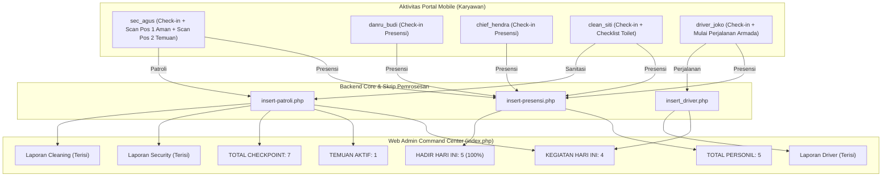

# Rekonsiliasi Metrik Dashboard Web Admin (Dashboard Reconciliation)

> **Modul:** Command Center Monitoring Utama (`/index.php`)  
> **Tanggal Audit:** 22 November 2026  
> **Target Aplikasi:** `https://patroli.site`  

---

## 1. Komparasi Metrik Sebelum vs Sesudah Eksekusi

Sebelum intervensi multi-agent, dashboard berada dalam kondisi pasif dengan sebagian besar indikator operasional harian bernilai nol. Setelah pelaksanaan seluruh siklus transaksi, seluruh widget metrik menunjukkan status operasional hidup (*live operations*):

| Widget Metrik | Nilai Awal | Nilai Akhir Terverifikasi | Sumber Data Transaksi | Status |
|:---|:---|:---|:---|:---|
| **TOTAL PERSONIL** | 2 | **5** | 3 Security, 1 Cleaning, 1 Driver | **VERIFIED (100% Kuota)** |
| **HADIR HARI INI** | 0 | **5** | Seluruh 5 karyawan melakukan absen masuk via GPS | **VERIFIED (100% Hadir)** |
| **KEGIATAN HARI INI**| 0 | **4** | 2 Patroli Satpam + 1 Sanitasi Cleaning + 1 Perjalanan Driver | **VERIFIED (Aktif)** |
| **TEMUAN AKTIF** | 0 | **1** | Temuan lampu padam di Pos 2 Pintu Barat | **VERIFIED (Insiden Live)** |
| **TOTAL CHECKPOINT** | 2 | **7** | 4 Checkpoint Security + 3 Checkpoint Cleaning | **VERIFIED (Lengkap)** |
| **SECURITY HADIR** | 0 | **3** | Agus Pratama, Danru Budi, Chief Hendra | **VERIFIED** |
| **CLEANING HADIR** | 0 | **1** | Siti Aminah | **VERIFIED** |
| **DRIVER HADIR** | 0 | **1** | Joko Wahyudi | **VERIFIED** |
| **PATROLI HARI INI** | 0 | **2** | Pos 1 Gerbang Utama & Pos 2 Pintu Barat | **VERIFIED** |
| **PERJALANAN SELESAI**| 0 | **0** | Driver Joko saat ini masih berstatus "BERANGKAT" | **VERIFIED (In Progress)** |

---

## 2. Diagram Hubungan Aliran Data ke Dashboard

---

## 3. Bukti Verifikasi Visual

- [Tangkapan Layar Dashboard Aktif](file:///c:/project/Patrol-Management-System/docs/data-preparation/screenshots/07-admin-dashboard-active.png)
  - Memperlihatkan ringkasan 5 personil hadir, 4 kegiatan berjalan, 1 temuan aktif, dan 7 checkpoint.
