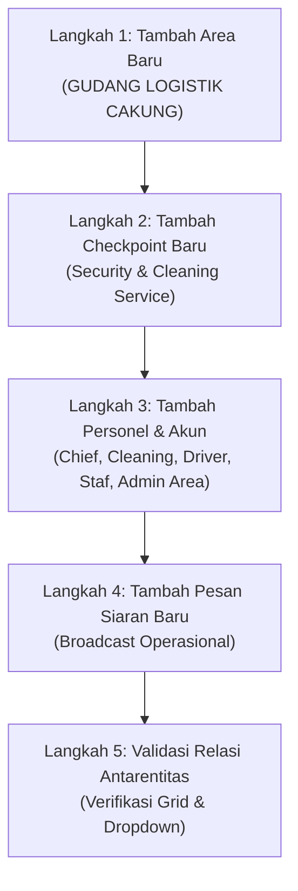

# Rencana Populasi Data (Data Population Plan) — Patroli Site

> **Status:** Siap Dieksekusi melalui Otomasi Playwright UI  
> **Tanggal:** 22 November 2026  

---

## 1. Rencana Kuantitatif Penambahan Dataset

| Entitas | Existing | Gap | Target Akhir | Tindakan | Justifikasi Bisnis |
| :--- | :---: | :---: | :---: | :---: | :--- |
| **Area / Site** | 1 | +1 | 2 | **CREATE** | Menghadirkan variasi site logistik untuk menguji filter multi-lokasi dan isolasi data. |
| **Checkpoint Security** | 1 | +3 | 4 | **CREATE** | Menyediakan variasi pos gerbang, gudang, dan ruang server agar pengujian rute patroli valid. |
| **Checkpoint Cleaning** | 1 | +2 | 3 | **CREATE** | Menyediakan variasi area toilet, lobby, dan kantin agar pelaporan sanitasi terwakili. |
| **Personel Operasional** | 2 | +6 | 8 | **CREATE** | Melengkapi seluruh divisi: Chief Security, Cleaning Service, Driver, Staf, Admin Klien, dan Site 2. |
| **Pesan Siaran** | 1 | +1 | 2 | **CREATE** | Menyiapkan pesan pengumuman operasional untuk site baru. |
| **Transaksi Absensi/Patroli**| 2 | Sesuai UI | Dynamic | **VERIFIED** | Sesuai batas Section 8.C, tidak memanipulasi waktu historis secara ilegal. |

---

## 2. Dependency Creation Order (Urutan Eksekusi)

---

## 3. Detail Data yang Akan Dibuat (Execution Plan)

### A. Entitas Area / Site
1. **Nama Area:** `GUDANG LOGISTIK CAKUNG`
   - Latitude: `-6.182431`
   - Longitude: `106.945217`
   - Shift Pagi: `07:00` - `15:00`
   - Shift Siang: `15:00` - `23:00`
   - Shift Malam: `23:00` - `07:00`
   - Shift Staf: `08:00` - `17:00`
   - Shift Chief: `08:00` - `17:00`

### B. Entitas Checkpoint
1. **Pos 2 Pintu Barat** (Security | Keamanan | Pintu Gerbang Barat Sentul | `aeon mall sentul`)
2. **Ruang Server Lantai 2** (Security | Fasilitas Vital | Ruang IT Server Lantai 2 | `aeon mall sentul`)
3. **Loading Dock Logistik** (Security | Keamanan Logistik | Area Bongkar Muat Barang | `gudang logistik cakung`)
4. **Lobby Utama Lantai 1** (Cleaning Service | Kebersihan Publik | Area Lobby Utama Sentul | `aeon mall sentul`)
5. **Kantin Karyawan** (Cleaning Service | Fasilitas Umum | Kantin Karyawan Lantai Dasar | `aeon mall sentul`)

### C. Entitas Personel & Akun Login
1. **Chief Hendra Wijaya:**
   - Posisi: `Security` | Jabatan: `chief` | Site: `aeon mall sentul`
   - Username: `chief_hendra` | Jam Kerja: 10
   - Gapok: Rp 5.500.000 | Tunjangan: Rp 750.000 | Lembur: Rp 30.000 | BPJS: Rp 120.000 | Pot. Izin: Rp 200.000 | Pot. Lupa: Rp 50.000
2. **Siti Aminah:**
   - Posisi: `Cleaning Service` | Jabatan: `anggota` | Site: `aeon mall sentul`
   - Username: `clean_siti` | Jam Kerja: 8
   - Gapok: Rp 3.500.000 | Tunjangan: Rp 300.000 | Lembur: Rp 25.000 | BPJS: Rp 75.000 | Pot. Izin: Rp 150.000 | Pot. Lupa: Rp 25.000
3. **Joko Wahyudi:**
   - Posisi: `Driver` | Jabatan: `anggota` | Site: `aeon mall sentul`
   - Username: `driver_joko` | Jam Kerja: 8
   - Gapok: Rp 3.700.000 | Tunjangan: Rp 350.000 | Lembur: Rp 25.000 | BPJS: Rp 80.000 | Pot. Izin: Rp 150.000 | Pot. Lupa: Rp 25.000
4. **Rina Oktaviani:**
   - Posisi: `Staf` | Jabatan: `anggota` | Site: `aeon mall sentul`
   - Username: `staff_rina` | Jam Kerja: 8
   - Gapok: Rp 4.000.000 | Tunjangan: Rp 400.000 | Lembur: Rp 25.000 | BPJS: Rp 85.000 | Pot. Izin: Rp 150.000 | Pot. Lupa: Rp 25.000
5. **Bambang Pengelola Area:**
   - Posisi: `Admin Area` | Jabatan: `Admin Area` | Site: Multiple (`aeon mall sentul`, `gudang logistik cakung`)
   - Username: `admin_bambang` | Jam Kerja: 8
   - Gapok: Rp 5.000.000 | Tunjangan: Rp 600.000 | Lembur: Rp 25.000 | BPJS: Rp 100.000 | Pot. Izin: Rp 150.000 | Pot. Lupa: Rp 25.000
6. **Surya Saputra:**
   - Posisi: `Security` | Jabatan: `anggota` | Site: `gudang logistik cakung`
   - Username: `sec_surya` | Jam Kerja: 10
   - Gapok: Rp 3.800.000 | Tunjangan: Rp 400.000 | Lembur: Rp 25.000 | BPJS: Rp 75.000 | Pot. Izin: Rp 150.000 | Pot. Lupa: Rp 25.000

### D. Entitas Pesan Siaran
1. **Pengumuman Baru:** "SOP PENJAGAAN & LOGISTIK DI GUDANG CAKUNG AKTIF MULAI MINGGU INI. SELURUH PERSONEL WAJIB PATUHI PROTOKOL." (Target: `GUDANG LOGISTIK CAKUNG`).
