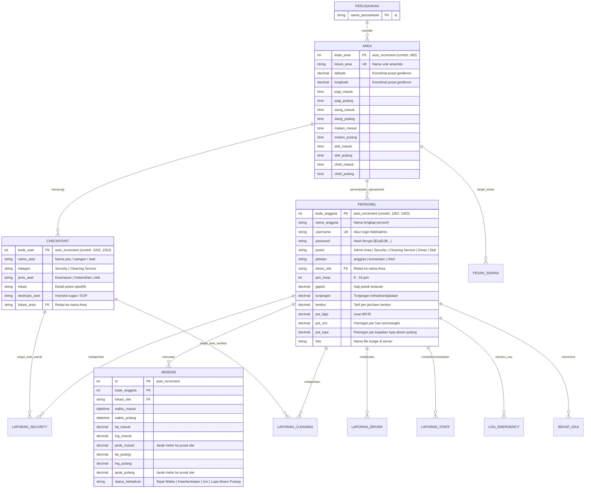

# Penemuan Relasi Data — Patroli Site (https://patroli.site)

> **Status:** Terverifikasi berdasarkan DOM, JavaScript Router, Form Payload, dan Schema Analisis  
> **Tanggal:** 22 November 2026  

---

## 1. Diagram Relasi Entitas Aktual (ERD)



---

## 2. Dependensi & Aturan Integritas Data

1. **Dependensi Pembuatan Data (Creation Order):**
   ```
   Area (Site & Shift) ➔ Checkpoint (Security / Cleaning) ➔ Personel & Akun Login ➔ Transaksi (Absensi / Patroli / Gaji)
   ```
2. **Karakteristik Unik Relasi String Key:**
   - Aplikasi menggunakan nama teks `lokasi_area` (seperti `"aeon mall sentul"`) sebagai foreign key di tabel `checkpoint`, `personil`, `absensi`, dan `laporan`, bukan sekadar `id` numerik. Oleh karena itu, konsistensi penulisan nama area (case-insensitive) sangat kritikal.
3. **Pemisahan Konseptual Posisi vs Jabatan:**
   - **Posisi:** Klasifikasi divisi peran fungsional (`Admin Area`, `Security`, `Cleaning Service`, `Driver`, `Staf`).
   - **Jabatan:** Khusus untuk `Security`, terdapat sub-level hierarki:
     - `anggota` (Petugas pelaksana patroli checkpoint)
     - `komandan` (Danru pembuat laporan rekap shift dan serah terima pos)
     - `chief` (Pimpinan pengawas supervisi kedisiplinan dan koordinasi)
   - Untuk posisi non-Security (`Cleaning Service`, `Driver`, `Staf`), dropdown jabatan disembunyikan dan otomatis bernilai default `'anggota'`.
4. **Relasi Geofence GPS pada Transaksi:**
   - Saat absensi atau patroli dilakukan, koordinat GPS perangkat dibandingkan dengan `latitude` dan `longitude` milik `Area`. Detail modal menampilkan `JARAK: X.XX METER`.
