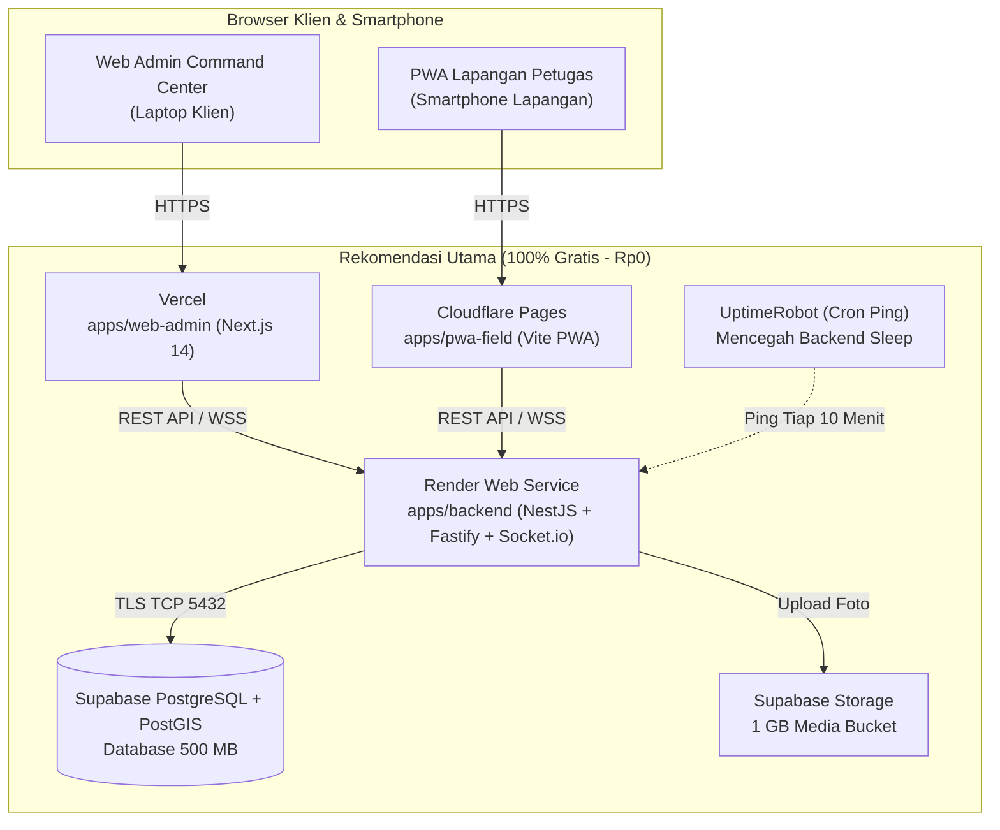

# FREE HOSTING COMPARISON & EVALUATION
## Patrol Management System — Client Presentation Environment
> **Riset Komparasi Layanan Cloud Hosting 100% Gratis & Tanpa Kartu Kredit**  
> **Status:** Evaluasi Final Alternatif Hosting  
> **Tanggal:** 21 November 2026  
> **Penyusun:** Cloud Architect & Software Deployment Specialist  

---

## 1. Metodologi Evaluasi & Kriteria Seleksi

Untuk memenuhi kebutuhan demonstrasi dan evaluasi calon klien dengan **biaya Rp0**, penyedia layanan cloud dinilai berdasarkan 8 kriteria utama:
1. **Dukungan Arsitektur Teknis**: Mampu menjalankan Next.js 14, Vite PWA, NestJS Fastify, dan Socket.io WebSockets.
2. **Dukungan PostGIS**: Menyediakan ekstensi `postgis` untuk query geofence dan radius GPS.
3. **Persistensi Data**: Data tidak otomatis dihapus dalam jangka waktu singkat (misal: 30 hari).
4. **Ketiadaan Kartu Kredit (No Credit Card Required)**: Bebas registrasi tanpa risiko tagihan mendadak (*zero credit card barrier*).
5. **Ketersediaan HTTPS / SSL Otomatis**: Wajib untuk akses API Kamera ponsel dan Geolocation GPS pada PWA.
6. **Batas Kuota Gratis (Free Allowance)**: Memadai untuk 50–100 pengguna evaluasi selama 30–60 hari masa presentasi.
7. **Cold Start & Inactivity**: Dampak jeda waktu tidur (*sleep*) terhadap kenyamanan presentasi langsung ke klien.
8. **Portabilitas Migrasi ke VPS**: Tidak mengunci kode pada proprietary vendor SDK (Zero Vendor Lock-In).

---

## 2. Evaluasi Komparatif Frontend Hosting

| Provider | Dukungan Next.js 14 | Dukungan Vite PWA | Bandwidth Gratis | Batas Build / Deploy | Kartu Kredit? | Evaluasi & Kesimpulan |
|---|:---:|:---:|---|---|:---:|---|
| **Vercel** *(Rekomendasi Utama Web Admin)* | **Sempurna (Native)** | Sangat Baik | 100 GB / bulan | 6,000 build menit/bln, Unlimited deploys | **TIDAK** | **Sangat Direkomendasikan untuk Web Admin (`apps/web-admin`)**. Dibuat oleh pencipta Next.js, zero-config SSR/App Router, domain gratis `*.vercel.app`, auto HTTPS. |
| **Cloudflare Pages** *(Rekomendasi Utama PWA)* | Cukup (Butuh adapter edge) | **Sempurna (Static SPA)** | **Unlimited Bandwidth** | 500 build/bulan, Unlimited requests | **TIDAK** | **Sangat Direkomendasikan untuk Mobile PWA (`apps/pwa-field`)**. Performa CDN global tercepat, gratis tanpa batas bandwidth, isolasi cache Service Worker sempurna di `*.pages.dev`. |
| **Netlify** | Baik (via Netlify Next runtime) | Sangat Baik | 100 GB / bulan | 300 build menit/bulan | **TIDAK** | Alternatif andal jika Vercel mengalami limitasi. Dukungan PWA dan SSR stabil. |
| **Render Static Site** | Terbatas (SSG only, no SSR) | Sangat Baik | 100 GB / bulan | Unlimited deploys | **TIDAK** | Hanya cocok untuk static SPA murni. Kurang optimal untuk Next.js App Router yang memerlukan dynamic rendering. |

---

## 3. Evaluasi Komparatif Backend Hosting (Node.js & WebSocket)

Kebutuhan backend: Menjalankan NestJS Fastify dan mempertahankan **koneksi persistent WebSocket Socket.io** untuk alarm Panic SOS dan radar GPS live.

| Provider | Runtime Model | RAM & CPU | Persistent WebSocket? | Inactivity Sleep (Idle) | Kartu Kredit? | Evaluasi & Rekomendasi |
|---|---|---|:---:|---|:---:|---|
| **Render.com** *(Rekomendasi Utama)* | Container / Node Native Web Service | 512 MB RAM, 0.1 CPU | **YA (Didukung Penuh)** | Tidur setelah 15 mnt idle (Cold start 50-90 detik) | **TIDAK** | **Paling Mudah & Andal**. Mendukung NestJS + Fastify + Socket.io langsung dari repo GitHub. Cold start dapat diatasi dengan ping cron gratis (UptimeRobot). Disk bersifat ephemeral. |
| **Koyeb** *(Alternatif Kuat)* | MicroVM Container (Frankfurt / US) | 512 MB RAM, 0.1 vCPU | **YA (Didukung Penuh)** | Sleep jika tidak ada trafik web | **TIDAK** | Alternatif sangat baik untuk Render. Response time sangat cepat, deploy dari Dockerfile atau repo monorepo, gratis 1 instance Eco Nano. |
| **Hugging Face Spaces (Docker)** | Docker Space | **16 GB RAM, 2 vCPU** | **YA** | Berjalan terus (No sleep) | **TIDAK** | Resource terbesar di kelas gratis. Namun UI diarahkan untuk AI apps, port publik harus disesuaikan ke 7860, dan URL berbentuk `*.hf.space`. |
| **Fly.io** | MicroVM Firecracker | 256 MB RAM | YA | Auto-suspend | **YA (Wajib Kartu Kredit)** | **TIDAK DIPILIH**. Memerlukan kartu kredit saat registrasi meskipun menggunakan free allowance. |
| **Railway** | Container Cloud | 512 MB | YA | Tidak sleep selama credit ada | Trial $5 saja | **TIDAK DIPILIH**. Bukan layanan gratis permanen (hanya trial kredit sementara yang habis dalam hitungan minggu). |
| **Oracle Cloud Always Free** | Dedicated Baremetal VPS (ARM Ampere) | 4 OCPU, 24 GB RAM | YA (Full Dedicated) | Tidak pernah sleep (24/7) | **YA (Wajib Kartu Kredit)** | **Sangat Baik untuk Produksi, Tapi Kurang Cocok untuk Demo Cepat**. Pendaftaran sangat ketat, sering terjadi penolakan kartu debit/kredit Indonesia (*out of capacity*). |

---

## 4. Evaluasi Komparatif Database (PostgreSQL + PostGIS)

Kebutuhan database: PostgreSQL versi 15+ dengan ekstensi spasial **PostGIS** aktif (`ST_DWithin`, `ST_Distance`, `ST_MakePoint`).

| Provider | Versi PostgreSQL | Dukungan PostGIS? | Kapasitas Database | Retensi / Kebijakan Idle | Kartu Kredit? | Evaluasi & Rekomendasi |
|---|:---:|:---:|---|---|:---:|---|
| **Supabase** *(Rekomendasi Utama)* | PostgreSQL 15 / 16 | **YA (`CREATE EXTENSION postgis;`)** | **500 MB Storage** | Jeda setelah 7 hari tidak aktif (Bisa dibangunkan dengan 1 klik) | **TIDAK** | **Pilihan Terbaik**. PostGIS terpasang secara native, UI dashboard query lengkap, menyediakan direct connection string dan pooler (port 5432 & 6543), serta bonus Storage S3 1GB gratis. |
| **Neon.tech** *(Alternatif Kuat)* | PostgreSQL 16 Serverless | **YA (`CREATE EXTENSION postgis;`)** | **500 MB Storage** | Scale to zero setelah 5 mnt idle, resume sangat instan (<1 detik) | **TIDAK** | Alternatif sangat modern. Auto-resume sangat cepat tanpa downtime berarti, branch database gratis, kompatibel 100% dengan driver `pg`. |
| **Render PostgreSQL** | PostgreSQL 16 | YA | 1 GB | **DIHAPUS OTOMATIS setelah 30 hari** | **TIDAK** | **TIDAK DIREKOMENDASIKAN**. Database gratis Render otomatis dihapus total beserta isinya setelah 30 hari, berisiko menghilangkan data demo. |
| **Aiven** | PostgreSQL 15 | YA | 5 GB (Trial 30 hari) | Berbayar setelah masa trial | YA (Trial) | **TIDAK DIPILIH**. Hanya menyediakan program trial sementara, bukan free tier permanen. |

---

## 5. Evaluasi Komparatif File & Media Storage

Kebutuhan storage: Menyimpan foto swafoto clock-in, checklist sanitasi kebersihan, dan bukti foto checkpoint patroli (dikirim dalam Base64, ukuran ~300KB–1MB per file).

| Provider | Kapasitas Gratis | Bandwidth Gratis | Protokol / Akses | Ketahanan Data | Kartu Kredit? | Evaluasi & Rekomendasi |
|---|---|---|---|---|:---:|---|
| **Supabase Storage** *(Rekomendasi Utama)* | **1 GB Storage** | 2 GB / bulan | S3-Compatible API & Public CDN URL | Permanen | **TIDAK** | **Sangat Direkomendasikan**. Terintegrasi langsung dalam akun database Supabase yang sama, memiliki URL publik untuk foto, dan kuota 1GB cukup untuk ~2.000 foto demo. |
| **Cloudinary** *(Alternatif Kuat)* | **25 GB Credits** (~25.000 transformasi) | 25 GB / bulan | REST API / SDK Base64 upload langsung | Permanen | **TIDAK** | Sangat mudah untuk upload base64 langsung via REST HTTP API tanpa perlu dependensi S3, performa CDN gambar sangat cepat. |
| **Cloudflare R2** | 10 GB Storage | Unlimited Egress (Bebas Biaya) | S3-Compatible API | Permanen | **YA (Wajib Kartu Kredit)** | **TIDAK DIPILIH UNTUK FREE PLAN**. Membutuhkan kartu kredit aktif saat aktivasi R2 di dashboard Cloudflare. |
| **Local Disk (Render/Koyeb)** | Menggunakan disk container (512MB) | Mengikuti bandwidth host | Static file via Fastify `/uploads/*` | **Hilang saat restart (Ephemeral)** | **TIDAK** | Dapat digunakan untuk pengujian instan, namun foto akan hilang jika server restart. |

---

## 6. Tabel Matriks Keputusan Akhir (Final Recommendation Matrix)

### Ringkasan Pilihan Provider Terbaik:
1. **Frontend Web Admin**: **Vercel** (Dukungan Next.js 14 terbaik, deployment instan dari subfolder monorepo).
2. **Frontend Mobile PWA**: **Cloudflare Pages** (Bandwidth unlimited, PWA caching tercepat, HTTPS wajib).
3. **Backend API & Gateway**: **Render.com** (Mendukung persistent WebSocket Socket.io, gratis 512MB RAM, no credit card).
4. **Database Spasial**: **Supabase** (PostgreSQL 16 native PostGIS, 500MB storage, connection pooling, no credit card).
5. **Media Storage**: **Supabase Storage** (1GB storage gratis, terintegrasi di project Supabase yang sama).
6. **Keep-Alive Service**: **UptimeRobot** (Gratis 50 monitor ping setiap 5–10 menit untuk meniadakan cold start Render).

**Total Biaya Bulanan: Rp0 / bulan (100% Free)**.
Semua provider di atas **TIDAK MEMERLUKAN KARTU KREDIT**.
