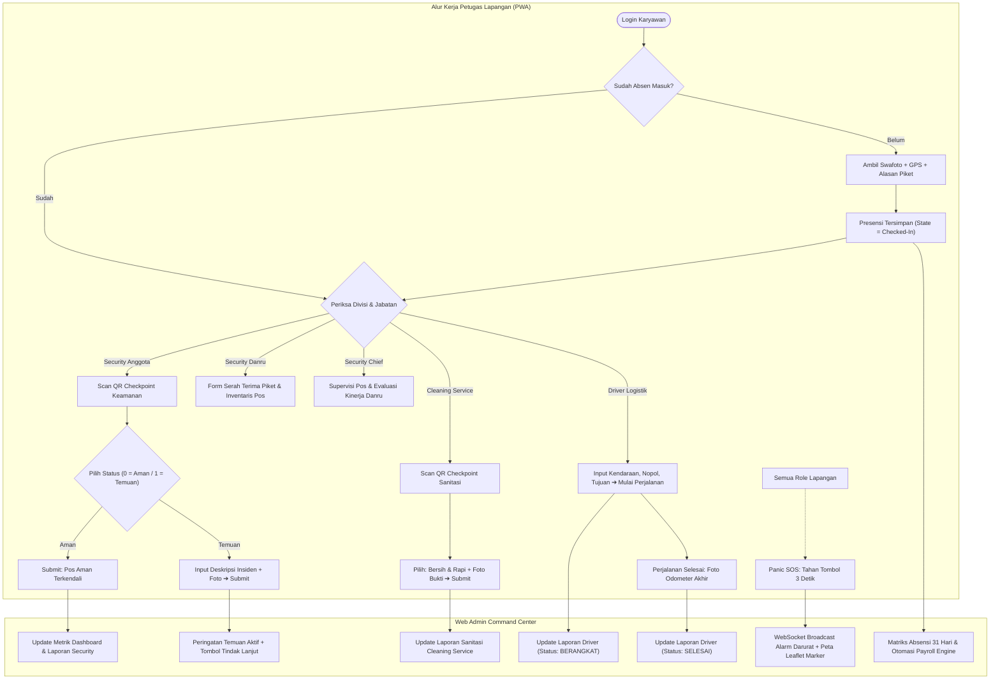
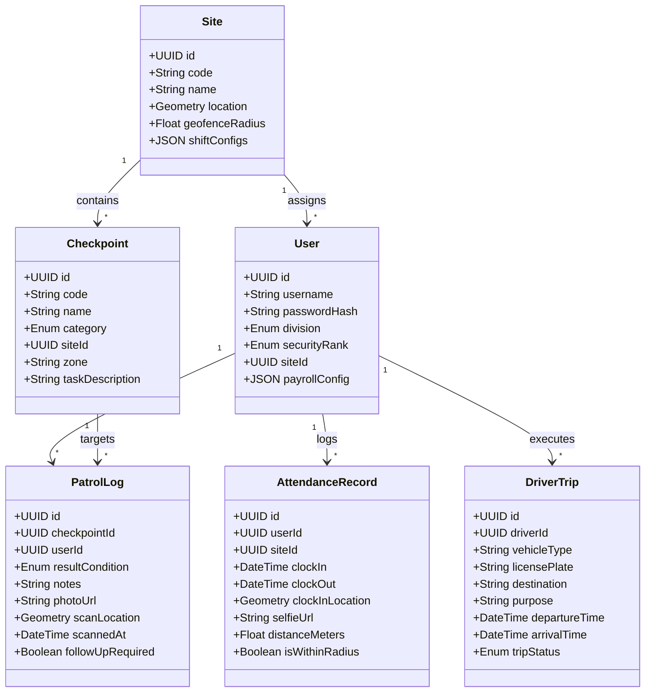
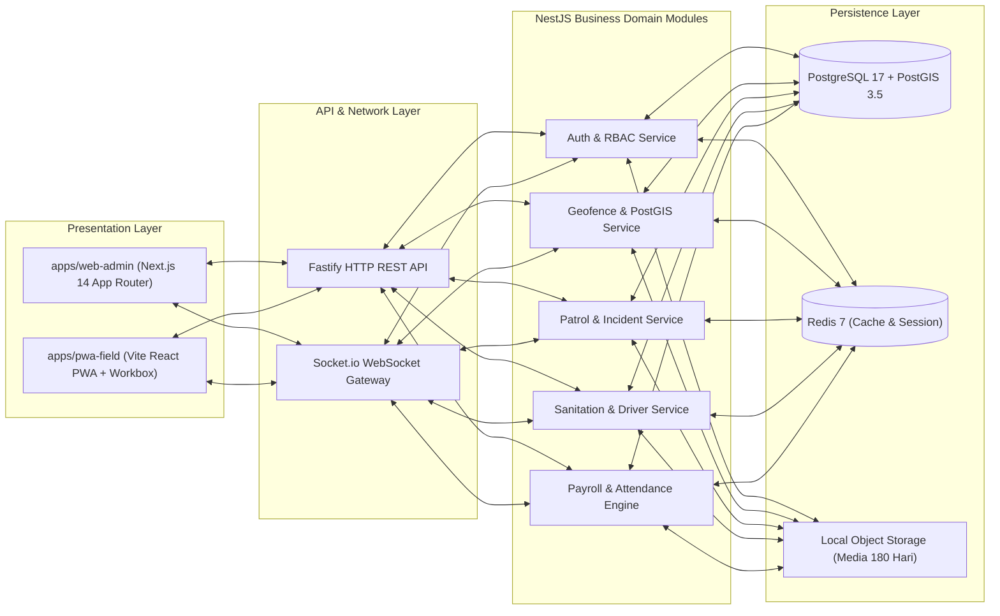

# MASTER PLAN REKAYASA BALIK SISTEM (REVERSE ENGINEERING MASTER PLAN)
## Patrol & Facility Management System (Enterprise In-House)
> **File:** `docs/reverse-engineering/RE-MASTER-PLAN.md`  
> **Versi:** 1.0 (Phase 0 — Baseline & Execution Blueprint)  
> **Target Aplikasi (Our Product):**  
> - Web Admin Command Center: `https://patrol-management-system.vercel.app/`  
> - Employee PWA: `https://patrol-management-system.pages.dev/validasi-patroli/`  
> **Aplikasi Referensi (Benchmark):** `https://patroli.site`  
> **Auditor / Architect:** Main Orchestrator, Principal Software Architect & QA Lead  

---

## 1. Executive Summary

### 1.1 Tujuan Rekayasa Balik (Objective)
Tujuan utama reverse engineering adalah mendekonstruksi dan memahami secara tuntas seluruh proses bisnis, struktur data relasional, alur operasional per divisi, logika agregasi laporan, kalkulasi penggajian, dan interaksi pengguna dari aplikasi referensi `https://patroli.site`, untuk kemudian dibangun ulang dan disempurnakan menjadi sistem **Single-Tenant In-House Enterprise Beli Putus** modern pada repositori `Patrol-Management-System`.

### 1.2 Ruang Lingkup (Scope)
Rekayasa balik mencakup seluruh domain fungsional:
- **3 Divisi Operasional Terpadu:** Satuan Pengamanan (Security), Cleaning Service (Sanitasi), dan Driver Armada (Logistik).
- **Hierarki Korporat:** Pusat ➔ Fasilitas / Site ➔ Divisi ➔ Pos / Checkpoint.
- **Siklus Operasional:** Presensi Geofence GPS & Swafoto ➔ Pemindaian QR Checkpoint / Pencatatan Armada ➔ Pelaporan Normal vs Insiden ➔ Monitoring Real-time Command Center ➔ Rekapitulasi Gaji (Payroll) & Ekspor Laporan.

### 1.3 Kondisi Sistem Saat Ini & Hasil Investigasi Awal
- **Aplikasi Referensi:** Dataset telah berhasil diaktifkan dari nol menjadi operasional aktif (5 personil hadir 100%, 4 kegiatan harian, 1 temuan insiden aktif, 7 checkpoint, dan 2 site).
- **Repositori Target:** Monorepo (`@patrol/types`, `@patrol/backend`, `@patrol/pwa-field`, `@patrol/web-admin`) telah memiliki fondasi arsitektur modern (NestJS, Fastify, PostGIS 3.5, Next.js 14, React PWA) dan lulus kompilasi 100% tanpa error.

### 1.4 Risiko Utama (Key Risks)
1. *Small Dataset Bias:* Data referensi terbatas pada 1 tenant dan 5 akun, sehingga variasi edge-case skala besar harus dirancang mandiri.
2. *Reference Limitations:* Referensi tidak memiliki kapabilitas offline sync dan memiliki limit kuota 5 akun SaaS. Keterbatasan ini **tidak boleh ditiru** pada monorepo in-house kita.

---

## 2. Cakupan Modul Aplikasi (Application Scope)

Berikut adalah daftar lengkap 22 modul operasional yang diobservasi dan direkonstruksi:

| No | Modul Sistem | Komponen & Fitur Kunci | Rute Web Admin / PWA |
|:---|:---|:---|:---|
| 1 | **Dashboard Command Center** | 10 Widget metrik, grafik tren harian, status personil | `/index.php` / `/dashboard` |
| 2 | **Master Data Area / Site** | Titik koordinat PostGIS, Leaflet map, geofence radius, 10 shift | `/datainduk/area` |
| 3 | **Master Data Checkpoint** | Checkpoint Security & Cleaning, stiker QR A4 160x160px | `/datainduk/checkpoint` |
| 4 | **Master Data Personel** | Akun, divisi, peran, webcam capture, konfigurasi payroll | `/datainduk/personil` |
| 5 | **Presensi Karyawan** | Dual-gate login, GPS validation, swafoto portrait, alasan piket | `validasi-patroli/xxxxx_xx.php` / `/absensi` |
| 6 | **Matriks Presensi 31 Hari** | Grid absensi bulanan, kode status (`M`, `P`, `X`, `I`, `S`, `A`) | `/absensi/monitoring` |
| 7 | **Patroli Keamanan (Security)**| Scan QR aset, form hasil patroli (Aman vs Temuan Insiden) | `validasi-patroli/xxxxx_xxxxxxxxx.php` |
| 8 | **Laporan Serah Terima Danru** | Serah terima piket shift, checklist inventaris pos | `/laporan/security/komandan` |
| 9 | **Laporan Supervisi Chief** | Evaluasi Danru, inspeksi kerapian dan kesiapan pos | `/laporan/security/chief` |
| 10| **Checklist Sanitasi Cleaning**| Scan QR zona kebersihan, status Bersih dan Rapi, foto bukti | `/laporan/cleaning-service` |
| 11| **Log Perjalanan Driver** | Catat tipe armada, nopol, tujuan, status BERANGKAT/SELESAI | `validasi-patroli/xxxxx_xxxxxxxxxx.php` |
| 12| **Laporan Staf Operasional** | Logbook harian aktivitas kantor non-checkpoint | `/laporan/staff` |
| 13| **Tracking Patroli Timeline** | Visualisasi timeline vertikal inspeksi pos per site/petugas | `/laporan/tracking-patroli` |
| 14| **Monitoring Kegiatan** | Matriks kegiatan harian, tombol export Excel client-side | `/laporan/monitoring-kegiatan` |
| 15| **Rekapitulasi Kegiatan** | Agregasi bulanan total aktivitas per personil dan divisi | `/laporan/rekap-kegiatan` |
| 16| **Panic Button SOS** | Tombol darurat tahan 3 detik, koordinat live, Leaflet marker | `validasi-patroli/xxxxx_xxxxxxxx.php` |
| 17| **Command Center Emergency** | Modal alarm darurat `#myModalpan`, nonaktifkan alarm | `/emergency` |
| 18| **Mesin Penggajian (Payroll)**| Hitung gapok, tunjangan, lembur, potongan alpa, denda lupa absen | `/gaji` |
| 19| **Generator Slip Gaji A4** | Layout portrait cetak formal slip gaji karyawan | `/gaji/slip` |
| 20| **Pesan Siaran (Broadcast)** | Pengiriman pesan teks dari admin ke running ticker PWA | `/pesan-siaran` |
| 21| **Wizard Ekspor Laporan** | 4 form wizard cascading AJAX, router PDF spesifik per role | `/export-laporan` |
| 22| **ID Card Karyawan** | Generator kartu identitas format CR80 dengan QR Code | `/datainduk/personil/idcard` |

---

## 3. Matriks Peran & Hak Akses (Role & Permission Matrix)

```
┌────────────────────┬───────────┬──────────────┬──────────┬──────────┬──────────┬──────────┐
│ Modul / Fitur      │ SuperAdmin│ SiteSuperv   │ Danru    │ Chief    │ Anggota  │ Cleaning │ Driver   │
├────────────────────┼───────────┼──────────────┼──────────┼──────────┼──────────┼──────────┤
│ Dashboard Admin    │    CRUD   │      R       │    -     │    -     │    -     │    -     │    -     │
│ Master Area/Site   │    CRUD   │      R       │    -     │    -     │    -     │    -     │    -     │
│ Master Checkpoint  │    CRUD   │     CRUD     │    -     │    -     │    -     │    -     │    -     │
│ Master Personil    │    CRUD   │      R       │    -     │    -     │    -     │    -     │    -     │
│ Presensi PWA       │     -     │      -       │   EXEC   │   EXEC   │   EXEC   │   EXEC   │   EXEC   │
│ Scan QR Security   │     -     │      -       │   EXEC   │   EXEC   │   EXEC   │    -     │    -     │
│ Serah Terima Danru │     -     │      -       │   EXEC   │    R     │    -     │    -     │    -     │
│ Supervisi Chief    │     -     │      -       │    -     │   EXEC   │    -     │    -     │    -     │
│ Checklist Sanitasi │     -     │      -       │    -     │    -     │    -     │   EXEC   │    -     │
│ Log Perjalanan     │     -     │      -       │    -     │    -     │    -     │    -     │   EXEC   │
│ Panic Button SOS   │   MONITOR │   MONITOR    │   EXEC   │   EXEC   │   EXEC   │   EXEC   │   EXEC   │
│ Payroll & Slip     │    CRUD   │      R       │    -     │    -     │    -     │    -     │    -     │
│ Ekspor Laporan     │    ALL    │   SITE-ONLY  │    -     │    -     │    -     │    -     │    -     │
└────────────────────┴───────────┴──────────────┴──────────┴──────────┴──────────┴──────────┘
Keterangan: CRUD = Create/Read/Update/Delete, R = Read-only, EXEC = Execute transaksi PWA, - = Tidak memiliki akses.
```

---

## 4. Peta Alur Bisnis Operasional (Business Process Map)



---

## 5. Rencana Penemuan Model Data (Data Model Discovery Plan)

Entitas dan relasi yang dimodelkan pada arsitektur database:



---

## 6. Rencana Penemuan UI & Interaksi (UI Discovery Plan)

- **Inventarisasi Seluruh Halaman:** Memastikan setiap halaman Web Admin dan PWA memiliki representasi rute di Next.js App Router dan React Router PWA.
- **Form Inspection:** Memastikan seluruh form CRUD menggunakan pustaka form teruji (`react-hook-form` + `zod`) dengan validasi tipe data ketat dan pesan error bilingual yang ramah pengguna.
- **Modal Interaktif:** Mereproduksi perilaku modal Leaflet Map presisi, modal tindak lanjut temuan insiden, dan modal penyelesaian alarm Panic SOS.

---

## 7. Siklus Transaksi Operasional (Transaction Lifecycle)

1. **Pembuatan Transaksi (Creation):** Petugas memicu transaksi melalui PWA (Check-in, Scan QR, atau Mulai Perjalanan). Data diverifikasi di sisi klien (validasi foto base64 dan koordinat GPS).
2. **Pemrosesan Backend (Ingestion):** Fastify menerima payload, memverifikasi JWT token dan permission, menghitung jarak geofence PostGIS `ST_DWithin`, dan menyimpan record transaksi.
3. **Agregasi & Notifikasi (Distribution):** WebSocket mem-push pembaruan status ke Command Center, memperbarui widget metrik real-time.
4. **Penyelesaian Transaksi (Resolution):**
   - Patroli Temuan: Diselesaikan melalui koordinasi mitigasi teknisi di modal `#myModaltl`.
   - Perjalanan Driver: Ditutup melalui submit laporan kepulangan armada.
   - Presensi: Ditutup melalui presensi pulang (`ABSEN PULANG`).
5. **Pelaporan Finansial (Reconciliation):** Transaksi presensi direkapitulasi oleh Payroll Engine untuk menghasilkan Slip Gaji bulanan.

---

## 8. Penemuan Dashboard & Mesin Pelaporan (Reporting Engine)

- **Formula Agregasi Harian:**
  $$\text{Kegiatan Hari Ini} = \text{Total Patroli}(D) + \text{Total Sanitasi}(D) + \text{Total Perjalanan}(D)$$
- **Formula Payroll Engine:**
  $$\text{Take Home Pay} = \text{Gapok} + \text{Tunjangan} + (\text{Jam Lembur} \times \text{Tarif}) - \text{BPJS} - \text{Potongan Alpa} - (\text{Lupa Absen} \times \text{Denda})$$
- **Wizard Ekspor Laporan:** Menggunakan PDF generator berbasis headless printer (Chromium / PDFKit) dengan orientasi A4 portrait dan landscape sesuai tabel data.

---

## 9. Penemuan Offline & Sinkronisasi Data PWA

Khusus untuk mengatasi area blind spot / basement gedung:
1. **PWA Shell Caching:** Service Worker Workbox melakukan precache terhadap seluruh asset statis (`index.html`, bundle JS, CSS, fonts, icons).
2. **Offline Mutation Queue:** Transaksi saat offline disimpan ke dalam IndexedDB store `patrol_offline_queue`.
3. **Background Sync:** Menggunakan Background Sync API untuk memicu pengiriman otomatis begitu browser mendeteksi event `online`.
4. **Resolusi Konflik:** Transaksi offline mencatat `clientTimestamp` dan `deviceId`. Backend memvalidasi integritas urutan waktu dengan server timestamp untuk mencegah *replay attacks* atau duplikasi data.

---

## 10. Arsitektur Teknis Sistem Baru



---

## 11. Rencana Fase Eksekusi Rekayasa Balik (RE Execution Phases)

```
[Phase 0: Master Plan & Gap Audit]  <-- KITA DI SINI (SELESAI)
             │
             ▼ (Menunggu Persetujuan Project Owner)
[Phase 1: Deep Contract & API Decoding] ➔ Rekonstruksi spesifikasi OpenAPI & Payload Schema
             │
             ▼
[Phase 2: Database Schema & PostGIS Alignment] ➔ Sinkronisasi entitas TypeORM / Prisma
             │
             ▼
[Phase 3: Core Service & Business Logic Engine] ➔ Attendance, Patrol, Payroll, Geofence
             │
             ▼
[Phase 4: Field PWA & Offline Engine Finalization] ➔ IndexedDB Queue, Camera, Scanner
             │
             ▼
[Phase 5: Web Admin Command Center Integration] ➔ Dashboard, 7 Reports, Payroll Slips
             │
             ▼
[Phase 6: Comprehensive E2E Verification & DoD] ➔ Playwright multi-role automated tests
```

---

## 12. Daftar Dokumen Deliverables Lengkap

1. `docs/reverse-engineering/agent-01-data-structure-audit.md` (Selesai)
2. `docs/reverse-engineering/agent-02-security-patrol-audit.md` (Selesai)
3. `docs/reverse-engineering/agent-03-employee-workflow-audit.md` (Selesai)
4. `docs/reverse-engineering/agent-04-admin-reporting-audit.md` (Selesai)
5. `docs/reverse-engineering/agent-05-independent-qa-audit.md` (Selesai)
6. `docs/reverse-engineering/repository-baseline-audit.md` (Selesai)
7. `docs/reverse-engineering/HALLUCINATION-PREVENTION.md` (Selesai)
8. `docs/reverse-engineering/RE-MASTER-PLAN.md` (Dokumen ini)
9. `docs/reverse-engineering/RE-READINESS-REPORT.md` (Tahap Gerbang Kesiapan)

---

## 13. Kriteria Penerimaan Rekayasa Balik (Acceptance Criteria)

Rekayasa Balik dianggap selesai dan sukses apabila:
1. **Zero Hallucination:** 100% field, parameter, dan formula diverifikasi terhadap bukti empiris atau ditandai eksplisit sebagai keputusan desain mandiri.
2. **Definitive Business Specification:** Seluruh alur kerja Satpam, Cleaning Service, dan Driver terdokumentasi dalam state machine formal.
3. **Parity Validation:** Seluruh laporan di Web Admin lokal menghasilkan struktur kolom, filter, dan data yang setara atau lebih superior dibanding referensi.
4. **Approval by Project Owner:** Rencana implementasi telah ditinjau dan disetujui secara eksplisit oleh project owner.

---

## 14. Risiko & Ketidakpastian yang Perlu Diselesaikan (Open Risks)

1. *Kerahasiaan Kredensial:* Kredensial akun live harus dijaga ketat di browser session lokal dan dilarang dikomit ke repositori publik.
2. *Retensi Media:* Kebijakan penyimpanan foto bukti 180 hari memerlukan konfigurasi volume lokal atau S3-compatible storage untuk mencegah disk space server penuh.
3. *Gateway WhatsApp:* Pemilihan vendor gateway WhatsApp untuk pesan SOS darurat memerlukan pengesahan dari manajemen korporat.
