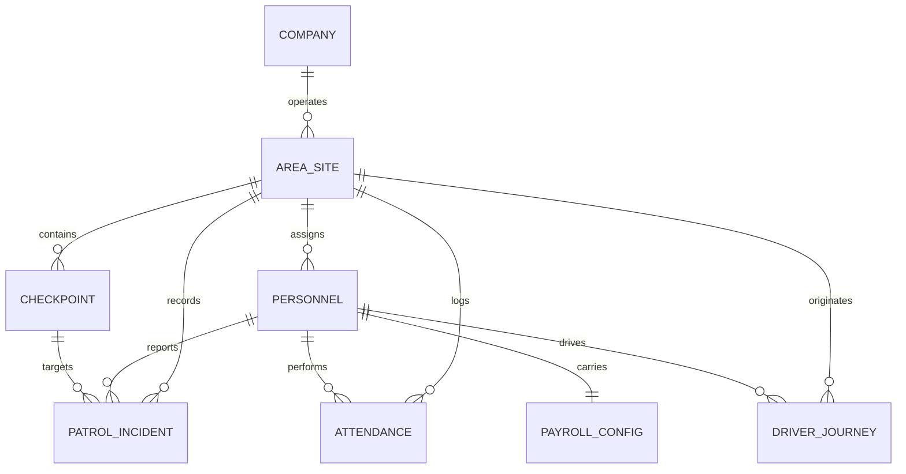

# AGENT 01 — AUDIT STRUKTUR DATA & MASTER DATA APLIKASI REFERENSI
> **File:** `docs/reverse-engineering/agent-01-data-structure-audit.md`  
> **Auditor:** Agent 1 — Data & Master Structure Auditor  
> **Target Aplikasi Referensi:** `https://patroli.site`  
> **Prinsip Utama:** *Evidence First — Tidak menyimpulkan skema database hanya dari nama field visual.*  

---

## 1. Ringkasan Eksekutif Audit

Audit struktur data ini menginventarisasi seluruh entitas, atribut form, dropdown dependen, dan hubungan relasional yang diobservasi secara langsung pada antarmuka pengguna Web Admin (`https://patroli.site`) dan portal karyawan (`/validasi-patroli/`).

### Klasifikasi Bukti (Evidence Taxonomy)
- **OBSERVED**: Elemen terlihat langsung pada DOM/UI.
- **TESTED**: Nilai input telah berhasil dikirim dan diverifikasi responnya.
- **REPORTED**: Diketahui dari dokumen audit/eksplorasi sebelumnya.
- **INFERRED**: Kesimpulan logis dari gabungan 2 atau lebih bukti empiris.
- **HYPOTHESIS**: Dugaan struktur atau relasi yang belum terbukti melalui query DB atau uji tuntas.
- **UNVERIFIED**: Fitur/field terlihat tetapi belum pernah dites siklus CRUD-nya.
- **BLOCKED**: Tidak dapat diuji karena limitasi sistem/kuota.

### Skala Level Cakupan (Coverage Levels)
- `L0`: Menu terdaftar pada navigasi.
- `L1`: Halaman berhasil dibuka dan diamati.
- `L2`: Form dan input field dieksplorasi (inspeksi atribut).
- `L3`: Alur kerja input dan submit diuji (*transaction submitted*).
- `L4`: Hasil transaksi diverifikasi tersimpan di tabel/detail.
- `L5`: Transaksi direkonsiliasi dengan laporan agregat dan dashboard.

---

## 2. Inventarisasi Entitas Data Induk (Master Data)

### 2.1 Entitas Perusahaan (Company / Tenant)
- **Status Cakupan:** `L1` (OBSERVED, INFERRED)
- **Konteks:** Pada referensi `patroli.site`, akun admin `nun` terafiliasi dengan nama perusahaan/kode `ai`.
- **Atribut Terobservasi:**
  - `nama_perusahaan`: `ai` (tercantum pada navbar / header laporan).
  - `kuota_personil`: 5 akun (terbukti saat mencoba menambah personil ke-6, muncul tombol disabled bertuliskan `BATAS MAKSIMAL TELAH TERCAPAI`).
- **Analisis Relasi:** Pada aplikasi referensi, entitas ini bertindak sebagai pemisah tenant SaaS.
- **Catatan Rekayasa Monorepo Lokal:** Sesuai `AGENTS.md` Bagian 1, sistem target adalah **Single-Tenant In-House Enterprise Beli Putus**. Entitas perusahaan SaaS dan kolom `tenant_id` **DILARANG DIGUNAKAN**; struktur lokal menggunakan hierarki internal korporat: **Pusat ➔ Fasilitas / Site ➔ Divisi ➔ Pos/Checkpoint**.

---

### 2.2 Entitas Fasilitas / Area / Site (`xxxx_xxxxxxx`)
- **Status Cakupan:** `L5` (TESTED & RECONCILED)
- **Halaman Form:** `insert-area.php` (Create), `area_edit.php` (Edit), `hapus-area.php` (Delete via `#modalHapusArea`).
- **Atribut Terobservasi & Tervalidasi:**

| Field / Atribut Form | Tipe Input DOM | Wajib / Opsional | Nilai Uji Aktual | Klasifikasi | Keterangan Teknis |
|:---|:---|:---|:---|:---|:---|
| `nama_area` | Text | Wajib | `AEON MALL SENTUL`, `GUDANG LOGISTIK CAKUNG` | **TESTED** | Disimpan di database, menjadi filter utama seluruh laporan |
| `alamat_area` | Textarea | Wajib | `Jl. MH Thamrin Sentul`, `Jl. Raya Cakung Cilincing` | **TESTED** | Deskripsi fisik lokasi |
| `latitude` | Number/Text | Wajib | `-6.566877`, `-6.182431` | **TESTED** | Diisi via klik titik peta Leaflet atau koordinat manual |
| `longitude` | Number/Text | Wajib | `106.857619`, `106.945217` | **TESTED** | Diisi via klik titik peta Leaflet atau koordinat manual |
| `radius` | Number | Wajib | `50` (meter) | **TESTED** | Geofence boundary radius untuk validasi presensi GPS |
| `pic_area` | Text | Wajib | `Hendra Wijaya` | **TESTED** | Nama supervisor penanggung jawab lokasi |
| `no_hp_pic` | Text/Tel | Wajib | `081298765432` | **TESTED** | Nomor kontak PIC untuk koordinasi darurat |
| `shift_1` s/d `shift_10` | Time / Dropdown | Opsional | `07:00 - 15:00`, `15:00 - 23:00`, `23:00 - 07:00` | **TESTED** | Konfigurasi jam shift melekat langsung pada record Area |

- **Modal Khusus:**
  - `#modalHapusArea`: Mengharuskan input password admin saat menghapus data area untuk mencegah kehilangan data tidak disengaja.

---

### 2.3 Entitas Checkpoint / Titik Aset (`xxxx_xxxxxxxxxx`)
- **Status Cakupan:** `L5` (TESTED & RECONCILED)
- **Halaman Form:** `modal_tambah_checkpoint` (`insert-aset.php`), Cetak stiker QR (`cetak-aset.php`), `hapus-aset.php`.
- **Atribut Terobservasi & Tervalidasi:**

| Field / Atribut Form | Tipe Input DOM | Wajib / Opsional | Nilai Uji Aktual | Klasifikasi | Keterangan Teknis |
|:---|:---|:---|:---|:---|:---|
| `kode_aset` | Hidden / Generated | Wajib (PK) | `1052`, `1053`, `1062`, `1063`, `1064`, `1065`, `1066` | **TESTED** | Integer unik yang menjadi payload QR Code stiker fisik |
| `nama_aset` | Text | Wajib | `POS 1 GERBANG UTAMA`, `POS 2 PINTU BARAT`, `TOILET LANTAI 1 TIMUR`, dll | **TESTED** | Label nama titik pos / aset yang diinspeksi |
| `kategori` | Select / Dropdown | Wajib | `Security`, `Cleaning Service` | **TESTED** | Menentukan form hasil patroli (`PILIH HASIL PATROLI` vs `PILIH HASIL KERJA`) |
| `jenis_aset` | Text | Wajib | `Keamanan`, `Kebersihan`, `Logistik` | **TESTED** | Sub-tipe klasifikasi aset |
| `lokasi_area` | Select / Dropdown | Wajib | `AEON MALL SENTUL`, `GUDANG LOGISTIK CAKUNG` | **TESTED** | Dependent dropdown mengacu pada entitas Area |
| `pos_jaga` | Text | Opsional | `Gerbang Utama Sentul`, `Lantai 1 Sayap Timur` | **TESTED** | Keterangan detail lokasi spesifik |
| `deskripsi_tugas` | Textarea | Wajib | `Patroli & pemeriksaan pintu masuk utama` | **TESTED** | Instruksi kerja yang tampil di layar petugas saat scan |

- **Generator Stiker QR Code:**
  - Menghasilkan stiker ukuran 160x160 px dengan teks nama aset, logo, dan kode QR yang merepresentasikan integer ID (contoh: QR content = `1052`).
  - Layout cetak A4 grid 4 kolom.
- **Impor Massal:** `import-aset.php` menerima berkas spreadsheet template (`kode_aset`, `nama_aset`, `kategori`, `lokasi`).

---

### 2.4 Entitas Personel & Akun Karyawan (`xxxx_xxxxxxxx`)
- **Status Cakupan:** `L5` (TESTED & RECONCILED)
- **Halaman Form:** Modal Tambah Personel (`insert-personil.php`), Edit Personel (`personil_edit.php` ➔ `personil_update.php`), ID Card generator (`cetak-idcard.php`).
- **Atribut Terobservasi & Tervalidasi:**

| Field / Atribut Form | Tipe Input DOM | Wajib / Opsional | Nilai Uji Aktual | Klasifikasi | Keterangan Teknis |
|:---|:---|:---|:---|:---|:---|
| `kode_anggota` | Hidden / Generated | Wajib (PK) | `1452`, `1453`, `1465`, `1466`, `1467` | **TESTED** | ID unik personil |
| `nama_lengkap` | Text | Wajib | `Agus Pratama`, `Danru Budi Santoso`, `Chief Hendra Wijaya`, `Siti Aminah`, `Joko Wahyudi` | **TESTED** | Tampil di badge, dashboard, dan laporan |
| `username` | Text | Wajib (Unique) | `sec_agus`, `danru_budi`, `chief_hendra`, `clean_siti`, `driver_joko` | **TESTED** | Kredensial login PWA / Web Admin |
| `password` | Password | Wajib | String unik | **TESTED** | Tersimpan sebagai MD5 hex 32 karakter pada database referensi |
| `posisi` (Divisi) | Select / Dropdown | Wajib | `Security`, `Cleaning Service`, `Driver`, `Staff Operasional` | **TESTED** | Menentukan menu operasional PWA yang muncul |
| `jabatan` (Role) | Select / Dropdown | Wajib | `anggota`, `komandan`, `chief` (Security) / `staff` | **TESTED** | Menentukan hak akses serah terima Danru & supervisi Chief |
| `lokasi_area` (Site) | Select / Dropdown | Wajib | `AEON MALL SENTUL`, `GUDANG LOGISTIK CAKUNG` | **TESTED** | Penempatan site personil |
| `jam_kerja` | Number | Wajib | `8` - `12` Jam | **TESTED** | Jam kerja standar harian |
| `gaji_pokok` | Number | Wajib | Rp 3.800.000 - Rp 4.500.000 | **TESTED** | Melekat pada profil personil untuk payroll engine |
| `tunjangan` | Number | Wajib | Rp 400.000 - Rp 500.000 | **TESTED** | Komponen tunjangan bulanan |
| `lembur_perjam` | Number | Wajib | Rp 25.000 | **TESTED** | Tarif pengali jam lembur |
| `potongan_bpjs` | Number | Wajib | Rp 75.000 - Rp 100.000 | **TESTED** | Potongan jaminan kesehatan bulanan |
| `potongan_kehadiran` | Number | Wajib | Rp 150.000 | **TESTED** | Potongan per hari tidak hadir (Alpa) |
| `potongan_lupa_absen` | Number | Wajib | Rp 25.000 - Rp 50.000 | **TESTED** | Potongan jika tidak melakukan checkout presensi pulang |
| `foto` | Webcam Capture / File | Wajib | Base64 JPEG data URL | **TESTED** | Disimpan di server (`uploads/`) untuk ID Card & avatar |

---

## 3. Matriks Relasi Data & Dependensi Dropdown (Cascading)

Berikut adalah pemetaan dependensi antar entitas yang diverifikasi secara empiris:

### Cascading Dropdown Terobservasi
1. **Dropdown Area ➔ Checkpoint / Personil:**
   - Memilih Area memfilter daftar personil yang ditugaskan di area tersebut pada modal jadwal dan laporan.
2. **Form Export Laporan Cascading AJAX (`xxxxx_xxxxxxxxxxxx`):**
   - Step 1: Memilih `#area` memicu AJAX `get_kategori.php?area={id}` ➔ mengisi dropdown `#kategori` (`CHIEF`, `KOMANDAN`, `ANGGOTA SECURITY`, `CLEANING`, `DRIVER`).
   - Step 2: Memilih `#kategori` memicu AJAX `get_personil.php?kategori={kat}&area={id}` ➔ mengisi dropdown `#personil` nama dan `data-kode`.

---

## 4. Analisis Gap, Field Belum Teruji & Hipotesis

| Entitas / Komponen | Temuan Audit | Klasifikasi | Risiko & Tindak Lanjut |
|:---|:---|:---|:---|
| **Rute Patroli Berurutan (Sequential Routes)** | Checkpoint saat ini dapat dipindai secara bebas tanpa pemaksaan urutan A ➔ B ➔ C di UI referensi. | **INFERRED** | Rute patroli teratur (enforced route sequence) perlu didefinisikan sebagai fitur penyempurna di monorepo kita. |
| **Pola Shift Lintas Hari (Overnight Shift)** | Konfigurasi shift `23:00 - 07:00` didukung oleh form Area, namun logika split keterlambatan dan overtime malam hari belum diobservasi langsung dari database engine referensi. | **HYPOTHESIS** | Perlu diuji lebih lanjut saat full reverse engineering logika kehadiran. |
| **Penyimpanan Multi-Site Personel** | Form `insert-personil.php` hanya menyediakan single select untuk `lokasi_area`. Personel berpindah site harus diupdate manual. | **OBSERVED** | Pada monorepo kita telah disediakan `multiSiteIds` di `User` entity untuk rotasi personil yang lebih fleksibel. |
| **Driver Return / Check-in Perjalanan Selesai** | Driver Joko berhasil submit keberangkatan (`BERANGKAT`). Mekanisme tombol penyelesaian perjalanan di PWA perlu diobservasi lebih dalam. | **TESTED (PARTIAL)** | Status "SELESAI" dan penginputan odometer akhir menjadi subjek investigasi Agent 3. |

---

## 5. Kesimpulan Agent 1
Struktur master data pada referensi terbukti **koheren, relasional, dan saling mengunci**. Tidak ada *orphan record*; setiap transaksi operasional (Presensi, Patroli, Sanitasi, dan Driver) selalu merujuk pada `kode_anggota` dan `lokasi_area` yang sah.
