# 01 — APPLICATION MAP & SITEMAP SISTEM LENGKAP
> **File:** `docs/reverse-engineering/phase-1/01-application-map.md`  
> **Tahap:** Phase 1 — Deep Reverse Engineering  
> **Sistem Acuan:** `https://patroli.site`  
> **Sistem Sasaran:** `Patrol-Management-System`  

---

## 1. Peta Topologi Navigasi Sistem

Sistem terbagi menjadi dua gerbang utama (*dual-gate portal*):
1. **Web Admin Command Center (`/index.php`)**: Berorientasi desktop untuk manajemen, konfigurasi data induk, pemantauan insiden live, dan pembukuan penggajian.
2. **Mobile Worker PWA (`/validasi-patroli/`)**: Berorientasi mobile smartphone untuk petugas lapangan (Satpam, Cleaning Service, Driver, dan Staff).

```mermaid
flowchart TD
    Login["Gerbang Login Utama (login.php)"]
    
    Login -->|Role Admin / Manager| AdminCenter["Web Admin Command Center (/index.php)"]
    Login -->|Role Operasional Lapangan| MobilePortal["Mobile Worker PWA (/validasi-patroli/index.php)"]

    subgraph Admin_Modules["Modul Web Admin"]
        AdminCenter --> Dash["Dashboard & Live Metrik"]
        AdminCenter --> MasterData["Data Induk (Area, Pos/Aset, Personil)"]
        AdminCenter --> AttendanceAdmin["Presensi & Matriks 31 Hari"]
        AdminCenter --> ReportsAdmin["7 Kategori Laporan & Rekap"]
        AdminCenter --> PayrollAdmin["Penggajian & Slip Gaji A4"]
        AdminCenter --> EmergencyAdmin["Pemantauan Alarm Darurat SOS"]
        AdminCenter --> BroadcastAdmin["Pesan Siaran Ticker"]
        AdminCenter --> ExportAdmin["4 Wizard Ekspor PDF/XLS"]
    end

    subgraph Mobile_Modules["Modul Mobile Worker PWA"]
        MobilePortal --> PresensiMasuk["Absen Masuk (GPS + Swafoto)"]
        MobilePortal --> PresensiPulang["Absen Pulang (GPS + Swafoto)"]
        MobilePortal --> ScanQR["Pemindaian QR Checkpoint (html5-qrcode)"]
        MobilePortal --> TripDriver["Log Perjalanan Armada Driver"]
        MobilePortal --> DanruChiefForm["Laporan Khusus Danru & Chief"]
        MobilePortal --> StaffForm["Logbook Kegiatan Harian Staff"]
        MobilePortal --> PanicBtn["Panic SOS (Hold 3s)"]
        MobilePortal --> LeaveForm["Pengajuan Izin / Sakit"]
    end
```

---

## 2. Inventarisasi Rute Web Admin Command Center

Berikut adalah katalog lengkap seluruh rute dan aksi di Web Admin `patroli.site` yang diobservasi secara mendalam:

| ID | Menu / Submenu | URL Endpoint Asli | Method | Fungsi & Komponen UI Terobservasi | Bukti Screenshot / Raw File |
|:---|:---|:---|:---:|:---|:---|
| **ADM-01** | Dashboard | `/index.php` | GET | 10 Widget kartu metrik, grafik batang kehadiran, tabel log aktivitas live | `02_admin_dashboard.png` |
| **ADM-02** | Master Area (List) | `/xxxx_xxxxxxx` | GET | Tabel area operasional, peta Leaflet OSM, tombol tambah/edit/hapus | `03_data_induk_area.png` |
| **ADM-03** | Master Area (Create) | `/insert-area.php` | POST | Form modal koordinat Leaflet, nama area, alamat, radius, 10 shift | `04_modal_tambah_area.png` |
| **ADM-04** | Master Area (Edit) | `/area_edit.php` | POST | Pembaruan koordinat, jam kerja shift, nama PIC, dan kontak darurat | `05_edit_area.png` |
| **ADM-05** | Master Area (Delete) | `/hapus-area.php` | POST | Modal `#modalHapusArea` dengan verifikasi input password admin | `03_data_induk_area.png` |
| **ADM-06** | Checkpoint (List) | `/xxxx_xxxxxxxxxx` | GET | Tabel master titik inspeksi Security & Cleaning, tombol cetak QR | `06_data_induk_checkpoint.png` |
| **ADM-07** | Checkpoint (Create) | `/insert-aset.php` | POST | Form modal tambah checkpoint, pemilihan site, kategori divisi, pos jaga | `07_modal_tambah_checkpoint.png` |
| **ADM-08** | Cetak QR Checkpoint | `/cetak-aset.php?kode_aset={id}` | GET | Generator stiker fisik QR format integer ID, ukuran 160x160 px | `admin-checkpoint-print.png` |
| **ADM-09** | Import Checkpoint | `/import-aset.php` | POST | Upload berkas template XLSX data aset massal | `08_import_checkpoint.png` |
| **ADM-10** | Checkpoint (Delete) | `/hapus-aset.php?kode_aset={id}` | GET | Konfirmasi penghapusan data titik aset | `06_data_induk_checkpoint.png` |
| **ADM-11** | Personil (List) | `/xxxx_xxxxxxxx` | GET | Tabel personil operasional, avatar, jabatan, site, kuota 5/5 | `09_data_induk_personil.png` |
| **ADM-12** | Personil (Create) | `/insert-personil.php` | POST | Form pendaftaran personil, webcam snapshot base64, tarif gaji | `10_modal_tambah_personil.png` |
| **ADM-13** | Personil (Edit) | `/personil_edit.php` ➔ `personil_update.php` | POST | Modal `#myModal` edit biodata, tarif lembur, dan reset password MD5 | `admin-personnel-table.png` |
| **ADM-14** | Cetak ID Card | `/cetak-idcard.php?id={id}` | GET | Generator kartu tanda pengenal CR80 dengan 5 tema warna (`B1` s/d `B5`) | `admin-personnel-idcard.png` |
| **ADM-15** | Import Personil | `/import-personil.php` | POST | Upload spreadsheet data karyawan massal | `11_import_personil.png` |
| **ADM-16** | Absensi: Semua Data | `/xxxx_xxxxxxxxx` | GET | Tabel riwayat presensi harian dengan filter site/status/tanggal | `admin-absensi-populated.png` |
| **ADM-17** | Absensi: Detail Modal| Modal `#myModalab` | GET/AJAX | Peta Leaflet komparasi GPS petugas vs site, jarak meter, swafoto | `admin-absensi-detail-modal.png` |
| **ADM-18** | Absensi: Matriks 31 Hari | `/xxxxx_xxxxxxxxxxxxxxxxxxxxxxxxxxxxxxxxxxxxxxxx` | GET | Grid monitoring absensi 1–31 hari per kolom, notasi `M`, `P`, `X`, `I` | `admin-absensi-matrix.png` |
| **ADM-19** | Laporan Security Anggota | `/xxxx_xxxxxxxxxxx` | GET | Tabel patroli normal (`Aman`) & insiden (`Perlu Tindak Lanjut`), foto | `10-laporan-security.png` |
| **ADM-20** | Modal Tindak Lanjut | Modal `#myModaltl` (`tl.php` ➔ `insert-tl.php`) | POST | Formulir penanganan mitigasi insiden oleh tim teknisi lapangan | `10-laporan-security.png` |
| **ADM-21** | Laporan Komandan (Danru) | `/xxxxx_xxxxxxxxxxxxxxxxxxxxxxxxxxxxxxxxxxxxxxxxx` | GET | Rekapitulasi serah terima piket shift, checklist inventaris pos | `admin-danru-detail.png` |
| **ADM-22** | Laporan Chief Security | `/xxxxx_xxxxxxxxxxxxxxxxxxxxxxxxxxxxxxxxxxxxxxxxxx` | GET | Rekapitulasi supervisi kesiapan pos dan penilaian kinerja Danru | `16_laporan_security_chief.png` |
| **ADM-23** | Laporan Cleaning Service | `/xxxxx_xxxxxxxxxxxxxxxxxxxxxxxxxxx` | GET | Tabel checklist kebersihan toilet/ruangan, status Bersih dan Rapi | `08-laporan-cleaning-service.png` |
| **ADM-24** | Laporan Driver Logistik | `/xxxxx_xxxxxxxxxxxxxxxxxxxxxxxxxxxx` | GET | Log perjalanan armada, nomor polisi, tujuan, status Berangkat | `09-laporan-driver.png` |
| **ADM-25** | Laporan Staf Operasional | `/xxxxx_xxxxxxxxxxxxxxxxxxxxxxxx` | GET | Logbook aktivitas harian kantor non-checkpoint | `17_laporan_staff_operasional.png` |
| **ADM-26** | Tracking Patroli Timeline| `/xxxxx_xxxxxxxxxxxxxxxxxxxxxxxxxxxxxxxxxxxxxxxxxxx` | GET | Visualisasi timeline vertikal pergerakan patroli petugas pos | `admin-tracking-map.png` |
| **ADM-27** | Rekapitulasi Kegiatan | `/xxxxx_xxxxxxxxxxxxxxxxxxxxxxxxxxxxxxxxxxxxxx` | GET | Agregasi bulanan total aktivitas per personil dan divisi | `11-rekap-kegiatan.png` |
| **ADM-28** | Monitoring Kegiatan | `/xxxxx_xxxxxxxxxxxxxxxxxxxxxxxxxxxxxxxxxxxxxxx` | GET | Filter harian, tombol `📊 Cetak Excel` client-side JS Blob | `admin-monitoring-excel.png` |
| **ADM-29** | Penggajian (Payroll) | `/xxxxx_xxxxxxxxxxxxxxxxxxxxxxxxxxxxxxxxxxxxx` | GET | Tabel rekapitulasi finansial otomatis, gapok, tunjangan, potongan | `admin-payroll-detail.png` |
| **ADM-30** | Slip Gaji A4 | `/slip.php` / pratinjau cetak | GET | Template cetak formal slip gaji karyawan portrait A4 14 baris | `admin-payroll-detail.png` |
| **ADM-31** | Pemantauan Darurat SOS | `/xxxxx_xxxxxxxxxxxxxxxxxxx` | GET | Log pemicuan alarm darurat dengan pin lokasi pada peta Leaflet | `admin-emergency-detail.png` |
| **ADM-32** | Nonaktifkan Alarm SOS | `/update_status_alarm.php` | POST | Resolusi pemadaman alarm darurat di Command Center | `admin-emergency-detail.png` |
| **ADM-33** | Pesan Siaran (Broadcast)| `/xxxxx_xxxxxxxxxxxxxxx` ➔ `pesan_update.php` | POST | Manajemen teks berjalan untuk running ticker PWA mobile | `24_pesan_siaran.png` |
| **ADM-34** | 4 Wizard Ekspor Laporan | `/xxxxx_xxxxxxxxxxxx` | POST | Dynamic cascading AJAX (`Area ➔ Kategori ➔ Personil`) ke router PDF | `admin-export-wizards.png` |
| **ADM-35** | Ubah Password Admin | Modal `#ubahpassword` (`ganti-pass.php`) | POST | Pembaruan kata sandi akun administrator | `28_modal_ubah_password.png` |

---

## 3. Inventarisasi Rute Mobile Worker PWA

Berikut adalah katalog lengkap rute antarmuka PWA `/validasi-patroli/`:

| ID | Nama Tampilan | URL Endpoint Asli | Akses Role | Aksi & Logika Operasional | Bukti File Raw |
|:---|:---|:---|:---:|:---|:---|
| **MOB-01** | Mobile Dashboard | `/validasi-patroli/index.php` | Semua Petugas | Running ticker pesan siaran, tombol SOS, status jam presensi | `01_dashboard_index.html` |
| **MOB-02** | Absen Masuk | `/validasi-patroli/xxxxx_xx.php` ➔ `../insert-presensi.php` | Belum Check-in | Input GPS, swafoto webcam base64, alasan piket | `02_absen_masuk.html` |
| **MOB-03** | Absen Pulang | `/validasi-patroli/xxxxx_xxx.php` ➔ `../update-presensi.php` | Sudah Check-in | Input GPS, swafoto webcam base64 checkout | `03_absen_pulang.html` |
| **MOB-04** | Pengajuan Izin/Alpha | `/validasi-patroli/xxxxx_xxxx.php` ➔ `../insert-presensi.php` | Semua Petugas | Pilihan: Sakit, Urusan Keluarga, Pribadi (`status_absen = 3`) | `04_izin_alpha.html` |
| **MOB-05** | Scan QR Checkpoint | `/validasi-patroli/xxxxx_xxxxxxxxx.php` ➔ `../cek.php` | Security & CS | Pemindai QR `html5-qrcode`, kirim `nama={kode_aset}` | `09_qr_scan.html` |
| **MOB-06** | Form Hasil Patroli | `/cek.php` ➔ `insert-patroli.php` | Security | Opsi Aman (`0`) / Temuan (`1`), foto, GPS, catatan insiden | `cek.php` (Live Verified) |
| **MOB-07** | Form Hasil Sanitasi | `/cek.php` ➔ `insert-patroli.php` | Cleaning | Opsi Bersih & Rapi (`0`) / Temuan (`1`), foto bukti toilet | `cek.php` (Live Verified) |
| **MOB-08** | Mulai Perjalanan | `/validasi-patroli/xxxxx_xxxxxxxxxx.php` ➔ `../insert_driver.php` | Driver Logistik | Input kendaraan, nomor polisi, tujuan, keperluan, foto mobil | `10_driver_trip.html` |
| **MOB-09** | Laporan Danru | `/validasi-patroli/laporan-komandan.php` ➔ `../insert_komandan.php` | Danru | Serah terima shift (Pagi/Siang/Malam), kehadiran regu, catatan | `12_laporan_komandan.html` |
| **MOB-10** | Laporan Chief | `/validasi-patroli/laporan-chief.php` ➔ `../insert_chief.php` | Chief Security | Evaluasi Danru, disiplin, koordinasi, insiden regu | `13_laporan_chief.html` |
| **MOB-11** | Form Kegiatan Staff | `/validasi-patroli/kegiatan-staff.php` ➔ `../insert_staf.php` | Staff | 8 Kategori kegiatan kantor, deskripsi, status (selesai/tertunda) | `14_laporan_staff.html` |
| **MOB-12** | Panic SOS | `/validasi-patroli/xxxxx_xxxxxxxx.php` ➔ `../insert-panic.php` | Semua Petugas | Tombol bulat merah tahan 3 detik, kirim koordinat darurat | `07_panic_button.html` |
| **MOB-13** | Riwayat Presensi | `/validasi-patroli/riwayat-absen.php` | Semua Petugas | Log presensi pribadi dan jam masuk-pulang bulanan | `05_riwayat_absen.html` |
| **MOB-14** | Riwayat Kegiatan | `/validasi-patroli/riwayat-kegiatan.php` | Semua Petugas | Log checkpoint yang berhasil dipindai atau perjalanan armada | `06_riwayat_kegiatan.html` |
| **MOB-15** | Profil Karyawan | `/validasi-patroli/profile.php` | Semua Petugas | Tampilan biodata, foto, nomor telepon, dan lokasi penempatan | `08_profile.html` |
