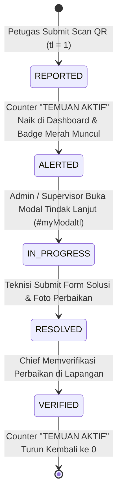

# 05 — SPESIFIKASI ALUR KERJA OPERASIONAL SATUAN PENGAMANAN (SECURITY)
> **File:** `docs/reverse-engineering/phase-1/05-security-workflow.md`  
> **Tahap:** Phase 1 — Deep Reverse Engineering  
> **Sistem Acuan:** `https://patroli.site`  
> **Divisi:** Satuan Pengamanan (Security)  

---

## 1. Arsitektur Alur Kerja Satpam (Security Workflow)

Operasional Satuan Pengamanan mencakup 3 hierarki peran komando (Anggota, Komandan Regu, dan Chief Security) yang bekerja dalam satu siklus pengamanan terintegrasi:

```mermaid
flowchart TD
    subgraph SIKLUS_PENGAMANAN_HARIAN["Siklus Harian Pengamanan (Security Cycle)"]
        S1["1. Login Akun & Validasi Peran (/login.php)"] --> S2["2. Presensi Masuk (GPS Geofence + Swafoto)"]
        S2 --> S3{"Hierarki Peran?"}

        S3 -- Anggota Satpam --> A1["Patroli Rute Checkpoint QR"]
        A1 --> A2["Pindai Stiker QR Fisik (html5-qrcode)"]
        A2 --> A3{"Kondisi Pos Inspeksi?"}
        A3 -- Aman Terkendali --> A4["Submit Status '0': Aman (Badge Hijau)"]
        A3 -- Temuan Anomali --> A5["Input Deskripsi Insiden + Foto ➔ Submit Status '1' (Badge Merah)"]
        
        S3 -- Komandan Regu (Danru) --> D1["Inspeksi Keliling Pos Jaga"]
        D1 --> D2["Form Laporan Serah Terima Piket (/insert_komandan.php)"]
        D2 --> D3["Checklist Kehadiran Regu & Catatan Khusus Shift"]

        S3 -- Chief Security --> C1["Supervisi Pos & Fasilitas"]
        C1 --> C2["Form Evaluasi Kinerja Danru (/insert_chief.php)"]
        C2 --> C3["Penilaian Disiplin, Koordinasi, & Evaluasi Insiden"]

        A4 & A5 & D3 & C3 --> S4["Monitoring Real-Time di Command Center"]
        A5 --> S5["Mitigasi Temuan di Modal Admin (#myModaltl)"]
        S4 --> S6["3. Presensi Pulang (Absen Checkout)"]
    end

    subgraph DARURAT["Penanganan Kedaruratan (Emergency SOS)"]
        SOS_Btn["Petugas Menahan Tombol SOS Selama 3 Detik"] --> SOS_Trig["POST ../insert-panic.php (GPS Live)"]
        SOS_Trig --> SOS_Alert["Modal Darurat Berkedip (#myModalpan) + Sirene di Command Center"]
        SOS_Alert --> SOS_Action["Penyelidikan Lapangan & Pemadaman Alarm (update_status_alarm.php)"]
    end
```

---

## 2. Diferensiasi Peran & Tanggung Jawab (Security Rank Breakdown)

### 2.1 Anggota Satpam (`SECURITY_OFFICER` / `anggota`)
- **Tugas Pokok:** Menjaga pos jaga fisik dan melakukan perondaan keliling sesuai jadwal checkpoint.
- **Interaksi Utama di PWA:**
  1. Melakukan `ABSEN MASUK` sebelum jam shift dimulai.
  2. Membuka menu `INPUT KEGIATAN` ➔ kamera aktif memindai QR code aset (`1052`, `1062`, `1063`, dll).
  3. Memilih hasil patroli:
     - Jika tidak ada masalah: Pilih `Situasi Aman Terkendali` (`tl = 0`), ambil foto pos, submit.
     - Jika ada masalah: Pilih `Perlu Tindak Lanjut` (`tl = 1`), ketik uraian insiden (misal *"Kaca pintu pecah / lampu padam"*), ambil foto bukti fisik, submit.
  4. Melakukan `ABSEN PULANG` saat jam dinas berakhir.

### 2.2 Komandan Regu / Danru (`SECURITY_LEADER` / `komandan`)
- **Tugas Pokok:** Memimpin apel shift, memverifikasi kelengkapan regu anggota, dan melakukan serah terima buku mutasi pos.
- **Interaksi Utama di PWA:**
  1. Melakukan presensi check-in dinas.
  2. Melakukan inspeksi pos dan memindai QR bila diperlukan.
  3. Mengisi **Form Laporan Komandan** (`12_laporan_komandan.html` ➔ `insert_komandan.php`):
     - Memilih `Shift` dinas (Pagi, Siang, Malam).
     - Menentukan status `Kehadiran Anggota`:
       - Jika `Lengkap`: Field jumlah tertutup.
       - Jika `Tidak Lengkap`: Muncul input angka `Jumlah Hadir` dan `Jumlah Izin/Cuti`.
     - Menentukan `Kesimpulan Komandan`:
       - Opsi `A`: *"Situasi aman terkendali"*.
       - Opsi `L`: *"Ada catatan"*, memunculkan textarea `Catatan Khusus` (maksimal 100 karakter).

### 2.3 Chief Security (`SECURITY_CHIEF` / `chief`)
- **Tugas Pokok:** Pengendali keamanan tingkat fasilitas/site, melakukan pembinaan dan penilaian objektif terhadap Komandan Regu.
- **Interaksi Utama di PWA:**
  1. Mengisi **Form Laporan Chief** (`13_laporan_chief.html` ➔ `insert_chief.php`):
     - Memilih nama `Komandan Regu` dari dropdown personil danru aktif di site.
     - Menilai `Disiplin Komandan`: *Baik / Cukup / Kurang*.
     - Menilai `Koordinasi & Komunikasi`: *Baik / Cukup / Kurang*.
     - Mengevaluasi `Kehadiran Regu`: Lengkap / Tidak Lengkap (dengan rincian regu hadir & izin).
     - Menentukan status `Temuan / Insiden`: *Tidak Ada / Ada* (dengan textarea rincian temuan max 100 karakter).
     - Memberikan `Catatan Singkat Chief` untuk briefing shift berikutnya.

---

## 3. Spesifikasi Siklus Hidup Insiden (Incident Lifecycle)

Insiden yang dilaporkan oleh petugas lapangan memiliki alur penyelesaian terstruktur:

1. **State `REPORTED` (Pelaporan):** Petugas memindai Pos 2 (`1062`), memilih `tl = 1`, menginput teks *"Lampu sorot pos padam dan pintu gerbang barat macet"*, dan mengunggah foto bukti.
2. **State `ALERTED` (Peringatan):** Web Admin Command Center menampilkan badge merah `🔴 PERLU TINDAK LANJUT`, memunculkan tombol `TINDAK LANJUTI TEMUAN`, dan menaikkan angka widget `TEMUAN AKTIF` dari 0 menjadi 1.
3. **State `IN_PROGRESS` (Penanganan):** Supervisor membuka modal `#myModaltl` (`tl.php`), menugaskan teknisi maintenance, dan mencatat estimasi perbaikan.
4. **State `RESOLVED` (Selesai):** Teknisi menyelesaikan perbaikan fisik pos, mengunggah foto kondisi pos yang telah diperbaiki, dan sistem menutup status insiden.

---

## 4. Spesifikasi Protokol Panic Button SOS

- **Mekanisme Pemicuan:** Tombol lingkaran merah besar (`07_panic_button.html`) mewajibkan interaksi **tahan selama 3 detik (*long press 3000ms*)**. Tindakan ini mencegah pemicuan tidak sengaja saat smartphone ditaruh di saku celana atau tas petugas.
- **Transmisi Payload:**
  - Browser membaca Geolocation API secara otomatis saat tombol ditekan.
  - Form melakukan auto-submit ke `../insert-panic.php` dengan koordinat latitude dan longitude petugas.
- **Respons Sistem Terpadu:**
  1. *Command Center Web Admin:* Memunculkan modal darurat berkedip `#myModalpan` dengan suara alarm dan marker merah darurat pada Leaflet Map.
  2. *WhatsApp Gateway (Target Monorepo In-House):* Mengirimkan pesan darurat otomatis ke grup WhatsApp manajemen korporat:
     > *"🚨 PERINGATAN DARURAT (SOS)! Petugas Agus Pratama menekan tombol darurat di AEON MALL SENTUL. Lokasi presisi: https://maps.google.com/?q=-6.566877,106.857619"*
  3. *Pemadaman Alarm:* Tombol pemadaman alarm hanya dapat ditekan oleh Administrator di Command Center setelah status darurat tertangani.
