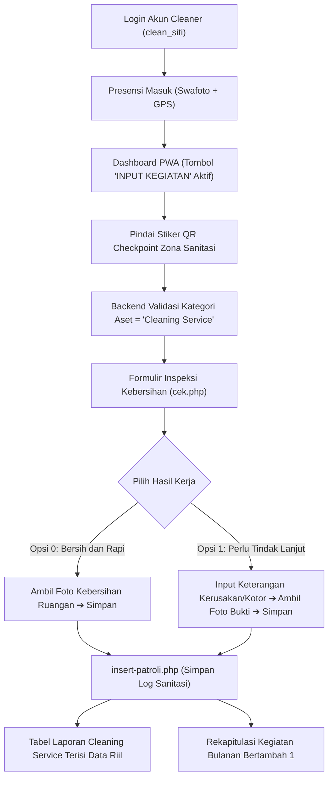

# 06 — SPESIFIKASI ALUR KERJA PETUGAS KEBERSIHAN (CLEANING SERVICE WORKFLOW)
> **File:** `docs/reverse-engineering/phase-1/06-cleaning-workflow.md`  
> **Tahap:** Phase 1 — Deep Reverse Engineering  
> **Sistem Acuan:** `https://patroli.site`  
> **Divisi:** Petugas Kebersihan & Sanitasi Fasilitas (Cleaning Service)  

---

## 1. Arsitektur Alur Kerja Sanitasi Fasilitas

Petugas kebersihan (*Cleaner*) bertanggung jawab menjaga standar higienitas dan kebersihan seluruh area fasilitas (toilet, lobby, koridor, kantin, dan ruang kerja).



---

## 2. Dekonstruksi Form Spesifik Sanitasi di `cek.php`

Pada saat QR checkpoint kategori `Cleaning Service` dipindai (contoh: `1053` Toilet Lantai 1 Timur atau `1065` Lobby Utama):
1. **Perubahan Label Dinamis:**
   - Label dropdown berubah secara otomatis dari *"PILIH HASIL PATROLI"* menjadi **`PILIH HASIL KERJA`**.
2. **Opsi Hasil Kerja:**
   - **`0` = Bersih dan Rapi (Badge Hijau):** Dipilih jika petugas telah menyelesaikan seluruh tugas pembersihan zona (menyapu, mengepel, menguras tempat sampah, sterilisasi wastafel).
   - **`1` = Perlu Tindak Lanjut (Badge Merah):** Dipilih jika petugas menemukan kerusakan fasilitas fisik yang tidak dapat diselesaikan sendiri (contoh: kran toilet patah, pipa bocor, plafon merembes air).
3. **Persyaratan Bukti Visual & Geofence:**
   - Petugas wajib mengambil foto kondisi fisik ruangan setelah dibersihkan (*clean photo verification*).
   - Koordinat GPS wajib berada di dalam radius toleransi area fasilitas.

---

## 3. Integrasi Laporan Web Admin (`xxxxx_xxxxxxxxxxxxxxxxxxxxxxxxxxx`)

Setelah data disubmit, Web Admin Command Center menampilkan log kegiatan kebersihan secara real-time:

### Format Tampilan Tabel Laporan Cleaning Service
```json
{
  "Site": "AEON MALL SENTUL",
  "Personel": "SITI AMINAH",
  "Kategori & Aset": "TOILET LANTAI 1 TIMUR - LANTAI 1 SAYAP TIMUR",
  "Deskripsi Tugas": "Membersihkan dan memastikan kebersihan toilet",
  "Status": "🟢 BERSIH DAN RAPI",
  "Waktu Transaksi": "MINGGU, 22 NOV 2026 | 19:47:00",
  "Foto Bukti": "https://patroli.site/uploads/cleaning_1053_1466.jpg",
  "Koordinat Inspeksi": "-6.566877, 106.857619 (Dalam Radius 0.00 M)"
}
```

---

## 4. Rekomendasi Penyempurnaan untuk Monorepo In-House

Pada aplikasi referensi, form hanya menyediakan satu pilihan global (*"Bersih dan Rapi"*). Untuk kebutuhan korporat enterprise modern, monorepo kita (`apps/pwa-field`) disempurnakan dengan **Sub-Checklist Sanitasi Terperinci**:
- [x] Lantai disapu dan dipel kering.
- [x] Tempat sampah dikosongkan dan kantong plastik diganti.
- [x] Sabun cuci tangan (hand soap) terisi penuh.
- [x] Tisu toilet / hand towel tersedia.
- [x] Cermin dan wastafel bersih dari bercak air.
- [x] Pengharum ruangan (air freshener) berfungsi.
