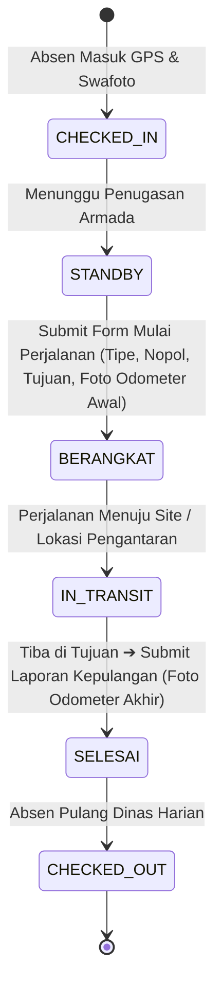

# 07 — SPESIFIKASI ALUR KERJA PENGEMUDI ARMADA LOGISTIK (DRIVER WORKFLOW)
> **File:** `docs/reverse-engineering/phase-1/07-driver-workflow.md`  
> **Tahap:** Phase 1 — Deep Reverse Engineering  
> **Sistem Acuan:** `https://patroli.site`  
> **Divisi:** Driver Armada & Logistik Korporat  

---

## 1. Arsitektur Alur Kerja Pengemudi Armada (Driver Trip Lifecycle)

Pengemudi armada logistik (*Driver*) memiliki alur operasional khusus berbasis perjalanan kendaraan antar fasilitas/site:



---

## 2. Formulir Keberangkatan Perjalanan (`10_driver_trip.html` ➔ `insert_driver.php`)

### 2.1 Pengecualian Antarmuka Driver
Petugas dengan posisi `Driver` **tidak memiliki akses ke pemindai QR checkpoint**, melainkan disajikan antarmuka khusus:
1. `ABSEN MASUK` (`xxxxx_xx.php`)
2. `MULAI PERJALANAN` (`xxxxx_xxxxxxxxxx.php`)
3. `ABSEN PULANG`

### 2.2 Dekonstruksi Elemen Form Keberangkatan
- **Endpoint POST:** `../insert_driver.php`
- **Atribut & Validasi Terobservasi:**
  1. `tipe`: Merk dan model kendaraan operasional (contoh: `Toyota Avanza Veloz`, `Daihatsu Gran Max Box`).
  2. `nopol`: Nomor registrasi kendaraan dinas (contoh: `B 1234 PAT`).
  3. `tujuan`: Alamat atau nama site tujuan (contoh: `Gudang Logistik Cakung`).
  4. `keperluan`: Deskripsi tugas operasional (contoh: `Antar dokumen kontrak & logistik sparepart`).
  5. `image`: Tangkapan foto fisik kendaraan / odometer awal via kamera.
  6. `latitude_b` & `longitude_b`: Titik koordinat GPS keberangkatan.
- **Validasi Klien (`frm.onsubmit`):**
  - Script PWA memeriksa flag `G` (GPS) dan `F` (Foto). Tombol `Simpan Perjalanan` (`#btnSimpan`) dalam status disabled sampai lokasi GPS dan foto berhasil dikonfirmasi.

---

## 3. Alur Penyelesaian Perjalanan (Trip Completion)

Saat pengemudi telah tiba kembali di fasilitas atau menyelesaikan tugas pengantaran:
1. **Formulir Selesai Perjalanan:**
   - Menampilkan ringkasan perjalanan aktif (Tipe: `Toyota Avanza Veloz`, Nopol: `B 1234 PAT`, Waktu Berangkat: `19:49:00`).
   - Input foto odometer kepulangan.
   - Pembacaan titik koordinat GPS tiba (`latitude_s`, `longitude_s`).
2. **Pembaruan Status Backend:**
   - Status record di database diperbarui dari `BERANGKAT` menjadi **`SELESAI`**.
   - Widget **`PERJALANAN SELESAI`** pada Command Center bertambah 1.

---

## 4. Tampilan Laporan Driver di Web Admin (`xxxxx_xxxxxxxxxxxxxxxxxxxxxxxxxxxx`)

Setelah transaksi keberangkatan disubmit, Command Center menampilkan data perjalanan aktif:

```json
{
  "Site Asal": "AEON MALL SENTUL",
  "Nama Driver": "JOKO WAHYUDI",
  "Armada & Nopol": "TOYOTA AVA - B 1234 PAT",
  "Waktu Keberangkatan": "BERANGKAT: MINGGU, 22 NOV 2026 - 19:49:00",
  "Tujuan & Keperluan": "GUDANG LOGISTIK CAKUNG - ANTAR DOKUMEN & LOGIS -",
  "Status": "BERANGKAT (Badge Kuning)",
  "Foto Bukti": "https://patroli.site/uploads/driver_trip_1467.jpg",
  "Aksi": "Tombol Detail (Menampilkan koordinat peta Leaflet keberangkatan)"
}
```

---

## 5. Fitur Tambahan untuk Monorepo In-House Enterprise

Pada monorepo `Patrol-Management-System`, alur Driver disempurnakan dengan fitur logistik armada modern:
- **Kalkulasi Jarak Tempuh Otomatis:** Menghitung selisih kilometer odometer awal vs akhir.
- **Log Pengisian BBM (Fuel Log):** Upload bukti struk pembelian BBM dan volume liter.
- **Surat Jalan Digital (Digital Delivery Order):** Fitur tanda tangan digital penerima barang di site tujuan.
