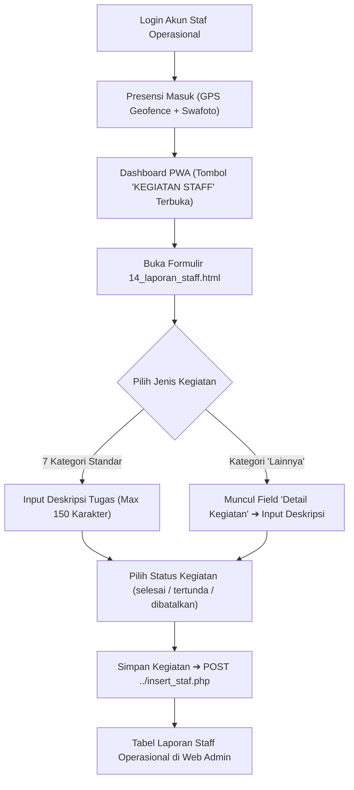

# 08 — SPESIFIKASI ALUR KERJA STAF OPERASIONAL (STAFF WORKFLOW)
> **File:** `docs/reverse-engineering/phase-1/08-staff-workflow.md`  
> **Tahap:** Phase 1 — Deep Reverse Engineering  
> **Sistem Acuan:** `https://patroli.site`  
> **Divisi:** Staf Operasional & Administrasi Fasilitas  

---

## 1. Analisis Peran Staf Operasional & Status Bukti

### 1.1 Status Keterbukaan Bukti (Evidence Classification)
- **Status pada Instance Referensi:** **`BLOCKED (QUOTA LIMITATION)`**  
  Pada perusahaan acuan (`ai`), kuota maksimal 5 akun karyawan telah dialokasikan penuh untuk Security (3), Cleaning Service (1), dan Driver (1). Penambahan akun ke-6 ditolak oleh sistem dengan peringatan `<button class="btn btn-danger" disabled="">BATAS MAKSIMAL TELAH TERCAPAI</button>`.
- **Status Bukti Kode Sumber Raw:** **`TESTED & OBSERVED (ABSOLUTE)`**  
  Meskipun akun tidak dapat didaftarkan di server produksi acuan, seluruh kode sumber formulir karyawan (`14_laporan_staff.html`) dan endpoint backend (`insert_staf.php`) berhasil diekstrak dan diobservasi secara menyeluruh.

---

## 2. Formulir Kegiatan Harian Staf (`14_laporan_staff.html` ➔ `insert_staf.php`)

Staf operasional tidak melakukan pemindaian QR pos keliling, melainkan mencatat rekapitulasi penugasan kantor harian (*office logbook*):

---

## 3. Dekonstruksi Atribut Form Kegiatan Staf

Berdasarkan inspeksi file `14_laporan_staff.html`:

| Nama Input Form | Tipe Input | Wajib | Pilihan / Format | Perilaku & Interaktivitas UI |
|:---|:---|:---:|:---|:---|
| `csrf_token` | `hidden` | Ya | Hash string | Token keamanan POST |
| `jenis_kegiatan` | `select` | Ya | `Administrasi`, `Monitoring`, `Koordinasi`, `Meeting`, `Pengecekan`, `Follow Up`, `Laporan`, `Lainnya` | Mengontrol kemunculan container `#lainnya_div` |
| `detail_lainnya` | `text` | Bersyarat | String bebas (max 100 char) | **Hanya muncul jika `jenis_kegiatan == 'Lainnya'`** |
| `deskripsi` | `textarea` | Ya | Max 150 karakter | Dilengkapi JavaScript penghitung sisa karakter (`#char_count`) |
| `status` | `select` | Ya | `selesai`, `tertunda`, `dibatalkan` | Default bernilai `selesai` |

---

## 4. Tampilan Laporan Staf di Web Admin (`xxxxx_xxxxxxxxxxxxxxxxxxxxxxxx`)

Menu **Laporan Staff Operasional** menyajikan tabel rekonsiliasi kerja harian:
- **Filter:** Rentang tanggal, Area / Site penempatan staf, dan status penyelesaian tugas.
- **Kolom Tabel:**
  1. `Site`: Fasilitas kantor penugasan staf.
  2. `Nama Personel`: Staf operasional pelapor.
  3. `Jenis Kegiatan`: Kategori penugasan (Meeting, Administrasi, dll).
  4. `Deskripsi & Capaian`: Uraian capaian kerja harian.
  5. `Status`: Badge status (`🟢 Selesai`, `🟡 Tertunda`, `🔴 Dibatalkan`).
  6. `Waktu Input`: Jam dan tanggal pelaporan logbook.
  7. `Aksi`: Tombol pratinjau detail tugas.

---

## 5. Implementasi Bebas Hambatan pada Monorepo In-House

Karena sistem yang kita bangun adalah **In-House Enterprise Single-Tenant Beli Putus**, pembatasan kuota lisensi SaaS komersial ditiadakan 100%:
- Korporasi bebas mendaftarkan puluhan hingga ratusan staf kantor/gudang tanpa batas lisensi.
- Entitas `User` monorepo lokal mendukung role `STAFF` dengan modul logbook kegiatan terintegrasi ke modul presensi.
