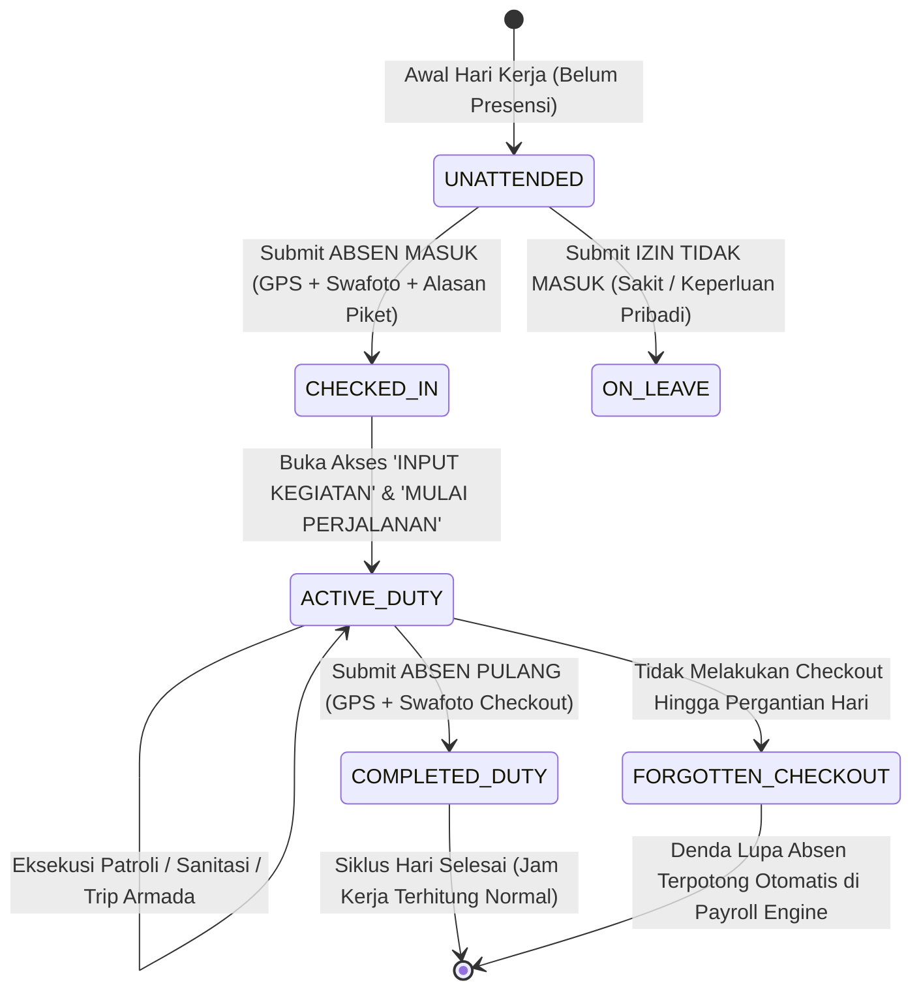

# 09 — SPESIFIKASI ALUR KERJA PRESENSI & GEOFENCE (ATTENDANCE WORKFLOW)
> **File:** `docs/reverse-engineering/phase-1/09-attendance-workflow.md`  
> **Tahap:** Phase 1 — Deep Reverse Engineering  
> **Sistem Acuan:** `https://patroli.site`  
> **Domain:** Presensi Geospasial, Swafoto, & Matriks Monitoring  

---

## 1. Arsitektur State Machine Presensi Karyawan

Alur presensi karyawan mengendalikan ketersediaan menu operasional pada PWA mobile melalui transisi state yang ketat:



---

## 2. Rincian Formulir Presensi Masuk & Pulang

### 2.1 Formulir Absen Masuk (`02_absen_masuk.html` ➔ `insert-presensi.php`)
- **Pemicu:** Tombol oranye terang **`ABSEN MASUK`** pada dashboard mobile.
- **Payload Request POST:**
  - `csrf_token`: Token validasi sesi.
  - `alasan`: Pilihan dropdown penugasan (`Piket Rutin`, `Lembur BKO`, `Tugas Khusus`).
  - `latin` & `longin`: Koordinat latitude dan longitude dari `navigator.geolocation`.
  - `image`: String data URL Base64 swafoto wajah petugas.
- **Logika Interaksi Klien:**
  - Container tombol simpan (`#simpan`) secara default tersembunyi (`display: none`).
  - Hanya setelah fungsi `preview()` webcam berhasil menangkap swafoto dan koordinat GPS terkonfirmasi, tombol `Simpan` (`#submitBtn`) ditampilkan.

### 2.2 Formulir Absen Pulang (`03_absen_pulang.html` ➔ `update-presensi.php`)
- **Pemicu:** Tombol **`ABSEN PULANG`** (muncul menggantikan tombol masuk setelah check-in berhasil).
- **Payload Request POST:**
  - `kode_absen`: ID record presensi masuk yang akan diperbarui (contoh: `2046`).
  - `lokasi_site`: Nama site penugasan.
  - `latitude_out` & `longitude_out`: Koordinat GPS saat checkout.
  - `image`: Swafoto saat meninggalkan fasilitas.
- **Pembaruan Backend:** Menghitung jam kerja efektif (selisih jam masuk dan pulang) dan menandai status checkout berhasil.

---

## 3. Logika Validasi Geofence Geospasial

Sistem referensi menghitung jarak petugas terhadap titik tengah site menggunakan formula matematis:

### 3.1 Komputasi Jarak Haversine
$$a = \sin^2\left(\frac{\Delta\phi}{2}\right) + \cos(\phi_1)\cos(\phi_2)\sin^2\left(\frac{\Delta\lambda}{2}\right)$$
$$d = 2R \cdot \text{atan2}\left(\sqrt{a}, \sqrt{1-a}\right)$$
Di mana $R = 6.371.000\text{ meter}$, $\phi$ adalah latitude, dan $\lambda$ adalah longitude.

- **Status Radius:**
  - Jika $d \le \text{Radius Site}$ (default 50 meter) ➔ **`🟢 DALAM RADIUS AREA`**.
  - Jika $d > \text{Radius Site}$ ➔ **`🔴 LUAR RADIUS AREA`**.

### 3.2 Keunggulan Monorepo Target (PostGIS Native)
Pada repositori monorepo kita (`apps/backend`), kalkulasi matematis PHP ini digantikan oleh query native geospasial PostgreSQL 17 + PostGIS 3.5 yang jauh lebih cepat dan akurat:
```sql
SELECT ST_DWithin(
  site.geofence_center, 
  ST_SetSRID(ST_MakePoint(worker_lon, worker_lat), 4326), 
  site.geofence_radius_meters
) AS is_within_geofence;
```

---

## 4. Matriks Absensi Bulanan 31 Hari (`xxxxx_xxxxxxxxxxxxxxxxxxxxxxxxxxxxxxxxxxxxxxxx`)

Halaman monitoring absensi menyajikan tabel matriks 1 s/d 31 hari per baris karyawan dalam satu bulan kalender penuh:

### 4.1 Notasi Kode Status Empiris

| Kode Notasi | Keterangan Status | Dampak terhadap Penggajian |
|:---:|:---|:---|
| `M {jam}` | Masuk kerja (Contoh: `M 07:15`) | Menghitung menit keterlambatan jika $> 07:00$ |
| `P {jam}` | Pulang kerja normal (Contoh: `P 15:02`) | Menghitung jam kerja efektif reguler (8 jam) |
| `X` | Lupa absen pulang (Check-in tanpa checkout) | **Memicu potongan Denda Lupa Absen di slip gaji** |
| `I` | Izin resmi disetujui | Potongan alpa ditiadakan (gaji pokok utuh) |
| `S` | Sakit dengan surat dokter | Potongan alpa ditiadakan |
| `A` | Alpa / Mangkir tanpa keterangan | **Memicu potongan Kehadiran (Rp 150.000/hari)** |
| `-` | Hari libur / Jadwal Off | Tidak ada potongan |

---

## 5. Modal Detail Presensi Geospasial (`#myModalab`)

Saat baris presensi diklik di Web Admin, sistem memunculkan modal `#myModalab` yang memuat:
1. **Dual Marker Leaflet Map:** Pin Biru (Pusat Site) dan Pin Hijau (Petugas).
2. **Kalkulasi Jarak Presisi:** Menampilkan jarak riil (contoh hasil audit: persis `0.00 METER`).
3. **Swafoto Resolusi Asli:** Foto portrait webcam 320x320 piksel petugas saat check-in.
4. **Tautan Navigasi Luar:** Tombol `Lihat di Google Maps` dengan koordinat presisi.
