# 10 — SPESIFIKASI PATROLI & PEMINDAIAN QR CODE (PATROL & QR SPECIFICATION)
> **File:** `docs/reverse-engineering/phase-1/10-patrol-and-qr-specification.md`  
> **Tahap:** Phase 1 — Deep Reverse Engineering  
> **Sistem Acuan:** `https://patroli.site`  
> **Domain:** Checkpoint Physical Sticking, Payload Encoding, Camera Scanner, & Asset Verification  

---

## 1. Arsitektur QR Code Checkpoint Fisik

Aplikasi referensi menggunakan arsitektur barcode dua dimensi berbasis standar QR Code ISO/IEC 18004 untuk verifikasi kehadiran fisik petugas di titik pos pengamanan atau zona sanitasi:

```mermaid
flowchart LR
    A["Web Admin (/insert-aset.php)"] -->|Generate Checkpoint| B["Database (kode_aset = 1052)"]
    B --> C["Cetak Stiker A4 (/cetak-aset.php)"]
    C -->|Cetak & Tempel Fisik| D["Stiker QR Fisik di Pintu / Pos"]
    
    D -->|Kamera Smartphone Petugas| E["Pemindai PWA (09_qr_scan.html)"]
    E -->|Decode Payload: '1052'| F["POST /cek.php (nama='1052')"]
    F -->|Cocokkan Data Aset| G["Tampilkan Form Patroli Sesuai Kategori"]
```



---

## 2. Dekonstruksi Generator Stiker QR (`cetak-aset.php`)

Halaman cetak stiker QR menghasilkan dokumen siap cetak A4 dengan tata letak grid:
- **Format Payload QR:** String numerik integer auto-increment murni (contoh: `"1052"` untuk Pos 1 Gerbang Utama, `"1053"` untuk Toilet Lantai 1, `"1062"` untuk Pos 2 Pintu Barat).
- **Dimensi Fisik Stiker:** 160 x 160 piksel pada layar (sekitar 4.2 x 4.2 cm saat dicetak).
- **Layout Cetak:** CSS Grid 4 kolom per baris format A4 Portrait siap potong dan tempel.
- **Elemen Grafis Stiker:**
  1. Header: Logo perusahaan dan teks `PATROLI KEAMANAN` atau `CHECKLIST SANITASI`.
  2. Gambar QR Code di tengah (level koreksi error ECC Level M).
  3. Footer: Nama titik pos (contoh: `POS 1 GERBANG UTAMA`) dan kode integer ID.

---

## 3. Mekanisme Pemindai Kamera PWA (`09_qr_scan.html`)

Berdasarkan inspeksi file `09_qr_scan.html`:
- **Pustaka Pemindai:** Menggunakan `html5-qrcode` versi 2.3.8 (`https://unpkg.com/html5-qrcode@2.3.8/html5-qrcode.min.js`).
- **Pilihan Sumber Video (`camera-select`):**
  - Kamera Belakang (*Environment Facing Mode* - default).
  - Kamera Depan (*User Facing Mode*).
- **Konfigurasi Scanner:**
  ```javascript
  const config = {
    fps: 10,
    qrbox: { width: 250, height: 250 },
    aspectRatio: 1.0
  };
  ```
- **Alur Callback Pemindaian Sukses (`onScanSuccess`):**
  1. Mencegah pemindaian ganda (*debounce flag* `isScanned = true`).
  2. Memasukkan teks hasil decode ke input hidden `#result`.
  3. Mematikan stream kamera (`html5QrCode.stop()`).
  4. Melakukan form auto-submit: `formScan.submit()` ke `../cek.php`.

---

## 4. Validasi Checkpoint di Sisi Server (`cek.php`)

Server PHP menerima parameter POST `nama` dan melakukan query pencocokan ke database:
1. **Kasus 1: Checkpoint Terdaftar & Sah (`kode_aset = '1052'`):**
   - Mengambil data nama aset, deskripsi tugas, dan kategori.
   - Merender form inspeksi dinamis:
     - Jika kategori `Security` ➔ label *"PILIH HASIL PATROLI"*.
     - Jika kategori `Cleaning Service` ➔ label *"PILIH HASIL KERJA"*.
2. **Kasus 2: Checkpoint Tidak Dikenal (`kode_aset = '1054'`):**
   - Menolak akses dan mengembalikan halaman error:  
     `"Kode aset tidak ditemukan. Silakan Scan QR Code."`
   - Kamera pemindai diinisialisasi ulang untuk scan berikutnya.
3. **Kasus 3: Checkpoint Luar Site Petugas:**
   - Memeriksa relasi `lokasi_area` aset terhadap penempatan tugas personil. Jika tidak cocok, sistem menolak submit hasil patroli.

---

## 5. Spesifikasi Penyelarasan untuk Monorepo Target

Untuk meningkatkan keamanan dan keandalan sistem enterprise beli putus pada `apps/pwa-field` dan `apps/backend`:
- **Peningkatan Format Payload:** Mendukung dual format:
  1. *Legacy Integer Compat:* Payload numerik pendek (misal `1052`) untuk kompatibilitas stiker fisik yang sudah dicetak.
  2. *Secure Enterprise Format:* Payload JSON terenkripsi HMAC (contoh: `{"id": "cp_1052", "site": "sentul", "hash": "a8f9..."}`) untuk mencegah pemindaian palsu via generator QR eksternal.
- **Dukungan Dual-Tag (QR + NFC):** Mempertahankan dukungan tag NFC fisik (pembacaan serial UID NFC nirkabel) yang telah dirancang pada monorepo kita untuk area dengan pencahayaan minim.
