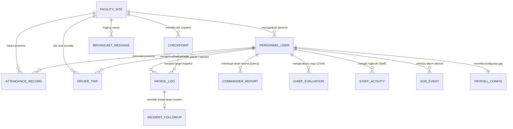

# 11 — MODEL DATA KONSEPTUAL & DIAGRAM ERD (DATA MODEL & ERD SPECIFICATION)
> **File:** `docs/reverse-engineering/phase-1/11-data-model-and-erd.md`  
> **Tahap:** Phase 1 — Deep Reverse Engineering  
> **Sistem Acuan:** `https://patroli.site`  
> **Sistem Sasaran:** `packages/types` & `apps/backend/src/database`  

---

## 1. Diagram Hubungan Entitas Konseptual (Conceptual ERD)

Berikut adalah diagram hubungan relasional lengkap dari seluruh entitas yang didekonstruksi dari aplikasi referensi dan diselaraskan ke dalam monorepo target:

---

## 2. Inventarisasi Entitas & Spesifikasi Kolom Relasional

### 2.1 Entitas `FACILITY_SITE` (Tabel Acuan: `master_area`)
- **Primary Key:** `id` (UUID / Integer serial `kode_area`).
- **Atribut Relasional:**
  - `name`: Nama fasilitas (contoh: `AEON MALL SENTUL`, `GUDANG LOGISTIK CAKUNG`).
  - `address`: Alamat fisik lengkap.
  - `geofence_center`: Geometri spasial titik koordinat (PostGIS `GEOMETRY(Point, 4326)`).
  - `latitude` & `longitude`: Koordinat numerik desimal.
  - `geofence_radius_meters`: Radius toleransi presensi (integer, default `50`).
  - `pic_name`: Nama penanggung jawab fasilitas.
  - `pic_phone`: Nomor telepon darurat target notifikasi WhatsApp.
  - `shift_configs`: Konfigurasi jam shift (Pagi, Siang, Malam, Staf, Chief).
- **Aturan Integritas:**
  - *Cascading Delete Restriction:* Penghapusan Site mewajibkan verifikasi kata sandi admin dan memvalidasi apakah masih terdapat personil aktif yang ditugaskan.

---

### 2.2 Entitas `CHECKPOINT` (Tabel Acuan: `master_aset`)
- **Primary Key:** `id` (UUID internal).
- **Atribut Relasional:**
  - `code`: String numerik integer unik stiker QR (contoh: `"1052"`, `"1053"`, `"1062"`). Indexed.
  - `name`: Label pos atau zona (contoh: `POS 1 GERBANG UTAMA`, `TOILET LANTAI 1 TIMUR`).
  - `category`: Enum `SECURITY` atau `CLEANING_SERVICE`.
  - `asset_type`: String klasifikasi fisik (Keamanan, Kebersihan, Ruang Server).
  - `site_id`: Foreign Key ke `FACILITY_SITE.id`.
  - `zone_name`: Detail posisi atau sayap lantai gedung.
  - `task_description`: Teks petunjuk inspeksi SOP harian.
  - `sequence_order`: Integer opsional untuk perondaan berurutan.

---

### 2.3 Entitas `PERSONNEL_USER` (Tabel Acuan: `master_personil` & `users`)
- **Primary Key:** `id` (UUID / Integer serial `kode_anggota`).
- **Atribut Relasional:**
  - `full_name`: Nama lengkap karyawan.
  - `username`: String alfanumerik unik untuk autentikasi login.
  - `password_hash`: Hash Bcrypt standar industri (cost factor 10+).
  - `division`: Enum `SECURITY`, `CLEANING`, `DRIVER`, `STAFF`.
  - `security_rank`: Enum `ANGGOTA`, `KOMANDAN`, `CHIEF` (Nullable untuk non-security).
  - `site_id`: Foreign Key ke `FACILITY_SITE.id` (Site tugas utama).
  - `multi_site_ids`: Array UUID fasilitas untuk rotasi tugas dinas.
  - `working_hours_per_day`: Integer jam standar (default `8` atau `10`).
  - `photo_url`: Path file avatar wajah di server storage.
  - `is_active`: Boolean status kepegawaian.

---

### 2.4 Entitas `PAYROLL_CONFIG` & `PAYROLL_RECORD` (Tabel Acuan: `gaji`)
- **Foreign Key:** `user_id` mengacu ke `PERSONNEL_USER.id` (Hubungan 1:1).
- **Komponen Pendapatan & Potongan:**
  - `base_salary`: Gaji pokok bulanan.
  - `fixed_allowance`: Tunjangan tetap jabatan/operasional.
  - `overtime_rate_per_hour`: Tarif kompensasi lembur per jam.
  - `bpjs_deduction`: Potongan premi jaminan kesehatan.
  - `alpa_deduction_per_day`: Denda pemotongan per hari mangkir (default Rp 150.000).
  - `forgot_checkout_penalty`: Denda lupa absen pulang per kejadian (default Rp 50.000).
- **Hasil Agregasi Bulanan (`PAYROLL_RECORD`):**
  - `month` & `year`: Periode kalender penggajian.
  - `total_attended_days`: Jumlah hari kerja efektif.
  - `total_overtime_hours`: Akumulasi jam lembur sah.
  - `total_forgot_checkout_count`: Jumlah kejadian check-in tanpa checkout.
  - `net_take_home_pay`: Gaji bersih yang ditransfer ke rekening karyawan.

---

### 2.5 Entitas `ATTENDANCE_RECORD` (Tabel Acuan: `presensi`)
- **Primary Key:** `id` (Integer / UUID `kode_absen`).
- **Foreign Key:** `user_id` (Personel), `site_id` (Fasilitas).
- **Atribut Relasional:**
  - `attendance_date`: Tanggal kalender presensi (`YYYY-MM-DD`).
  - `clock_in_time`: Timestamp presensi masuk.
  - `clock_out_time`: Timestamp presensi pulang (Nullable sebelum checkout).
  - `clock_in_location`: Titik spasial GPS saat masuk (PostGIS Geometry).
  - `clock_out_location`: Titik spasial GPS saat pulang.
  - `distance_in_meters`: Selisih jarak terhadap titik pusat site saat check-in.
  - `is_within_geofence`: Boolean status (`true` jika $d \le R$).
  - `selfie_clock_in_url`: Foto wajah saat masuk.
  - `selfie_clock_out_url`: Foto wajah saat pulang.
  - `status_code`: Kode matriks (`M`, `P`, `X`, `I`, `S`, `A`).
  - `reason`: Keterangan alasan penugasan (Piket Rutin / Lembur BKO).

---

### 2.6 Entitas `PATROL_LOG` (Tabel Acuan: `patroli`)
- **Primary Key:** `id` (Integer / UUID `kode_patroli`).
- **Foreign Key:** `checkpoint_id` (Titik pos), `user_id` (Petugas pelapor).
- **Atribut Relasional:**
  - `scanned_at`: Waktu presisi pemindaian stiker QR.
  - `scan_location`: Koordinat GPS saat submit.
  - `result_condition`: Enum `0` (Aman / Bersih) atau `1` (Perlu Tindak Lanjut).
  - `notes`: Deskripsi insiden / temuan anomali (wajib jika `condition = 1`).
  - `photo_url`: Bukti fisik foto titik pos / toilet.
  - `follow_up_status`: Enum `NOT_REQUIRED`, `PENDING`, `IN_PROGRESS`, `RESOLVED`.

---

### 2.7 Entitas `DRIVER_TRIP` (Tabel Acuan: `driver_trip`)
- **Primary Key:** `id` (Integer / UUID).
- **Foreign Key:** `driver_id` mengacu ke `PERSONNEL_USER.id`.
- **Atribut Relasional:**
  - `vehicle_type`: Tipe dan merk armada (contoh: `Toyota Avanza Veloz`).
  - `license_plate`: Nomor polisi armada (contoh: `B 1234 PAT`).
  - `destination`: Alamat atau site tujuan.
  - `purpose`: Keperluan dinas pengantaran barang/dokumen.
  - `departure_time`: Waktu keberangkatan.
  - `arrival_time`: Waktu penyelesaian perjalanan.
  - `departure_photo_url`: Foto fisik armada / odometer awal.
  - `arrival_photo_url`: Foto fisik armada / odometer akhir.
  - `trip_status`: Enum `BERANGKAT`, `SELESAI`, `DIBATALKAN`.

---

## 3. Klasifikasi Kepastian Hubungan Relasional

1. **Observed Relationships (Terbukti 100% via Query & Submit):**
   - `FACILITY_SITE 1:N CHECKPOINT` (Aset selalu terikat ke satu site).
   - `FACILITY_SITE 1:N PERSONNEL_USER` (Personil terdaftar di site tertentu).
   - `PERSONNEL_USER 1:N ATTENDANCE_RECORD` (Riwayat presensi terikat ke personil).
   - `CHECKPOINT 1:N PATROL_LOG` (Log patroli mencatat checkpoint ID yang sah).
   - `PERSONNEL_USER 1:1 PAYROLL_CONFIG` (Setiap personil membawa konfigurasi gapok).

2. **Inferred Relationships (Disimpulkan dari DOM & Logika Backend):**
   - `PATROL_LOG 1:1 INCIDENT_FOLLOWUP` (Modal `#myModaltl` mengikat ke baris patroli insiden).
   - `PERSONNEL_USER 1:N DRIVER_TRIP` (Driver hanya mencatat perjalanan atas namanya sendiri).

3. **Unverified Relationships (Hipotesis Belum Tervalidasi di DB Engine Referensi):**
   - Hubungan otomatis antara shift yang dikonfigurasi di Area dengan validasi batas keterlambatan harian karyawan (memerlukan pengujian Phase 2).
