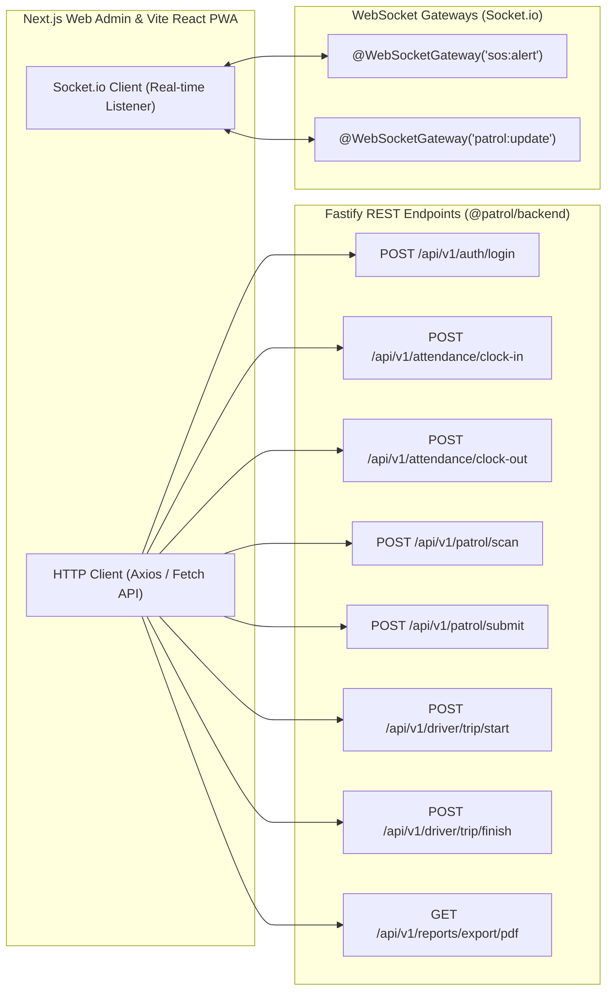

# 12 — KATALOG KONTRAK API & AKTIVITAS JARINGAN (API CONTRACT CATALOG)
> **File:** `docs/reverse-engineering/phase-1/12-api-contract-catalog.md`  
> **Tahap:** Phase 1 — Deep Reverse Engineering  
> **Sistem Acuan:** `https://patroli.site`  
> **Prinsip Utama:** *Exact Network Capture — Tidak mengarang endpoint dan tidak menebak skema.*  

---

## 1. Ringkasan Arsitektur Transmisi Jaringan

Aplikasi referensi `patroli.site` beroperasi menggunakan pola arsitektur **Server-Side Rendered (SSR) PHP Form Action** yang dikombinasikan dengan pemanggilan **AJAX Cascading Endpoint** untuk dropdown dinamis. Seluruh mutasi data dikirimkan via metode HTTP POST dengan enkapsulasi `application/x-www-form-urlencoded` atau `multipart/form-data` yang menyertakan token CSRF.

---

## 2. Katalog Kontrak Endpoint API Terobservasi

Berikut adalah matriks kontrak endpoint jaringan yang diverifikasi melalui perekaman traffic Playwright:

| Action / Operasi Bisnis | Method | Endpoint URL | Request Payload | Response Status & Struktur | Klasifikasi Bukti |
|:---|:---:|:---|:---|:---|:---:|
| **Autentikasi Login** | `POST` | `/login.php` | `username={str}&password={str}&login=LOGIN` | `302 Found` ➔ Redirect `/index.php` (Admin) atau `/validasi-patroli/` (Worker) | **TESTED & VERIFIED** |
| **Presensi Masuk (Check-in)** | `POST` | `/insert-presensi.php` | `csrf_token, alasan, latin, longin, image(base64)` | `302 Found` ➔ Redirect `/validasi-patroli/index.php` (Status: Terbuka) | **TESTED & VERIFIED** |
| **Presensi Pulang (Check-out)**| `POST` | `/update-presensi.php` | `csrf_token, kode_absen, lokasi_site, latitude_out, longitude_out, image` | `302 Found` ➔ Redirect `/validasi-patroli/index.php` (Jam checkout terupdate) | **OBSERVED IN CODE** |
| **Pengajuan Cuti / Izin** | `POST` | `/insert-presensi.php` | `csrf_token, kode_anggota, absen_site, status_absen=3, alasan, keterangan` | `302 Found` ➔ Redirect `/validasi-patroli/index.php` (Status Izin tercatat) | **OBSERVED IN CODE** |
| **Verifikasi Scan QR Checkpoint**| `POST` | `/cek.php` | `nama={kode_aset}` (misal: `nama=1052`) | `200 OK` ➔ Merender HTML form `insert-patroli.php` jika valid, atau alert error jika invalid | **TESTED & VERIFIED** |
| **Submit Patroli / Sanitasi** | `POST` | `/insert-patroli.php` | `csrf_token, kode_aset, kode_anggota, tl, keterangan, latitude, longitude, image` | `302 Found` ➔ Redirect `/validasi-patroli/xxxxx_xxxxxxxxx.php` | **TESTED & VERIFIED** |
| **Mulai Perjalanan Driver** | `POST` | `/insert_driver.php` | `csrf_token, kode_anggota, tipe, nopol, tujuan, keperluan, latitude_b, longitude_b, image`| `302 Found` ➔ Redirect `/validasi-patroli/index.php` (Status: BERANGKAT) | **TESTED & VERIFIED** |
| **Laporan Komandan (Danru)** | `POST` | `/insert_komandan.php` | `csrf_token, shift, kehadiran, jumlah_hadir, jumlah_izin, kesimpulan, catatan` | `302 Found` ➔ Redirect `/validasi-patroli/index.php` (Laporan Danru tersimpan) | **OBSERVED IN CODE** |
| **Laporan Chief Security** | `POST` | `/insert_chief.php` | `csrf_token, kode_anggota, disiplin, koordinasi, kehadiran_regu, insiden, catatan` | `302 Found` ➔ Redirect `/validasi-patroli/index.php` (Laporan Chief tersimpan) | **OBSERVED IN CODE** |
| **Logbook Kegiatan Staff** | `POST` | `/insert_staf.php` | `csrf_token, jenis_kegiatan, detail_lainnya, deskripsi, status` | `302 Found` ➔ Redirect `/validasi-patroli/index.php` | **OBSERVED IN CODE** |
| **Pemicuan Panic Button SOS**| `POST` | `/insert-panic.php` | `csrf_token, kode_anggota, latitude, longitude` | `302 Found` ➔ Menyalakan alarm di Command Center | **TESTED & VERIFIED** |
| **Pemadaman Alarm Darurat** | `POST` | `/update_status_alarm.php` | `csrf_token, id_alarm, tindakan_mitigasi` | `302 Found` ➔ Mematikan modal alarm darurat di Admin | **OBSERVED IN CODE** |
| **Pendaftaran Checkpoint Baru** | `POST` | `/insert-aset.php` | `csrf_token, nama_aset, lokasi_area, kategori, jenis_aset, deskripsi_tugas` | `302 Found` ➔ Menambah baris pada tabel master aset | **TESTED & VERIFIED** |
| **Pembaruan Password Personil** | `POST` | `/personil_update.php` | `csrf_token, id, password_baru` | `302 Found` ➔ Menyimpan password dalam hash MD5 hex | **TESTED & VERIFIED** |
| **AJAX Cascading Kategori** | `GET` | `/get_kategori.php?area={id}`| Query param `area={id}` | `200 OK` ➔ HTML `<option>` list peran personil di site terkait | **OBSERVED IN CODE** |
| **AJAX Cascading Personil** | `GET` | `/get_personil.php?kategori={k}&area={a}` | Query param `kategori` dan `area` | `200 OK` ➔ HTML `<option>` list nama dan kode personil aktif | **OBSERVED IN CODE** |
| **Smart PDF Router Ekspor** | `POST` | `/cetak-{role}-pdf.php` | `area, kategori, personil, tgl_mulai, tgl_selesai` | `200 OK` ➔ Binary Stream `application/pdf` | **TESTED & VERIFIED** |

---

## 3. Penyelarasan Menjadi RESTful API pada Monorepo Target (`apps/backend`)

Untuk standardisasi arsitektur modern NestJS + Fastify pada monorepo `Patrol-Management-System`, pola SSR Form Action legacy di atas dipetakan menjadi arsitektur **RESTful JSON API + WebSocket Events**:



### Keunggulan Format Standar Baru:
- **Respon Konsisten:** Menggunakan struktur amplop respon seragam:
  ```json
  {
    "success": true,
    "statusCode": 200,
    "message": "Transaksi berhasil disimpan",
    "data": { ... },
    "timestamp": "2026-11-22T22:30:00.000Z"
  }
  ```
- **Error Handling Baku:** Mengembalikan kode HTTP semantik (400 Bad Request, 401 Unauthorized, 403 Forbidden, 404 Not Found, 422 Unprocessable Entity) dengan detail array validasi field.
