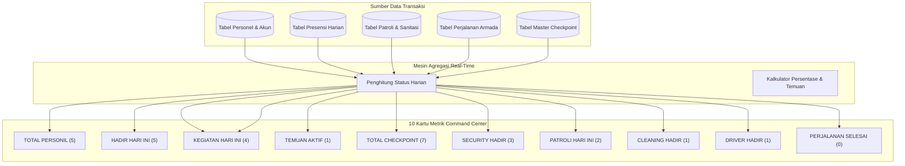

# 14 — SPESIFIKASI DASHBOARD COMMAND CENTER & SISTEM PELAPORAN
> **File:** `docs/reverse-engineering/phase-1/14-dashboard-and-reporting.md`  
> **Tahap:** Phase 1 — Deep Reverse Engineering  
> **Sistem Acuan:** `https://patroli.site`  
> **Sistem Sasaran:** `apps/web-admin/src/app/(dashboard)` & `apps/web-admin/src/app/laporan`  

---

## 1. Arsitektur Dashboard Command Center (`index.php`)

Dashboard Command Center berfungsi sebagai pusat pemantauan situasional real-time operasional korporat. Antarmuka menyajikan 10 widget metrik kartu, grafik batang tren kehadiran mingguan, dan tabel log insiden aktif:

---

## 2. Rincian 10 Widget Metrik Command Center

Berikut adalah spesifikasi mendalam formula dan sumber data setiap widget metrik:

| Widget ID | Nama Widget | Nilai Uji Terverifikasi | Formula Matematis / Query SQL | Jendela Waktu (Window) | Dampak Operasional |
|:---:|:---|:---:|:---|:---:|:---|
| **W-01** | `TOTAL PERSONIL` | `5` | `SELECT COUNT(*) FROM users WHERE is_active = true` | All-Time (Master) | Memantau kapasitas tenaga kerja korporat |
| **W-02** | `HADIR HARI INI` | `5` | `SELECT COUNT(DISTINCT user_id) FROM presensi WHERE tgl = CURRENT_DATE` | Harian (00:00 - 23:59) | Rasio kehadiran total (100% pada pengujian) |
| **W-03** | `KEGIATAN HARI INI` | `4` | `Total Patroli Hari Ini + Sanitasi Hari Ini + Trip Driver Hari Ini` | Harian | Mengukur produktivitas fisik lapangan |
| **W-04** | `TEMUAN AKTIF` | `1` | `SELECT COUNT(*) FROM patroli WHERE tl = '1' AND status_selesai = false` | Akumulasi Insiden Terbuka | Peringatan bahaya fasilitas yang butuh perbaikan |
| **W-05** | `TOTAL CHECKPOINT`| `7` | `SELECT COUNT(*) FROM master_aset` | All-Time (Master) | Jumlah titik pos fisik yang wajib diinspeksi |
| **W-06** | `SECURITY HADIR` | `3` | `SELECT COUNT(*) FROM presensi p JOIN users u ON p.user_id = u.id WHERE u.posisi = 'Security' AND p.tgl = CURRENT_DATE` | Harian | Kesiapan personel pengamanan fasilitas |
| **W-07** | `PATROLI HARI INI` | `2` | `SELECT COUNT(*) FROM patroli WHERE tgl = CURRENT_DATE AND kategori = 'Security'` | Harian | Jumlah perondaan pos yang telah dilaksanakan |
| **W-08** | `CLEANING HADIR` | `1` | `SELECT COUNT(*) FROM presensi p JOIN users u ON p.user_id = u.id WHERE u.posisi = 'Cleaning Service' AND p.tgl = CURRENT_DATE` | Harian | Kesiapan personel sanitasi dan kebersihan |
| **W-09** | `DRIVER HADIR` | `1` | `SELECT COUNT(*) FROM presensi p JOIN users u ON p.user_id = u.id WHERE u.posisi = 'Driver' AND p.tgl = CURRENT_DATE` | Harian | Kesiapan pengemudi armada logistik |
| **W-10** | `PERJALANAN SELESAI`| `0` | `SELECT COUNT(*) FROM driver_trip WHERE status = 'SELESAI' AND tgl = CURRENT_DATE` | Harian | Jumlah penugasan pengantaran armada yang tuntas |

---

## 3. Spesifikasi 7 Kategori Laporan Operasional

Web Admin menyediakan 7 modul pelaporan terpisah untuk audit kepatuhan dan evaluasi manajemen:

### 3.1 Laporan Security Anggota (`xxxx_xxxxxxxxxxx`)
- **Fokus:** Seluruh riwayat pemindaian pos perondaan oleh petugas keamanan regu.
- **Kolom Kunci:** Site, Petugas, Status Patroli (`🟢 Situasi Aman Terkendali` / `🔴 Perlu Tindak Lanjut`), Waktu Scan, Foto Pos, Tombol Detail & Tindak Lanjut.
- **Filter:** Rentang Tanggal, Area Fasilitas, Petugas Spesifik, Status Normal vs Temuan.

### 3.2 Laporan Komandan Regu (`xxxxx_xxxxxxxxxxxxxxxxxxxxxxxxxxxxxxxxxxxxxxxxx`)
- **Fokus:** Berita acara serah terima buku mutasi pos jaga antar shift (Pagi, Siang, Malam).
- **Kolom Kunci:** Shift, Status Kehadiran Regu (Lengkap / Tidak Lengkap), Jumlah Anggota Hadir & Izin, Kesimpulan Danru (Aman / Ada Catatan Khusus).

### 3.3 Laporan Chief Security (`xxxxx_xxxxxxxxxxxxxxxxxxxxxxxxxxxxxxxxxxxxxxxxxx`)
- **Fokus:** Penilaian berkala Chief terhadap profesionalisme dan koordinasi Komandan Regu.
- **Kolom Kunci:** Nama Danru yang Dinilai, Skor Disiplin, Skor Koordinasi, Evaluasi Insiden Regu, Rekomendasi Manajerial.

### 3.4 Laporan Cleaning Service (`xxxxx_xxxxxxxxxxxxxxxxxxxxxxxxxxx`)
- **Fokus:** Verifikasi sanitasi zona toilet, lobby, dan area publik.
- **Kolom Kunci:** Site, Petugas Sanitasi, Titik Aset (Toilet Lt 1), Hasil Kerja (`🟢 Bersih dan Rapi`), Waktu Pembersihan, Foto Bukti.

### 3.5 Laporan Driver Logistik (`xxxxx_xxxxxxxxxxxxxxxxxxxxxxxxxxxx`)
- **Fokus:** Buku log pergerakan armada kendaraan dinas korporat.
- **Kolom Kunci:** Site Asal, Pengemudi, Tipe Kendaraan, Nomor Polisi, Waktu Berangkat, Tujuan, Keperluan, Status (`BERANGKAT` / `SELESAI`).

### 3.6 Laporan Tracking Patroli Timeline (`xxxxx_xxxxxxxxxxxx`)
- **Fokus:** Pemetaan urutan inspeksi pos patroli secara visual.
- **Tampilan Khusus:** CSS Timeline vertikal bolak-balik yang memperlihatkan kronologi pergerakan petugas dari Pos 1 ke Pos 2 beserta selisih waktu menit antar pos.

### 3.7 Rekapitulasi & Monitoring Kegiatan (`xxxxx_xxxxxxxxxxxxxxxxxxxxxxxxxxxxxxxxxxxxxx`)
- **Fokus:** Agregasi kuantitas produktivitas kerja per karyawan per bulan.
- **Fitur Ekspor Khusus:** Tombol `📊 Cetak Excel` client-side JS Blob yang menghasilkan file spreadsheet tanpa me-reload halaman.

---

## 4. Spesifikasi 4 Wizard Ekspor Laporan Formal (`xxxxx_xxxxxxxxxxxx`)

Modul ekspor laporan formal menggunakan wizard interaktif dengan AJAX cascading dropdown:
1. **Pilih Fasilitas / Area:** Memicu pemanggilan AJAX `get_kategori.php?area={id}`.
2. **Pilih Kategori Peran:** Memicu AJAX `get_personil.php?kategori={kat}&area={id}`.
3. **Pilih Personil & Rentang Tanggal:** Menentukan subjek laporan.
4. **Router PDF Otomatis:**
   - Komandan ➔ diarahkan ke generator PDF `cetak-komandan-pdf.php`.
   - Chief ➔ diarahkan ke `cetak-chief-pdf.php`.
   - Anggota ➔ diarahkan ke `cetak-anggota-pdf.php`.
   - Cleaning Service ➔ diarahkan ke `cetak-cleaning-pdf.php`.
   - Driver ➔ diarahkan ke `cetak-driver-pdf.php`.
   - Staf ➔ diarahkan ke `cetak-staf-pdf.php`.
