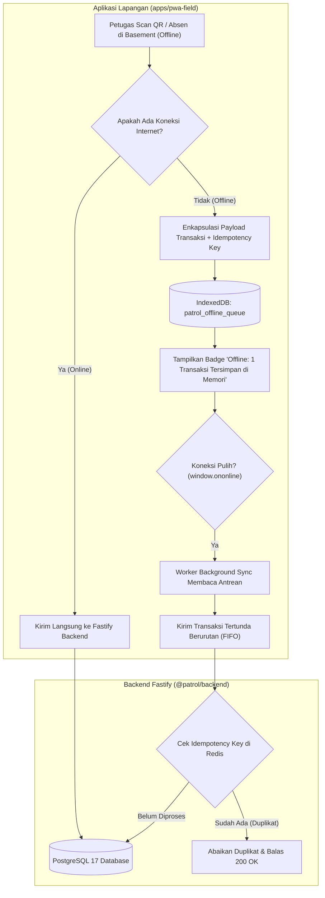

# 15 — ANALISIS KAPABILITAS OFFLINE & SINKRONISASI DATA (OFFLINE & SYNC ANALYSIS)
> **File:** `docs/reverse-engineering/phase-1/15-offline-and-sync-analysis.md`  
> **Tahap:** Phase 1 — Deep Reverse Engineering  
> **Sistem Acuan:** `https://patroli.site`  
> **Sistem Sasaran:** `apps/pwa-field` (Workbox PWA + IndexedDB Queue)  

---

## 1. Audit Empiris Kapabilitas Offline Aplikasi Referensi (`patroli.site`)

Berdasarkan pengujian simulasi jaringan terputus (*network disconnection test*) dan dekonstruksi file `service-worker.js` acuan:

### 1.1 Kode Sumber Asli `service-worker.js` Referensi
```javascript
// sw.js — Versi minimal, untuk aktivasi PWA saja.
// Tidak ada cache besar karena aplikasi bekerja online.

self.addEventListener("install", (event) => {
  self.skipWaiting();
});

self.addEventListener("activate", (event) => {
  clients.claim();
});

// Tidak meng-cache resource apa pun
// Semua request akan tetap menggunakan jaringan (online first)
self.addEventListener("fetch", (event) => {
  // Tidak mengubah request apa pun
});
```

### 1.2 Temuan & Fakta Kegagalan Offline pada Referensi
1. **Kegagalan Membuka Halaman (Page Load Failure):** Jika petugas berada di area basement gedung yang tidak memiliki sinyal seluler dan me-refresh halaman, browser menampilkan layar error Chrome default `ERR_INTERNET_DISCONNECTED`.
2. **Kegagalan Form Submit (Data Loss):** Jika petugas menekan tombol `Simpan` hasil scan QR saat sinyal terputus, request HTTP POST langsung gagal, halaman menjadi blank/error, dan data inspeksi petugas **hilang seketika**.
3. **Ketiadaan Antrean Transaksi (Zero Queue):** Referensi tidak memiliki antrean penyimpanan lokal (IndexedDB atau LocalStorage) untuk menyimpan transaksi sementara.
4. **Ketiadaan Background Sync:** Tidak ada mekanisme deteksi otomatis untuk mengirim ulang transaksi saat koneksi internet pulih.

---

## 2. Prinsip Rekayasa Monorepo Sasaran: Offline-First PWA

Sesuai aturan `AGENTS.md`, kelemahan fatal sistem referensi **DILARANG DITIRU**. Monorepo `apps/pwa-field` wajib mengimplementasikan arsitektur **Offline-First PWA** penuh:



---

## 3. Spesifikasi Arsitektur Sinkronisasi Mandiri

### 3.1 PWA Shell Pre-caching (Workbox)
- **Modul:** `apps/pwa-field/vite.config.ts` via `vite-plugin-pwa`.
- **Aset yang Di-cache:** Bundle JavaScript, CSS, file index HTML, logo, font, dan template SVG.
- **Hasil:** Aplikasi dapat dibuka kapan saja di area tanpa sinyal tanpa menampilkan layar error browser.

### 3.2 Skema Antrean Mutasi IndexedDB (`patrol_offline_queue`)
Setiap kali petugas melakukan aksi saat offline, record mutasi disimpan dalam format:
```typescript
interface OfflineMutation {
  id: string; // UUID v4 (Idempotency Key)
  endpoint: string; // e.g. "/api/v1/patrol/submit"
  method: "POST" | "PUT";
  payload: {
    checkpointId: string;
    condition: "0" | "1";
    notes?: string;
    photoBase64: string;
    coordinates: { lat: number; lng: number };
    clientTimestamp: string; // ISO 8601 saat fisik scan dilakukan
  };
  retryCount: number;
  status: "PENDING" | "SYNCING" | "FAILED";
  createdAt: number;
}
```

### 3.3 Protokol Resolusi Konflik Waktu (Timestamp Conflict Resolution)
- **Masalah:** Petugas melakukan patroli di basement jam `14:15` (offline), namun sinyal baru pulih dan data terkirim jam `16:30`.
- **Aturan Keputusan Korporat:**
  1. **`scanned_at` (Waktu Patroli Resmi):** Menggunakan `clientTimestamp` yang dicatat oleh perangkat petugas pada saat tombol simpan ditekan secara fisik. Ini memastikan petugas tidak dianggap terlambat atau mangkir oleh jadwal patroli.
  2. **`synced_at` (Waktu Terima Server):** Server mencatat waktu tiba sinkronisasi (`CURRENT_TIMESTAMP`) untuk keperluan audit kepatuhan IT.
  3. **Pencegahan Fraud Waktu:** Aplikasi PWA membaca jam perangkat dan mencocokkannya dengan *monotonic clock* internal browser (`performance.now()`) untuk mendeteksi apakah petugas sengaja memundurkan jam smartphone mereka saat offline.

### 3.4 Pencegahan Transaksi Ganda (Duplicate & Replay Attack Prevention)
- Setiap transaksi offline menyertakan atribut unik `id` (Idempotency Key).
- Backend NestJS menyimpan key tersebut di Redis dengan TTL 24 jam.
- Jika request dikirim ulang lebih dari sekali akibat gangguan jaringan, backend hanya mengeksekusi request pertama dan langsung mengembalikan status sukses untuk request berikutnya tanpa menduplikasi data di PostgreSQL.
