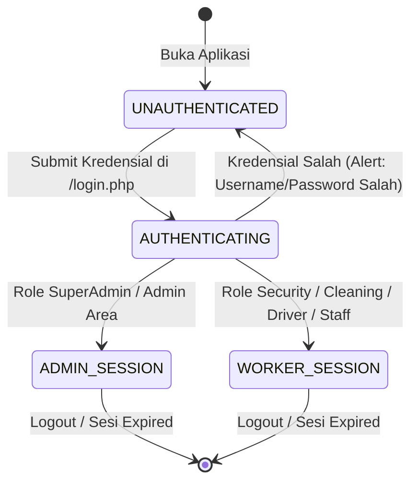
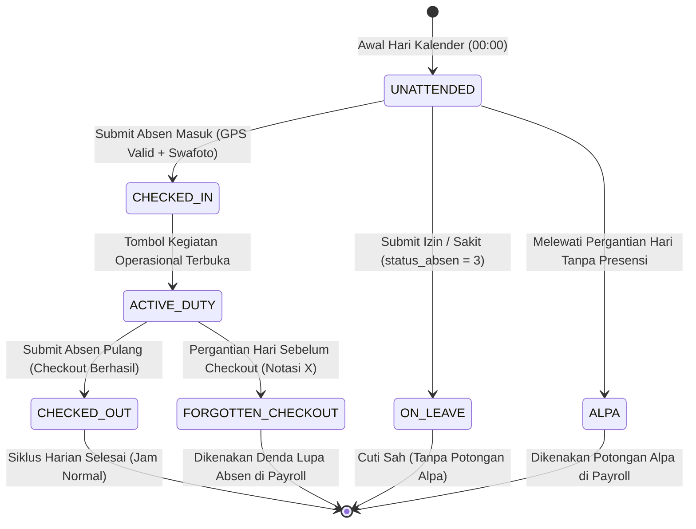
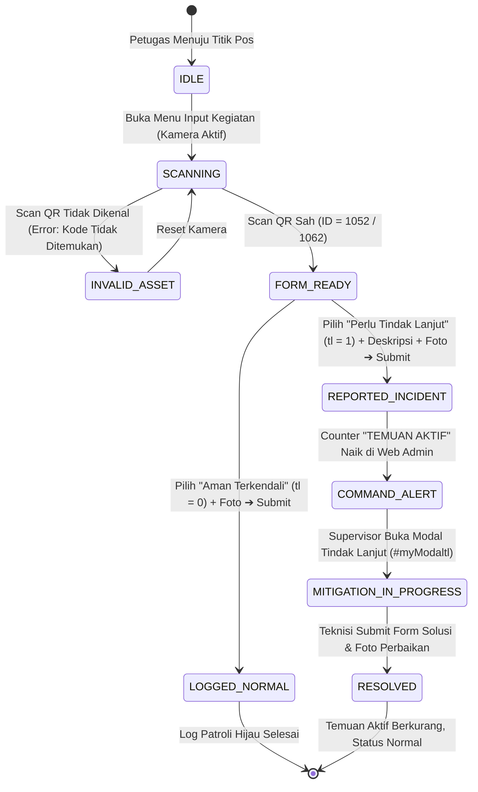
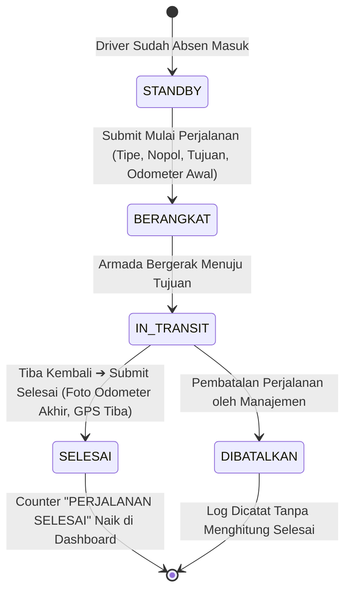
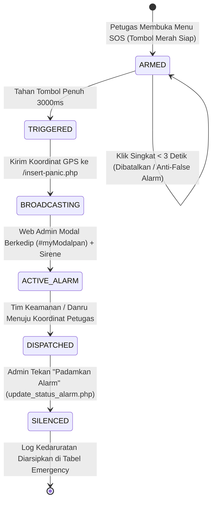
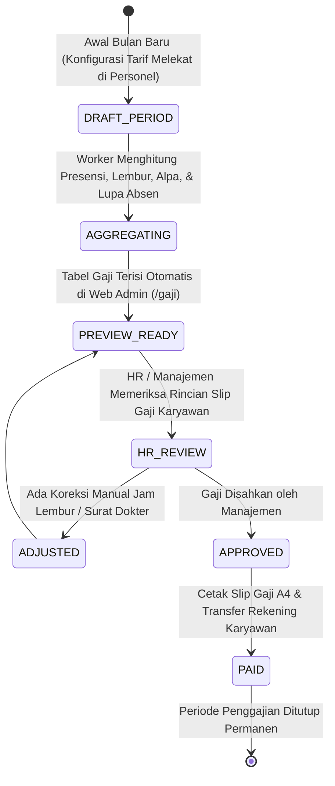

# 16 — DIAGRAM TRANSISI STATE TRANSAKSI OPERASIONAL (STATE TRANSITION DIAGRAMS)
> **File:** `docs/reverse-engineering/phase-1/16-state-transition-diagrams.md`  
> **Tahap:** Phase 1 — Deep Reverse Engineering  
> **Sistem Acuan:** `https://patroli.site`  
> **Prinsip Utama:** *Formal State Machines — Mendefinisikan status transisi siklus hidup data.*  

---

## 1. State Machine Autentikasi & Sesi Karyawan

---

## 2. State Machine Siklus Presensi Harian (Attendance Lifecycle)

---

## 3. State Machine Patroli & Eskalasi Insiden (Patrol & Incident Lifecycle)

---

## 4. State Machine Perjalanan Armada Driver (Driver Trip Lifecycle)

---

## 5. State Machine Kedaruratan Panic Button SOS (SOS Event Lifecycle)

---

## 6. State Machine Siklus Penggajian Bulanan (Payroll Lifecycle)

