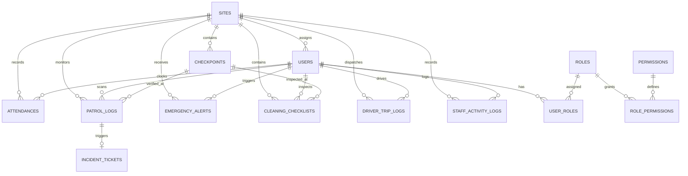

# PHASE 3 — FINAL PRODUCT REQUIREMENTS DOCUMENT & SYSTEM BLUEPRINT
> **Patrol & Facility Management System (Enterprise In-House Single-Tenant Beli Putus)**  
> **Status:** APPROVED & ARCHITECTED  
> **Target Release:** Production v1.0.0  
> **Repository:** Monorepo (`packages/types`, `apps/backend`, `apps/pwa-field`, `apps/web-admin`)

---

## 1. Product Overview & Corporate Scope

Sistem ini adalah platform manajemen operasional terpadu yang dirancang eksklusif untuk **satu perusahaan korporat (Single-Tenant In-House Enterprise)** yang membeli sistem secara **Putus**.

### Prinsip Inti Arsitektur
1. **Zero Multi-Tenancy SaaS Overhead:**
   - Tidak ada kolom `tenant_id`, tidak ada pembagian database dinamis antar perusahaan.
   - Hirarki murni korporasi: **Kantor Pusat ➔ Cabang/Fasilitas (Sites) ➔ Divisi ➔ Pos/Checkpoints**.
2. **4 Divisi Operasional Terpadu:**
   - **Security (Keamanan):** Anggota Satpam (Patroli checkpoint QR, geofencing, laporan insiden, Panic SOS), Komandan Regu (Serah terima shift / mutasi log), dan Chief Security (Supervisi mutu dan evaluasi kinerja).
   - **Cleaning Service (Kebersihan):** Checklist sanitasi 6 sub-tugas per zona lantai/toilet, verifikasi foto kebersihan, dan laporan tindak lanjut kotor/rusak.
   - **Driver Logistik:** Siklus armada dua arah (Catat keberangkatan dengan odometer awal ➔ Selesaikan perjalanan dengan odometer akhir dan kalkulasi jarak KM).
   - **Staff Operasional:** Logbook kegiatan harian non-lapangan (Administrasi, Meeting, Dokumentasi, Penginputan Data, Koordinasi Lapangan, Pemeliharaan Aset, Pelatihan, Lain-lain).
3. **Modul Penggajian & HRIS Terpadu:**
   - Perhitungan gaji pokok, tunjangan kehadiran, uang lembur, potongan keterlambatan (setelah toleransi 15 menit), potongan BPJS, dan potongan lupa absen.
   - Rekapitulasi presensi bulanan 31 hari (Matriks M, P, P+, X, I, -) dan cetak slip gaji format resmi A4.
4. **Panic Button SOS Terintegrasi:**
   - Tahan 3 detik pada PWA Field memicu WebSocket push ke Web Admin Command Center (< 2 detik) dan mengirim pesan darurat WhatsApp otomatis via Fonnte/Wablas ke grup supervisor dengan link Google Maps presisi.
5. **Kebijakan Retensi Media 180 Hari:**
   - Foto swafoto presensi, bukti kebersihan, dan foto speedometer kendaraan disimpan selama 180 hari sebelum di-purge otomatis oleh background cron job.

---

## 2. Functional Requirements by Module

### 2.1 Master Data & Hierarchy Management
- **FR-MD-01 (Site & Geofence):** Admin dapat membuat, mengedit, dan menonaktifkan Site/Area dengan koordinat GPS presisi dan radius geofence (default 100 meter).
- **FR-MD-02 (Shift Scheduling per Site):** Setiap Site memiliki jadwal shift pagi, siang, malam, staf, dan chief dengan toleransi keterlambatan 15 menit.
- **FR-MD-03 (Checkpoint Management):** Admin dapat membuat titik pantau ber-QR token unik dengan kategori Security atau Cleaning Service, deskripsi aset, dan urutan sekuensial (sequence order).
- **FR-MD-04 (QR Generation & Batch Print):** Sistem dapat menghasilkan QR code presisi dan mencetak batch ID card atau label checkpoint ke format cetak.
- **FR-MD-05 (Personil & User Approval):** Pendaftaran personil baru masuk ke antrean persetujuan Superadmin/Manager (`is_approved = FALSE`), dapat disetujui atau ditolak dengan alasan penolakan.

### 2.2 Attendance & Shift Engine (HRIS)
- **FR-AT-01 (Clock-In with Selfie & Geofence):** Karyawan melakukan absensi masuk dengan foto swafoto dan validasi radius PostGIS terhadap site penugasan.
- **FR-AT-02 (Late Minutes Calculation):** Keterlambatan dihitung otomatis jika jam check-in melewati jam shift masuk ditambah 15 menit toleransi.
- **FR-AT-03 (Clock-Out & Cross-Midnight):** Check-out menghitung total menit kerja efektif. Untuk shift malam (misal 23:00 - 07:00), sistem mendeteksi transisi lintas hari (status matriks `P+`).
- **FR-AT-04 (Overtime Engine):** Kelebihan jam kerja di atas 8 jam kerja standar secara otomatis dihitung sebagai jam lembur (overtime).
- **FR-AT-05 (Leave & Permission Request):** Karyawan dapat mengajukan izin/sakit dengan lampiran surat keterangan dokter atau dokumen pendukung.

### 2.3 Security Patrol & Emergency SOS
- **FR-SC-01 (QR Checkpoint Scanning):** Petugas satpam memindai QR code pos checkpoint; sistem memverifikasi geofence PostGIS secara real-time.
- **FR-SC-02 (Incident Reporting & Auto-Ticketing):** Jika satpam memilih "Perlu Tindak Lanjut", tiket insiden otomatis dibuat di `incident_tickets` dan dibroadcast ke Command Center.
- **FR-SC-03 (Incident Resolution / Tindak Lanjut):** Supervisor/Admin dapat menyelesaikan tiket insiden via modal tindak lanjut dengan catatan mitigasi.
- **FR-SC-04 (Panic Button SOS):** Menekan tombol SOS selama 3 detik memicu alarm visual & audio di Command Center Web Admin serta mengirim pesan WhatsApp darurat.
- **FR-SC-05 (Danru Handover):** Komandan regu mencatat buku mutasi serah terima shift, jumlah personil hadir, inventaris inventaris senjata/perlengkapan.
- **FR-SC-06 (Chief Evaluation):** Chief security melakukan supervisi dan memberikan skor disiplin, koordinasi, dan kehadiran komandan.

### 2.4 Cleaning Service Sanitation
- **FR-CL-01 (Sanitation Checklist):** Petugas kebersihan memindai QR zona atau memilih area sanitasi dan mengisi 6 sub-checklist:
  1. Lantai bersih dan dipel
  2. Tempat sampah dikosongkan & diganti plastik baru
  3. Sabun cuci tangan / sanitizer terisi
  4. Cermin & wastafel bersih tanpa noda
  5. Ketersediaan tisu / hand dryer berfungsi
  6. Pengharum ruangan beraroma segar
- **FR-CL-02 (Photo Proof):** Petugas wajib menyertakan foto hasil pekerjaan sanitasi.
- **FR-CL-03 (Tindak Lanjut Kebersihan):** Temuan kotor atau kerusakan fasilitas dapat ditandai untuk ditindaklanjuti.

### 2.5 Driver Logistics & Fleet Journey
- **FR-DR-01 (Trip Start):** Driver mencatat keberangkatan armada (nomor polisi, jenis kendaraan, lokasi tujuan, keperluan muatan, foto speedometer awal, GPS).
- **FR-DR-02 (Active Trip Enforcement):** Driver tidak dapat memulai perjalanan baru jika perjalanan sebelumnya belum berstatus `COMPLETED`.
- **FR-DR-03 (Trip Complete & Return):** Driver menyelesaikan perjalanan dengan memasukkan odometer akhir dan foto speedometer; sistem secara otomatis menghitung total kilometer perjalanan (`odometer_end - odometer_start`).

### 2.6 Staff Operational Logbook
- **FR-ST-01 (Daily Activity Log):** Staf operasional mencatat laporan kegiatan harian dengan 8 kategori terstandar dan deskripsi tugas.

### 2.7 Reporting, Monitoring & Payroll
- **FR-RP-01 (Command Center Live Monitoring):** Web Admin menampilkan peta spasial Leaflet, feed log real-time, dan status SOS.
- **FR-RP-02 (24-Hour Hourly Patrol Matrix):** Matriks visual pemantauan patroli per jam (00:00 - 23:00) terhadap seluruh checkpoint.
- **FR-RP-03 (7 Specialized Reports):** Laporan Keamanan (Anggota, Danru, Chief), Kebersihan, Driver, Staf, Tracking Rute, Rekap Kegiatan, dan Monitoring Kegiatan.
- **FR-RP-04 (Payroll Calculation & Slip Export):** Rekapitulasi penggajian bulanan dengan komponen gaji pokok, lembur, potongan keterlambatan, BPJS, dan cetak slip A4.

### 2.8 Offline-First & Synchronization
- **FR-OF-01 (PWA Offline Capability):** Seluruh aset UI PWA di-cache oleh Workbox service worker sehingga tetap dapat dibuka tanpa koneksi internet.
- **FR-OF-02 (IndexedDB Mutation Queue):** Presensi masuk, scan patroli, dan log kegiatan saat offline disimpan di antrean `offline_queue` dengan `deviceTimestamp` asli.
- **FR-OF-03 (Auto-Drain on Online):** Ketika koneksi pulih, background sync memproses transaksi secara sekuensial dengan kunci idempotensi untuk mencegah duplikasi data.

---

## 3. Unified Data Model & Entity Relations

---

## 4. API Endpoints Catalog (NestJS Fastify)

| Method | Endpoint | Description | Role / Permission |
|---|---|---|---|
| `POST` | `/api/v1/auth/login` | Login user, verifikasi password Bcrypt & audit lockout | Public |
| `POST` | `/api/v1/auth/register` | Registrasi personil baru (status pending approval) | Public |
| `GET`  | `/api/v1/auth/me` | Profil pengguna saat ini + permissions | Authenticated |
| `GET`  | `/api/v1/sites` | Daftar seluruh Site dan konfigurasi geofence | Authenticated |
| `POST` | `/api/v1/attendance/clock-in` | Presensi masuk + foto + geofence + grace period check | `FIELD:DASHBOARD_ACCESS` |
| `POST` | `/api/v1/attendance/clock-out` | Presensi pulang + kalkulasi jam kerja efektif & lembur | `FIELD:DASHBOARD_ACCESS` |
| `GET`  | `/api/v1/attendance/today` | Status presensi hari ini untuk user aktif | Authenticated |
| `POST` | `/api/v1/patrol/scan` | Catat scan QR pos checkpoint + verifikasi jarak PostGIS | `SECURITY_OFFICER` |
| `GET`  | `/api/v1/patrol/hourly-matrix` | Matriks patroli per jam 24 jam untuk Web Admin | `ADMIN:DASHBOARD_ACCESS` |
| `POST` | `/api/v1/cleaning/checklist` | Submit 6 sub-checklist kebersihan + foto | `CLEANER` |
| `GET`  | `/api/v1/cleaning/records` | Daftar laporan kebersihan dengan filter site | `ADMIN:DASHBOARD_ACCESS` |
| `POST` | `/api/v1/cleaning/:id/tl` | Update tindak lanjut kebersihan | `ADMIN:DASHBOARD_ACCESS` |
| `POST` | `/api/v1/driver/trips/start` | Catat keberangkatan armada driver + odometer awal | `DRIVER` |
| `POST` | `/api/v1/driver/trips/:id/complete`| Selesaikan perjalanan driver + odometer akhir + KM | `DRIVER` |
| `GET`  | `/api/v1/driver/trips/active` | Ambil perjalanan aktif yang sedang berlangsung | `DRIVER` |
| `GET`  | `/api/v1/driver/trips` | Daftar log perjalanan armada untuk Web Admin | `ADMIN:DASHBOARD_ACCESS` |
| `POST` | `/api/v1/staff/activities` | Simpan logbook kegiatan staf operasional | `STAFF`, Authenticated |
| `GET`  | `/api/v1/staff/activities` | Ambil log kegiatan staf operasional | Authenticated |
| `POST` | `/api/v1/sos/trigger` | Picu alarm Panic SOS + WhatsApp + WebSocket | `FIELD:DASHBOARD_ACCESS` |
| `POST` | `/api/v1/sos/:id/resolve` | Selesaikan insiden Panic SOS dengan catatan mitigasi | `ADMIN_SUPER`, `SITE_SUPERVISOR` |
| `GET`  | `/api/v1/reports/payroll` | Rekapitulasi penggajian bulanan dan slip gaji | `HRD_PAYROLL`, `ADMIN_SUPER` |

---
**Status Blueprint Phase 3:** LENGKAP & TERVALIDASI. Lanjut ke Phase 4 (Implementation Master Plan).

