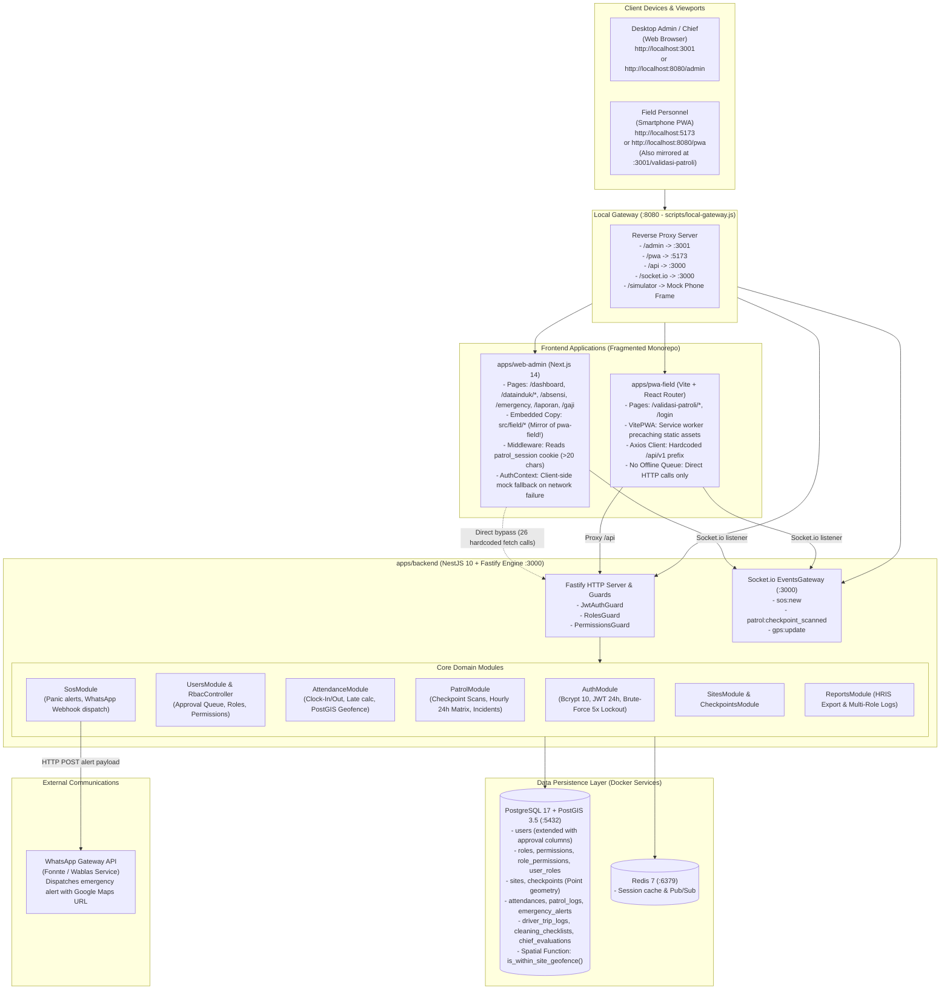
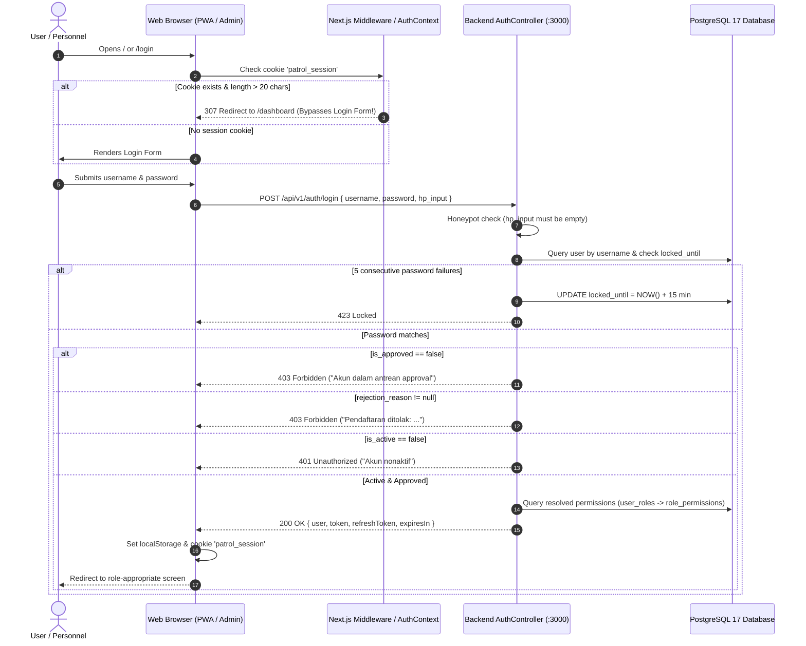
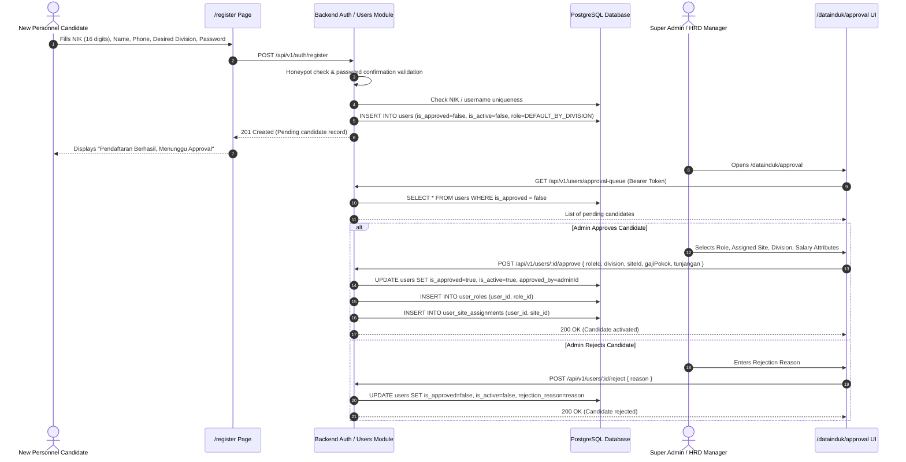
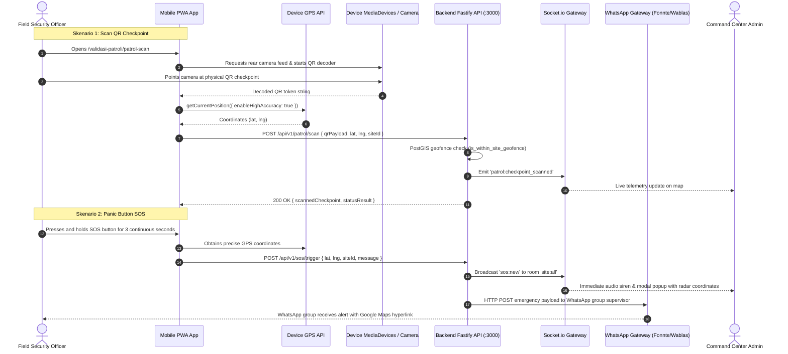

# 01 — SYSTEM OVERVIEW & ARCHITECTURAL TOPOLOGY
> **Patrol & Facility Management System (Enterprise In-House / Single-Tenant Beli Putus)**  
> Technical Audit & Architectural Baseline Analysis

---

## 1. Executive Summary & Business Scope

The **Patrol & Facility Management System** is an enterprise-grade operational management platform engineered specifically for **single-tenant in-house deployment** (*Beli Putus*). It is designed to manage physical security, cleaning operations, logistics fleet tracking, attendance compliance, emergency incident responses (Panic SOS), and administrative oversight across an organization's internal facilities (Headquarters, Manufacturing Plants, Warehouses, and Operational Sites).

In accordance with core enterprise governance rules (`AGENTS.md`):
- **Single-Tenant Corporate Hierarchy**: Strictly no multi-tenancy SaaS abstractions (no `tenant_id` columns or dynamic tenant routing). The hierarchy strictly represents corporate organization: `Pusat ➔ Fasilitas / Site ➔ Divisi ➔ Pos / Checkpoint`.
- **Three Core Operational Divisions**:
  1. **Security (Satpam)**: Roving patrol routes, QR code checkpoints, GPS geofence validation, incident reporting, and real-time Panic Button SOS.
  2. **Cleaning Service**: Periodic sanitation checklists for hygiene zones (floors, restrooms, lobbies) with photo proofs.
  3. **Logistics Drivers**: Fleet journey logs, vehicle plate tracking, departure/arrival odometer captures, and delivery task status.
- **Integrated Attendance & HRIS Pre-Payroll Engine**: Shift adherence calculation, grace-period lateness computation, effective working hours, cross-midnight shifts, and payroll deductions/allowances for internal HR export.
- **Media Retention & Storage**: 180-day (6-month) automatic retention lifecycle for selfie verifications and patrol inspection photos.
- **Real-Time Emergency Broadcast**: 3-second continuous hold on the mobile Panic SOS button broadcasting immediate WebSocket telemetry to Web Admin Command Center and triggering WhatsApp Gateway alerts with precision Google Maps links.

---

## 2. Monorepo Repository Structure & Topography

The project is structured as an npm workspaces monorepo:

```
Patrol-Management-System/
├── AGENTS.md                                # AI Agent Guidelines & Corporate Standards
├── package.json                             # Monorepo root configuration & scripts
├── docker-compose.yml                       # PostgreSQL 17 + PostGIS 3.5 & Redis 7 services
├── docker/
│   └── init-db/
│       ├── 01_init_schema.sql               # Base tables, PostGIS extensions, & geofence functions
│       └── 02_seed_data.sql                 # Baseline corporate accounts, sites, & checkpoints
├── packages/
│   └── types/                               # Single Source of Truth (SSOT) shared TypeScript types
│       ├── package.json
│       ├── tsconfig.json
│       └── src/
│           └── index.ts                     # Core entities, DTOs, Enums, & WebSocket contracts
├── apps/
│   ├── backend/                             # NestJS 10 + Fastify + PostgreSQL + Socket.io
│   │   ├── package.json
│   │   ├── nest-cli.json
│   │   ├── tsconfig.json
│   │   └── src/
│   │       ├── common/                      # Guards, decorators, upload utilities
│   │       ├── database/                    # DatabaseService (pg Pool) & SQL migrations
│   │       ├── modules/                     # Domain modules (auth, users, patrol, attendance, etc.)
│   │       ├── app.module.ts
│   │       └── main.ts
│   ├── web-admin/                           # Next.js 14 App Router Command Center & Management
│   │   ├── package.json
│   │   ├── next.config.mjs
│   │   ├── tailwind.config.ts
│   │   └── src/
│   │       ├── app/                         # App Router pages (/dashboard, /datainduk, /laporan, etc.)
│   │       ├── components/                  # Admin UI components, modals, tables, layout
│   │       ├── field/                       # Duplicated mobile PWA pages and services
│   │       ├── lib/                         # AuthContext, DataContext, Excel export helpers
│   │       └── middleware.ts                # Next.js edge route protection & cookie inspector
│   └── pwa-field/                           # Vite 5 + React 18 + React Router 6 Mobile PWA
│       ├── package.json
│       ├── vite.config.ts                   # VitePWA plugin configuration & proxy rules
│       ├── tailwind.config.js
│       └── src/
│           ├── components/                  # Mobile UI modals & skeuomorphic buttons
│           ├── pages/                       # Mobile operational pages (ClockIn, PatrolScan, Panic, etc.)
│           ├── services/                    # Axios API client
│           └── App.tsx                      # React Router route tree
├── docs/                                    # Technical documentation & audit artifacts
│   ├── system-audit/                        # Comprehensive audit deliverables (this directory)
│   ├── redesign/                            # Redesign specifications & page inventories
│   └── superpowers/                         # Execution specs & plans
└── scripts/                                 # Operational automation & parity verification scripts
    ├── local-gateway.js                     # Port 8080 single-entry reverse proxy
    ├── check-db.js                          # Database connectivity & count inspector
    └── check-rbac-db.js                     # RBAC schema & permissions validator
```

---

## 3. Technology Stack & Framework Matrix

| Component Layer | Technology / Library | Version | Role in Ecosystem | Architectural Status |
| :--- | :--- | :--- | :--- | :--- |
| **Workspace Manager** | npm Workspaces | v10+ | Orchestrates multi-package builds and dependencies | Healthy |
| **Shared Types** | TypeScript | v5.4.5 | Monorepo Single Source of Truth (`@patrol/types`) | Healthy |
| **Backend Framework** | NestJS | v10.3.8 | Enterprise Modular API Framework | Healthy |
| **HTTP Transport** | Fastify (`@nestjs/platform-fastify`) | v4.26.2 | High-throughput asynchronous HTTP engine | Healthy |
| **Database** | PostgreSQL + PostGIS | 17 / 3.5 | Spatial geometry (`Point`), GiST indexing, `ST_DWithin` | Healthy |
| **Realtime Dispatch** | Socket.io | v4.7.5 | Bi-directional WebSocket gateway for SOS & Patrol | Healthy |
| **Database Access** | `pg` (node-postgres Pool) | v8.11.5 | Raw parameterized SQL queries via `DatabaseService` | Working, but lacks migration runner |
| **Admin Frontend** | Next.js App Router | v14.2.3 | Desktop Command Center & Master Data Portal | Fragmentation issues present |
| **Field Mobile Frontend**| Vite + React | v5.2.11 / v18.3.1 | Mobile PWA for field personnel | Duplicated inside `web-admin` |
| **PWA Engine** | `vite-plugin-pwa` (Workbox) | v0.20.0 | Offline asset caching & Service Worker generator | Only in `pwa-field`, incomplete offline sync |
| **Local Storage Engine**| `idb` (IndexedDB Wrapper) | v8.0.4 | Browser client-side persistence | Installed in packages but UNUSED |
| **Mapping Engine** | Leaflet + React-Leaflet | v1.9.4 | Desktop geofence editing & SOS radar visualization | Healthy |
| **QR Code Scanner** | `html5-qrcode` | v2.3.8 | Camera-based barcode/QR code reader | Working, but lacks offline retry |
| **Document Export** | ExcelJS & jsPDF | v4.4.0 / v4.2.1 | Generation of HRIS Excel spreadsheets and PDF audit logs | Healthy |
| **Local Gateway** | Node.js native `http`/`https` proxy | Custom | Single-port reverse proxy at `:8080` | Fragile bridge masking app split |

---

## 4. Current Architecture Diagram



---

## 5. End-to-End Application Flows

### Flow 1: Authentication & Session Lifecycle


### Flow 2: Registration & Administrator Approval


### Flow 3: Field Operations (Patrol Checkpoint & Panic SOS)


---

## 6. Key Architectural Anomalies & Technical Disconnects

During the deep-dive audit of the source tree, five foundational architectural disconnects were confirmed through code inspection:

1. **Dual Frontend & Code Duplication**:
   - `apps/pwa-field` (Vite + React Router) and `apps/web-admin` (Next.js 14) are two completely separate frontend projects.
   - However, someone copied all 14 pages and components from `apps/pwa-field` directly into `apps/web-admin/src/field/` and exposed them via Next.js dynamic routes (`/validasi-patroli/[slug]`).
   - Consequently, bug fixes or UI updates applied to one application do not propagate to the other, creating massive divergence.

2. **The "Reverse Proxy Gateway" Patchwork**:
   - Because the system was fragmented into three separate dev servers (Admin at `:3001`, PWA at `:5173`, Backend at `:3000`), a custom reverse proxy script (`scripts/local-gateway.js`) was introduced at port `:8080`.
   - While it proxies `/admin` to `:3001` and `/pwa` to `:5173`, internal hyperlinks inside the apps still link to absolute roots (e.g. `/dashboard` instead of `/admin/dashboard`, or `/validasi-patroli` instead of `/pwa/validasi-patroli`), causing broken sub-resource routing when users navigate without the reverse proxy.

3. **Hardcoded Internal API Calls**:
   - In 26 distinct component files in `apps/web-admin`, `fetch('http://localhost:3000/api/v1/...')` is hardcoded directly.
   - This bypasses the Next.js API rewrite layer, bypasses the gateway proxy, breaks SSL termination, and prevents the app from functioning when accessed over a local area network (LAN) IP or on a mobile smartphone connecting to the host machine.

4. **Middleware Session Short-Circuit**:
   - In `apps/web-admin/src/middleware.ts`, checking authentication relies exclusively on `request.cookies.get('patrol_session')?.value?.length > 20`.
   - When any authenticated cookie exists, navigating to `/` or clicking "MASUK" (`/login`) immediately triggers a `NextResponse.redirect('/dashboard')`.
   - The user is completely blocked from accessing the login screen to view credentials, switch accounts, or log out cleanly.

5. **Disjointed RBAC Backend Pipeline**:
   - The database has fully seeded `roles`, `permissions`, and `role_permissions` tables, and `UsersService` populates permissions during login.
   - However, `JwtStrategy.validate()` in `apps/backend/src/modules/auth/jwt.strategy.ts` executes a query that fails to join `user_roles` and `role_permissions`, returning `user` with `permissions: undefined`.
   - Any endpoint protected by `@Permissions(...)` using `PermissionsGuard` will always reject non-superadmin users, forcing controllers to fall back to hardcoded `@Roles(...)` enums.
