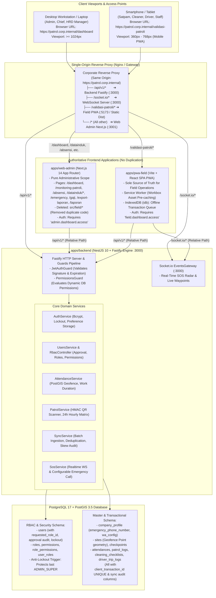
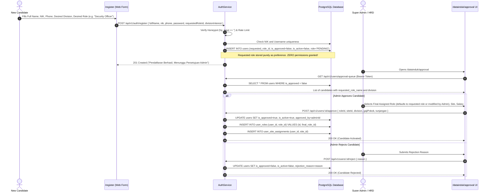

# 04 — TARGET ARCHITECTURE SPECIFICATION (REVISED)
> **Patrol & Facility Management System (Enterprise In-House / Single-Tenant)**  
> Architecture Decision: Option B (Two Frontend Frameworks, One Unified Ecosystem, Single-Origin Reverse Proxy)  
> Document Version: 2.0.0 — Status: Revised for Final Review

---

## 1. Architectural Strategy & Scope

Based on the stakeholder architectural decisions:
- **Application Architecture (Option B Selected)**:
  - `apps/web-admin`: Desktop Command Center built with **Next.js 14 App Router**.
  - `apps/pwa-field`: Mobile Operational Application built with **Vite 5 + React 18**.
  - `apps/backend`: Enterprise API & Realtime Gateway built with **NestJS 10 Fastify**.
  - Single database: **PostgreSQL 17 + PostGIS 3.5**.
  - **Single-Origin Deployment**: Both frontends and the API are served under one domain and the same origin via a unified reverse proxy (Nginx in production, local gateway in development).
  - **Elimination of Code Duplication**: Remove the copy of field pages inside `apps/web-admin/src/field`. `apps/pwa-field` is the **sole authoritative source of truth** for all field operational screens.
- **Unified Authentication & Dynamic RBAC**:
  - One central credential validation mechanism with bcrypt and 5-attempt brute-force lockout.
  - No client-side mock authentication fallbacks.
  - Explicit separation between administrative and operational interface access:
    - `admin.dashboard.access` (Administrative Command Center)
    - `field.dashboard.access` (Field Operational PWA)
- **Registration & Admin-Controlled Approval**:
  - Candidate registers and selects a **requested role** stored strictly as a preference (`requested_role_id`), which grants zero permissions.
  - Account remains `is_approved = false`, `is_active = false`.
  - Administrator reviews the queue, can approve, reject, or modify the assigned role, site, and wage attributes.
  - Upon approval, the final assigned role is committed to `user_roles`, activating access.
- **Offline-First PWA Operational Standard**:
  - PWA remains independently deployable with Service Worker caching and IndexedDB (`idb`).
  - Five distinct transaction states: `PENDING_OFFLINE`, `SYNCING`, `SYNCED`, `REJECTED`, `NEEDS_REVIEW`.
  - Secure offline session model that does not treat local tokens as backend authorization; the server revalidates all transactions upon sync.
  - Configurable emergency telephone hotline (retrieved from `company_profile`) with transparent offline notification.

---

## 2. Target Architecture Diagram (Single-Origin Dual Frontend)



---

## 3. Interface Separation: Admin vs. Field Dashboard

To prevent cross-interface pollution and eliminate hardcoded role switches:

1. **`admin.dashboard.access`**:
   - Required by `apps/web-admin` to access `/dashboard`, `/monitoring-patroli`, `/datainduk/*`, `/absensi`, `/emergency`, `/gaji`, `/export-laporan`, and `/laporan`.
   - Users without this permission attempting to access administrative URLs are redirected to `/validasi-patroli`.
2. **`field.dashboard.access`**:
   - Required by `apps/pwa-field` to access `/validasi-patroli` and operational modules (`clock-in`, `patrol-scan`, `panic`, etc.).
   - Users without this permission attempting to access field modules are redirected to `/dashboard` (if admin) or `/login`.
3. **Dual-Access Users (Supervisors / Chief Security)**:
   - Personnel with both permissions receive a convenient interface switch button in the header/drawer, allowing immediate movement between Command Center and field tools.

---

## 4. Registration and Approval Workflow (With Requested Role)



---

## 5. Offline-First PWA Architecture & Synchronization Engine

### 5.1 Secure Offline Session Strategy
Storing raw long-lived JWT tokens directly in IndexedDB presents an XSS attack vector. Instead, the application implements a **scoped offline operational session**:
1. **Token Handling**:
   - The active JWT is stored in memory (`sessionStorage` / secure HttpOnly cookie).
   - An encrypted **Offline Identity Ticket** is saved in client storage, containing: `userId`, `displayName`, `assignedSiteIds`, `offlineTicketExpiry` (max 7 days), and `grantedPermissionsCache`.
2. **Local Authorization vs Backend Authority**:
   - Local permissions in IndexedDB are used **strictly for UI rendering** (e.g. showing the "Scan QR" button or "Log Odometer" button while offline).
   - Local permissions **never constitute authoritative authorization**.
   - When the device reconnects, the backend `SyncService` re-authenticates the user and **revalidates every transaction against live database rules**. If a user was revoked or deactivated while working offline, their queued transactions are tagged as `REJECTED`.

### 5.2 Transaction Lifecycle State Machine
Every offline transaction in `patrol_offline_db` progresses through five distinct lifecycle states:

```
[ PENDING_OFFLINE ] ─── (Connection Restored) ───► [ SYNCING ]
                                                        │
                      ┌─────────────────────────────────┼─────────────────────────────────┐
                      ▼                                 ▼                                 ▼
                 [ SYNCED ]                       [ REJECTED ]                     [ NEEDS_REVIEW ]
           (Committed to Database)             (Validation Failed)             (Clock Skew > 60m / GPS Anomaly)
```

1. **`PENDING_OFFLINE`**:
   - Created in IndexedDB when an action occurs without network connectivity.
   - Assigned a `clientTransactionId: UUIDv4`.
   - UI shows clear indicator: *"Tersimpan di Perangkat (Menunggu Sinkronisasi)"* with count badge. **Never shown as a confirmed server success.**
2. **`SYNCING`**:
   - Network connectivity detected (`navigator.onLine` / foreground event).
   - Batch payload sent to `POST /api/v1/sync/flush`.
3. **`SYNCED`**:
   - Server returns HTTP 200 OK with transaction acknowledgement.
   - IndexedDB removes or archives the item.
4. **`REJECTED`**:
   - Server revalidation rejected the item (e.g. inactive user account, tampered payload, or invalid QR HMAC).
   - User and supervisor notified of the rejection reason.
5. **`NEEDS_REVIEW`**:
   - Transaction committed to database but flagged for supervisor sign-off due to anomaly (e.g. device timestamp skewed > 60 minutes from server time, or approximate location outside geofence).
   - Held from final HR attendance/payroll tally until approved by supervisor.

### 5.3 Clock Manipulation & Anti-Fraud Detection
1. **Dual Timestamp Preservation**:
   - `device_timestamp`: Captured from `new Date().toISOString()` when the guard clicks or scans.
   - `synced_at`: Server timestamp (`CURRENT_TIMESTAMP`) when the payload is ingested.
2. **Elapsed Realtime Monotonic Tracking**:
   - Client records `performance.now()` delta alongside device clock to detect manual OS time rollbacks.
3. **Threshold Enforcement**:
   - `|device_timestamp - synced_at| <= 15 minutes`: Normal sync.
   - `15 minutes < |device_timestamp - synced_at| <= 60 minutes`: Synced with `is_offline_sync = true`.
   - `|device_timestamp - synced_at| > 60 minutes`: Marked as `NEEDS_REVIEW` with `clock_skew_flag = true`. Requires explicit supervisor verification in `/absensi`.

### 5.4 Multi-Site Attendance Resolution Policy
To balance flexibility and compliance for roaming or multi-facility personnel:
1. **Single Site Assigned**: If `user_site_assignments` contains exactly one facility, the system resolves `siteId` automatically without prompt.
2. **Multiple Sites Assigned**: If the user is assigned to two or more facilities:
   - Before clock-in, the PWA presents an explicit selection modal: *"Pilih Lokasi Fasilitas Penugasan Anda Hari Ini"*.
   - The user selects their assigned site.
   - The device GPS coordinates are validated against the chosen facility's PostGIS geofence radius.
   - The system **never guesses** the facility purely from GPS proximity without user confirmation.

### 5.5 Configurable Offline Emergency SOS Hotline Protocol
In life-safety situations without internet connectivity:
1. When SOS is triggered offline (`!navigator.onLine`):
   - The screen switches to high-contrast red emergency layout.
   - Explains clearly: **"PERINGATAN: Tidak Ada Jaringan Internet. Sinyal Real-Time Belum Terkirim ke Command Center."**
   - Retrieves the configured `emergency_phone_number` from cached `company_profile` (or fallback corporate control room number).
   - Provides a prominent one-tap dialer button: `[ PANGGIL PUSAT KONTROL: tel:<emergency_phone_number> ]`.
   - Prompts personnel to transmit alert via handheld two-way radio (HT).
2. The SOS alert record is queued in IndexedDB as `PRIORITY_EMERGENCY` and transmitted first upon reconnection with original coordinates and incident start time.

---

## 6. Single-Origin Reverse Proxy Routing Matrix

Served under a single origin (e.g. `https://patrol.corp.internal` or `http://localhost:8080` in dev):

| Request Path | Reverse Proxy Target | Target Application | Protocol | Notes |
| :--- | :--- | :--- | :--- | :--- |
| `/login` | `http://127.0.0.1:3001/login` | `web-admin` | HTTP | Unified login portal |
| `/register` | `http://127.0.0.1:3001/register` | `web-admin` | HTTP | Candidate registration |
| `/dashboard` | `http://127.0.0.1:3001/dashboard` | `web-admin` | HTTP | Admin Command Center |
| `/monitoring-patroli` | `http://127.0.0.1:3001/monitoring-patroli` | `web-admin` | HTTP | 24h Patrol Matrix & Live Map |
| `/absensi` | `http://127.0.0.1:3001/absensi` | `web-admin` | HTTP | Attendance monitoring |
| `/datainduk/*` | `http://127.0.0.1:3001/datainduk/*` | `web-admin` | HTTP | Master data & RBAC |
| `/emergency` | `http://127.0.0.1:3001/emergency` | `web-admin` | HTTP | Emergency SOS radar |
| `/gaji` | `http://127.0.0.1:3001/gaji` | `web-admin` | HTTP | Payroll calculations |
| `/export-laporan` | `http://127.0.0.1:3001/export-laporan` | `web-admin` | HTTP | Excel/PDF export wizard |
| `/laporan` | `http://127.0.0.1:3001/laporan` | `web-admin` | HTTP | Operational reports hub |
| `/validasi-patroli` | `http://127.0.0.1:5173/validasi-patroli` | `pwa-field` | HTTP | Field PWA Dashboard |
| `/validasi-patroli/*` | `http://127.0.0.1:5173/validasi-patroli/*`| `pwa-field` | HTTP | Field PWA operational screens |
| `/api/v1/*` | `http://127.0.0.1:3000/api/v1/*` | `backend` | HTTP | Fastify REST API |
| `/socket.io/*` | `http://127.0.0.1:3000/socket.io/*` | `backend` | WS / WSS | Realtime WebSocket server |
